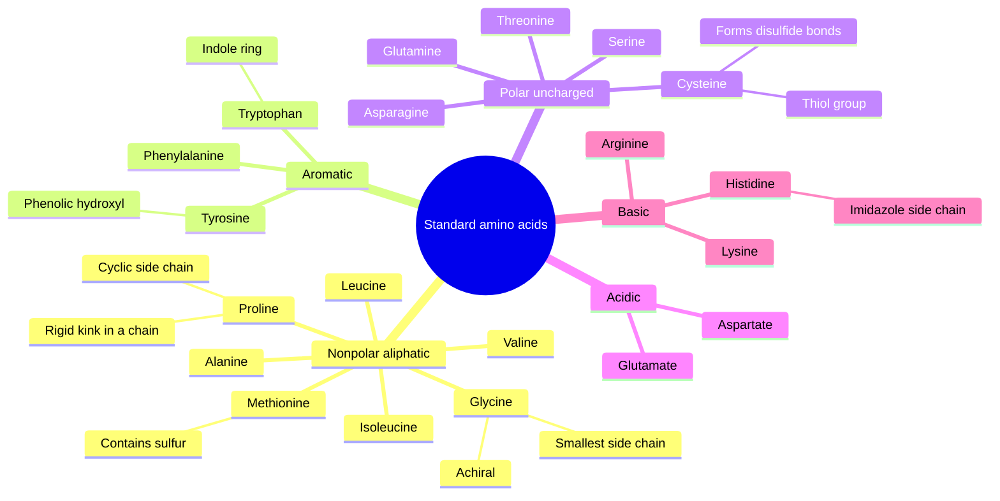
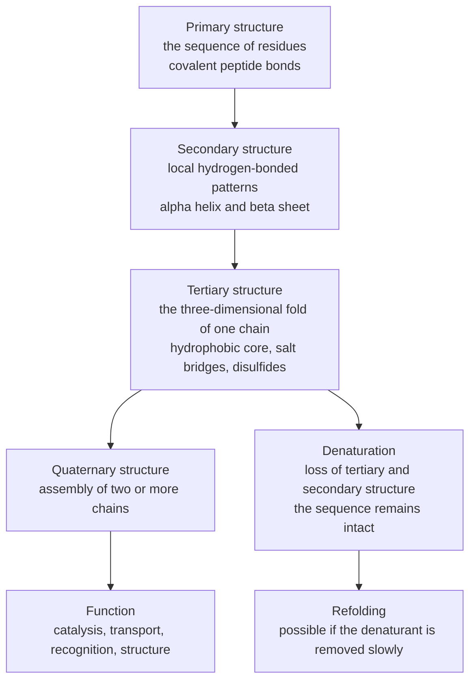
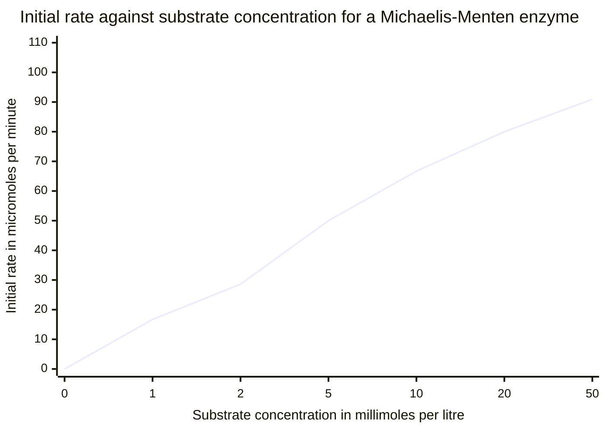
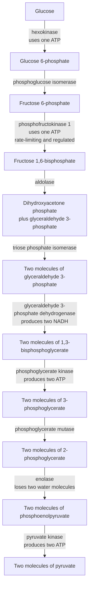
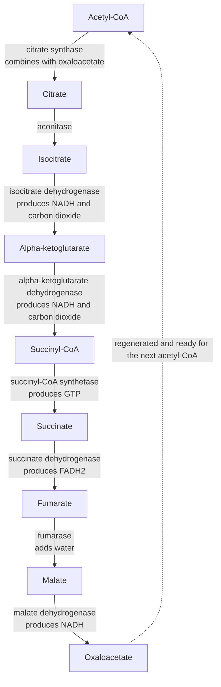
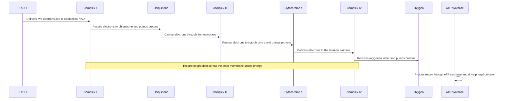
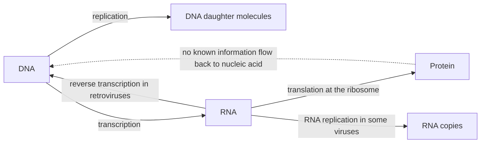

# Biochemistry — Visual Gallery

> **Level:** 8 · **Figures:** 7 · **Study time:** 45 minutes
> **Supports:** [Level 8 — Biochemistry](../../09-biochemistry/README.md), chapters 2, 3, 6 and 7.
> **Companion galleries:** [Organic chemistry](../organic-chemistry/README.md) · [Thermodynamics](../thermodynamics/README.md)

Biochemistry is organic chemistry under constraints: water as the solvent, 37 °C as the
temperature, pH near 7, and a cell that cannot afford to waste energy. The diagrams below
are organised around those constraints. The first two show how a protein is built and why
its shape follows from its sequence. The third shows how an enzyme's rate saturates. The
last four show how the cell extracts energy in small, enzyme-controlled steps rather than
in one uncontrolled combustion.

A warning that applies to every pathway diagram in this gallery: the names and the order
of the steps are facts, but the arrows are not a mechanism. Each arrow is catalysed by a
specific enzyme, and the regulation — the part that matters in a living cell — is almost
entirely absent from a pathway chart.

---

## 1. The twenty standard amino acids

**Figure 1 — Classification of the twenty standard amino acids.** The map encodes the
classification by side-chain chemistry that predicts how a residue will behave in a folded
protein: nonpolar residues cluster in the interior, charged residues sit on the surface,
and cysteine can form covalent cross-links. It deliberately omits the pKa values, the
one-letter codes, the fact that histidine is only partly protonated at pH 7 (its side-chain
pKa is about 6), and the post-translational modifications that change a residue after it
has been incorporated. **Question it should answer:** why does a change from glutamate to
valine at a surface position often destabilise a protein, while the same change in the
hydrophobic core is usually tolerated?

Glutamate carries a negative charge and is strongly solvated at the surface; replacing it
with a nonpolar valine removes a favourable interaction with water and with neighbouring
side chains. In the core the situation is reversed: a charged residue is already
destabilising, so the substitution may cost less. The classification is not decoration —
it is a prediction about where a residue can sit.

---

## 2. The four levels of protein structure

**Figure 2 — The hierarchy of protein structure.** The diagram encodes the dependence of
each level on the one before it: secondary structure is local, tertiary structure is
global, and quaternary structure is intermolecular. It deliberately omits the fact that
many proteins contain domains that fold independently, the role of chaperones in vivo, and
the disordered proteins that have no fixed tertiary structure yet are fully functional.
**Question it should answer:** why does denaturation destroy an enzyme's activity without
breaking any peptide bond?

Because activity depends on the three-dimensional arrangement of side chains, not on the
sequence alone. Heating or changing the pH disrupts the weak interactions — hydrogen bonds,
hydrophobic contacts, salt bridges — that hold the fold together, while the covalent
peptide backbone survives. The sequence is intact but the active site is gone. Refolding
can restore activity only if the denatured chain has not aggregated irreversibly.

---

## 3. Michaelis–Menten kinetics

**Figure 3 — A Michaelis–Menten saturation curve.** The curve is computed from
$v = V_{\max}[\ce{S}]/(K_M + [\ce{S}])$ with $V_{\max} = 100\
\mu\mathrm{mol\ min^{-1}}$ and $K_M = 5$ mM, and it encodes the three regimes that the
equation describes: first-order at low substrate, mixed order around $K_M$, and zero-order
saturation at high substrate. It deliberately omits the assumptions behind the equation
(steady state, single substrate, rapid equilibrium of the enzyme–substrate complex), the
inhibition that changes the apparent $K_M$ or $V_{\max}$, and the fact that many enzymes
show cooperativity rather than a hyperbola. **Question it should answer:** what does
$K_M$ mean physically, and why is it not the same as the substrate concentration inside a
cell?

$K_M$ is the substrate concentration at which the initial rate is half of $V_{\max}$; for
a simple mechanism it approximates the dissociation constant of the enzyme–substrate
complex, so a small $K_M$ means tight binding. It is a kinetic constant measured in vitro,
not a cellular concentration. A cell can operate at a substrate concentration far below
$K_M$ for one enzyme and far above it for another, and that difference is part of how flux
is distributed between pathways.

---

## 4. Glycolysis

**Figure 4 — The ten steps of glycolysis, condensed into eight nodes.** The diagram
encodes the architecture of the pathway: an investment phase that spends two ATP to split
glucose into two three-carbon units, and a payoff phase that recovers four ATP and two
NADH. It deliberately omits the individual enzyme mechanisms, the regulatory allosteric
effectors (ATP, citrate, fructose 2,6-bisphosphate), and the fate of pyruvate, which
depends on whether oxygen is available. **Question it should answer:** the pathway spends
two ATP and makes four, so where exactly does the net gain of two ATP and two NADH come
from?

The net gain is an arithmetic consequence of symmetry. Two ATP are spent before the split;
after the split every subsequent reaction happens twice per glucose, so the two
substrate-level phosphorylation steps each yield two ATP, giving four in total. The two
NADH come from the single glyceraldehyde 3-phosphate dehydrogenase step, again doubled by
the split. A student who forgets the doubling gets two ATP and one NADH and cannot balance
the pathway.

---

## 5. The citric acid cycle

**Figure 5 — One turn of the citric acid cycle.** The cycle encodes the regeneration of
oxaloacetate: acetyl-CoA enters by condensation and the same four-carbon carrier is
recovered at the end, which is why the cycle can run continuously. It deliberately omits
the stereochemistry of each step, the fact that succinate dehydrogenase is also Complex II
of the electron transport chain, and the anaplerotic reactions that replenish cycle
intermediates for biosynthesis. **Question it should answer:** per turn, how many NADH,
FADH2, GTP and carbon dioxide molecules are produced, and why does the cycle need two
turns per glucose?

One turn gives three NADH, one FADH2, one GTP and two CO2. Each glucose yields two
acetyl-CoA, so the cycle turns twice per glucose and the totals double: six NADH, two
FADH2, two GTP and four CO2. The two CO2 molecules per turn account for the two carbons
that entered as acetyl-CoA; the carbons released are not literally the same two atoms,
because the cycle intermediates are symmetric and scramble the label, a subtlety that
isotope experiments were needed to establish.

---

## 6. The electron transport chain

**Figure 6 — Electron transfer and chemiosmosis.** The sequence encodes the order of the
carriers and the two coupled processes: electrons flow down a potential gradient, and the
free energy released is used to pump protons across the inner mitochondrial membrane. It
deliberately omits Complex II, which feeds electrons from FADH2 into ubiquinone without
pumping protons, the stoichiometry of proton pumping at each complex, and the shuttle
systems that carry reducing equivalents from the cytosol into the mitochondrion.
**Question it should answer:** why does FADH2 yield less ATP than NADH, when both deliver
electrons to the same chain?

Because FADH2 enters at Complex II, downstream of Complex I. The electrons bypass the first
proton-pumping site, so fewer protons are translocated per pair of electrons and less ATP
is made — conventionally about 1.5 ATP against about 2.5 ATP for NADH. The difference is
not in the electrons but in where they join the chain.

---

## 7. The central dogma

**Figure 7 — Information flow in the central dogma.** The diagram encodes Crick's claim,
which is about the *direction of sequence information*, not about the chemistry of the
molecules: nucleic acid to nucleic acid, nucleic acid to protein, and never protein to
nucleic acid. It deliberately omits the epigenetic marks that are copied through cell
division without changing the sequence, the prions that propagate a protein conformation,
and the catalytic RNA and ribozymes that blur the division of labour between nucleic acid
and protein. **Question it should answer:** why does the existence of reverse
transcriptase not refute the central dogma?

Because reverse transcriptase transfers information from RNA to DNA, which is a
nucleic-acid-to-nucleic-acid transfer. The claim that is excluded is the transfer of
sequence information from protein back to nucleic acid, and no enzyme is known to do that.
The word "dogma" is historically unfortunate: Crick meant a firmly established principle,
not an untestable article of faith, and the principle has survived every exception found so
far.

---

## Reconstruct from memory

1. **The amino acids.** Draw the five classes and place all twenty residues, marking
   glycine, proline and cysteine with their special properties.
2. **The hierarchy.** Draw the four levels as a chain, then add the denaturation branch and
   say which bonds survive.
3. **The curve.** Sketch $v$ against $[\ce{S}]$, mark $V_{\max}$ and $K_M$, and label the
   three kinetic regimes.
4. **Glycolysis.** Draw the ten steps from glucose to pyruvate with the three regulated
   enzymes marked and the ATP and NADH tally written beside each phase.
5. **The cycle.** Draw the eight steps of the citric acid cycle, closing the loop at
   oxaloacetate, and count the reduced coenzymes per turn.
6. **The chain.** Draw the carriers in order from NADH to oxygen, marking the three
   proton-pumping complexes and the ATP synthase.
7. **The dogma.** Draw the three canonical arrows and the two special transfers, then mark
   the one arrow that does not exist.

---

## Where the diagram lies

| Figure | Careless reading | What the diagram actually says |
|---|---|---|
| 1 | "All twenty amino acids are chemically similar." | The side chains range from hydrophobic to strongly charged, and that range is what makes folding possible. |
| 2 | "Denaturation breaks the protein into amino acids." | It disrupts the weak interactions that hold the fold; the peptide bonds and the sequence remain intact. |
| 3 | "The rate keeps rising with substrate concentration." | The curve saturates: at high substrate every enzyme active site is occupied and the rate approaches $V_{\max}$. |
| 4 | "Glycolysis produces two ATP directly." | It consumes two and produces four, for a net gain of two; the gross and net figures are not the same. |
| 5 | "The two carbons of acetyl-CoA are the two carbons released as CO2 in the same turn." | The cycle's symmetry means the label is scrambled; the released carbons come from the oxaloacetate pool. |
| 6 | "The proton gradient is a waste product." | It is the intermediate energy store that couples electron transfer to ATP synthesis. |
| 7 | "The central dogma says information can only flow from DNA to RNA to protein." | It says information cannot flow from protein back to nucleic acid; RNA to DNA and RNA to RNA transfers are permitted. |

---

## Links back to the chapters

- The Level 8 sequence, from water and amino acids to metabolism and regulation: [Level 8 — Biochemistry](../../09-biochemistry/README.md). Chapters 2, 3, 6 and 7 correspond to the figures here.
- The carbonyl and amine chemistry behind peptide bonds and enzyme catalysis: [Organic chemistry gallery](../organic-chemistry/README.md).
- The thermodynamic driving force for the electron transport chain: [Thermodynamics gallery](../thermodynamics/README.md).
- The electrochemical measurement of that driving force: [Electrochemistry gallery](../electrochemistry/README.md).

For the kinetic treatment of enzymes beyond the Michaelis–Menten model, see the [Reaction mechanisms gallery](../reaction-mechanisms/README.md).
