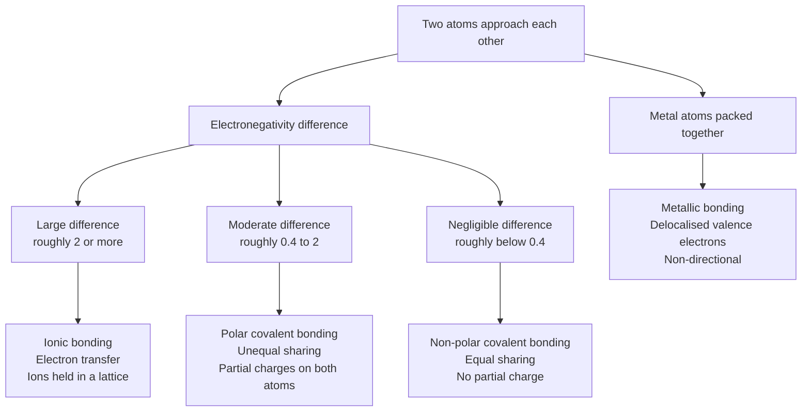
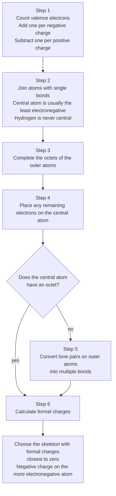
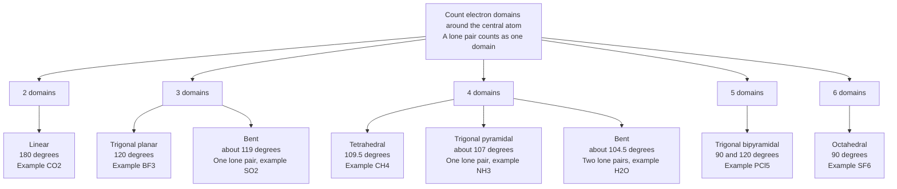
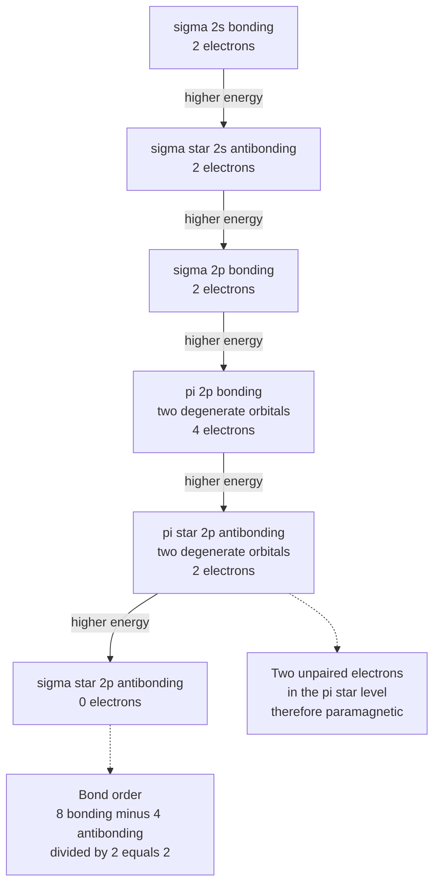
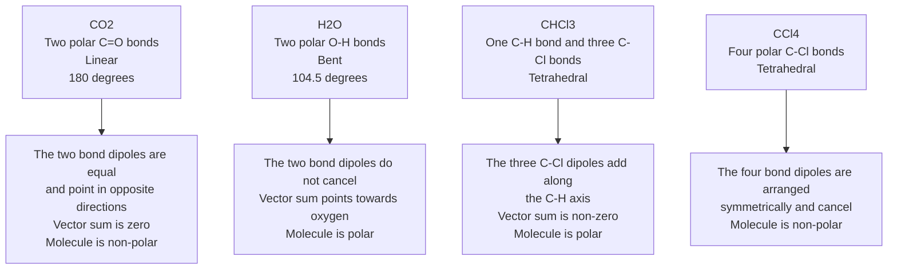
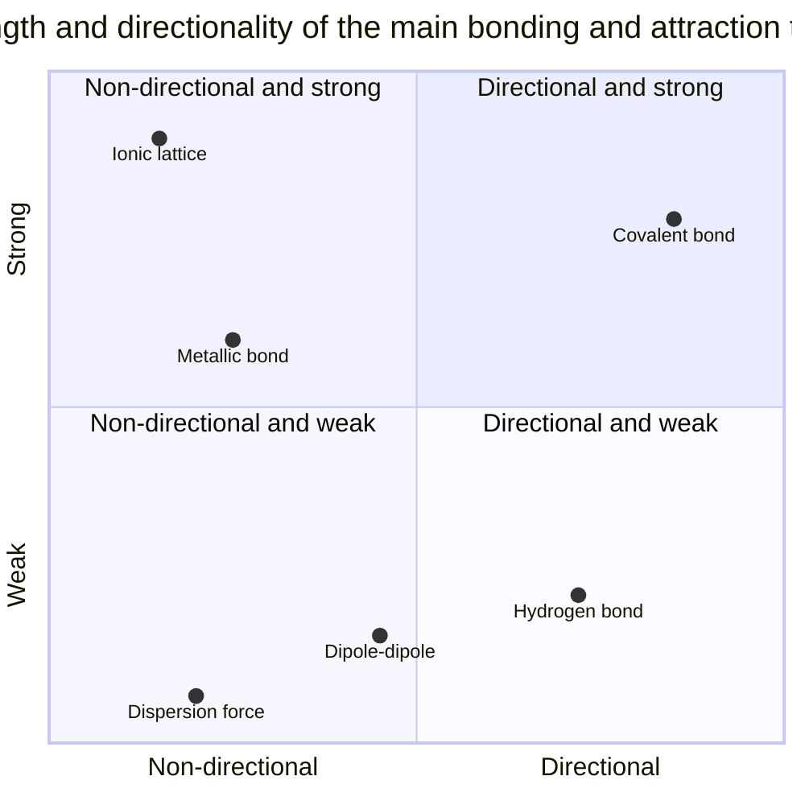

# Chemical Bonding — Visual Gallery

> **Level:** 1 to 3 · **Figures:** 6 · **Study time:** 35 minutes
> **Supports:** [Level 1, Chapter 6 — Lewis Structures and Chemical Formulas](../../02-elementary-chemistry/06-lewis-structures-and-chemical-formulas.md) and [Level 1, Chapter 1 — Atomic Structure](../../02-elementary-chemistry/01-atomic-structure.md).
> **Companion galleries:** [Atomic structure](../atomic-structure/README.md) · [Reaction mechanisms](../reaction-mechanisms/README.md)

Bonding is taught as three boxes — ionic, covalent, metallic — and then examined on the
cases that do not fit the boxes. This gallery keeps the boxes but puts the boundaries
where they belong: on a continuum of electronegativity difference, with directionality
as a second, independent axis. The last two figures move from *what a bond is* to *what
a bond does to the shape and polarity of a molecule*, which is where most exam marks are
actually lost.

Two warnings before you start. First, "ionic" and "covalent" describe the *dominant*
model for a substance, not a sharp physical division: no bond is 100 per cent ionic, and
caesium fluoride has more covalent character than the phrase "ionic solid" suggests.
Second, a Lewis structure is a bookkeeping device for valence electrons; it is not a
picture of the electron density, and it cannot tell you about paramagnetism or bond
order. Figure 4 exists to show exactly where the Lewis model runs out.

---

## 1. Four bonding models on one continuum

**Figure 1 — Four models, one continuum.** The diagram encodes the operational test most
courses use — compare electronegativities — and the qualitative consequences of each
outcome for electron ownership. It deliberately omits the fact that the thresholds are
conventions rather than physical discontinuities (the 0.4 and 2.0 cut-offs are Pauling's
teaching labels, not measured constants), the Fajans rules that make a small, highly
charged cation polarise an anion into covalent behaviour, and the entire band-structure
description of metals. **Question it should answer:** why is hydrogen chloride a gas of
discrete polar molecules while sodium chloride is a lattice that only conducts when
molten?

The metallic branch is drawn from the same starting node on purpose. Metallic bonding is
not a variant of covalent bonding with loose electrons; it is what happens when the
number of available valence orbitals is comparable to the number of electrons, so that
no pair can claim a localised bond. That is why metals conduct in the solid state while
ionic solids do not.

---

## 2. Drawing a Lewis structure

**Figure 2 — The six-step Lewis procedure.** The diagram encodes the order of operations
that makes the method reproducible: count, connect, complete, place, fix, check. It
deliberately omits the exceptions that break each step — odd-electron species such as
nitrogen monoxide, expanded octets in sulfur and phosphorus compounds, and electron-
deficient species such as boron trifluoride — and it omits resonance, which is what you
do when two or more valid skeletons survive step 6. **Question it should answer:** for
the carbonate ion, why does the procedure produce three equivalent resonance structures
rather than one structure with one short and two long C–O bonds?

Step 6 is the step students skip and examiners test. Formal charge is not the same as
oxidation state and not the same as partial charge: it is a bookkeeping count that
assumes electrons in a bond are shared equally. It is nevertheless the best simple
predictor of which skeleton is correct, precisely because it penalises structures that
put positive charge on electronegative atoms.

---

## 3. Electron domains to molecular shape

**Figure 3 — The VSEPR map from domain count to shape.** The diagram encodes the single
idea that generates every entry: domains repel, so they spread as far apart as the
geometry allows, and a lone pair occupies more angular space than a bonding pair. It
deliberately omits the shapes of the five- and six-coordinate lone-pair variants (seesaw,
T-shaped, square planar), the fact that double bonds occupy more space than single bonds,
and the exceptions driven by ligand–ligand repulsion rather than central-atom
hybridisation. **Question it should answer:** why is the H–O–H angle in water smaller
than the H–N–H angle in ammonia, when both molecules have four electron domains?

The logic of the compression is worth stating explicitly, because it is the reasoning the
diagram rewards. Four domains give a tetrahedron; replacing one vertex by a lone pair
compresses the remaining angles from 109.5° to about 107°; replacing a second gives about
104.5°. The trend is monotonic and the cause is the same in both steps. A student who can
reconstruct that sentence does not need to memorise the table.

---

## 4. Molecular orbitals of dioxygen

**Figure 4 — Molecular-orbital energy ladder for O2.** The diagram encodes the
configuration $\sigma_{2s}^2\sigma_{2s}^{*2}\sigma_{2p}^2\pi_{2p}^4\pi_{2p}^{*2}$ and the
two results the Lewis model cannot deliver: a bond order of 2 and two unpaired electrons,
which make liquid oxygen paramagnetic. It deliberately omits the mixing that produces the
$\sigma_{2p}$–$\pi_{2p}$ ordering, the detailed nodal shapes of the molecular orbitals,
and the fact that the ordering is reversed for N2 and lighter diatomics, where
$\pi_{2p}$ lies *below* $\sigma_{2p}$. **Question it should answer:** why does the Lewis
structure of O2, with a double bond and no unpaired electrons, fail to predict that
oxygen is attracted into a magnetic field?

That last point is the most commonly misstated fact in the whole of introductory
bonding. The ordering shown here is correct for O2 and F2. For N2, the $\pi_{2p}$ level
lies below $\sigma_{2p}$, and the resulting configuration still gives a bond order of 3
with no unpaired electrons. Do not generalise the ladder downwards without checking the
molecule.

---

## 5. Bond dipoles and molecular polarity

**Figure 5 — Why polar bonds do not guarantee a polar molecule.** The diagram encodes
the vector addition of bond dipoles, which is the whole content of the rule. It
deliberately omits the magnitudes (CO2 has no net dipole, water has about 1.85 D,
chloroform about 1.04 D), the lone-pair contribution to the water dipole, and the fact
that a molecule can be polar overall while having a zero dipole moment in one particular
conformation. **Question it should answer:** carbon tetrachloride and chloroform both
contain polar C–Cl bonds, so why is one a non-polar solvent and the other a polar one?

The contrast between the last two branches is the one to remember. Symmetry, not bond
polarity, decides the outcome. Counting polar bonds predicts that CCl4 is polar and gets
it wrong; adding the vectors predicts both molecules correctly. The same test explains
why carbon dioxide has no dipole moment despite having two C=O bonds with a substantial
electronegativity difference.

---

## 6. Bond strength against bond type

**Figure 6 — A qualitative map of bond and attraction types.** The diagram encodes two
properties that vary independently: how directional the interaction is, and how much
energy is needed to break it. It deliberately omits the numerical ranges (a covalent bond
is typically 150 to 1000 $\mathrm{kJ\ mol^{-1}}$; a hydrogen bond in water is about 20
$\mathrm{kJ\ mol^{-1}}$; a dispersion contact is a few $\mathrm{kJ\ mol^{-1}}$), the
overlap between categories, and the enormous variation within the metallic class from
mercury to tungsten. **Question it should answer:** why does ice melt at 0 °C while
diamond, held together by the same broad category of interaction, sublimes above
3500 °C?

The axes are ordinal, not measured, and the point positions are placed for legibility.
Read the quadrant, never the coordinate. A careless reading is to conclude that ionic
bonding is "stronger than covalent bonding"; the lattice energy of sodium chloride
(about 787 $\mathrm{kJ\ mol^{-1}}$) and the bond enthalpy of carbon–carbon in diamond
(about 348 $\mathrm{kJ\ mol^{-1}}$ per bond, but four per atom) are not the same kind of
quantity and cannot be compared directly.

---

## Reconstruct from memory

1. **The continuum.** Redraw Figure 1 with both the electronegativity thresholds and the
   metallic branch. Add one example substance to each terminal box.
2. **The six steps.** Recite the Lewis procedure in order, then apply it to
   $\ce{SO3^{2-}}$ without looking at any worked example.
3. **The VSEPR map.** From blank paper, produce the table of domain counts 2 to 6 with
   the parent shape, the lone-pair variants, the ideal angle and one example each.
4. **The oxygen ladder.** Draw the six molecular-orbital levels with their electron
   counts, mark the two unpaired electrons, and compute the bond order from your own
   diagram.
5. **The polarity vectors.** Draw CO2, H2O, CHCl3 and CCl4, add bond-dipole arrows to
   each, and state the net dipole direction or its absence.
6. **The map of interactions.** Redraw the four quadrants and place six named
   interactions without using the original positions as a guide.

---

## Where the diagram lies

| Figure | Careless reading | What the diagram actually says |
|---|---|---|
| 1 | "Electronegativity difference above 2 makes a bond purely ionic." | The threshold is a teaching convention; real bonds have partial covalent character and the boundary is continuous. |
| 2 | "Any structure that satisfies the octet rule is the correct structure." | Step 6 exists because several skeletons can satisfy the octet rule; formal charge chooses between them. |
| 3 | "A bent molecule must come from four electron domains." | Bent geometry also arises from three domains with one lone pair, as in SO2, with a different angle. |
| 4 | "The ladder applies to every diatomic molecule in the same order." | The $\sigma_{2p}$ and $\pi_{2p}$ ordering is reversed for N2 and lighter molecules; the diagram is specific to O2 and F2. |
| 5 | "A molecule with polar bonds is always polar." | Symmetry can cancel the bond dipoles, as in CO2 and CCl4; the net dipole is a vector sum, not a count. |
| 6 | "Ionic bonding is in the strongest quadrant, so ionic solids must have the highest melting points." | The axes are ordinal and the categories overlap; lattice energy and bond enthalpy are different quantities and are not directly comparable. |

---

## Links back to the chapters

- The three bonding models: [Level 1, Chapter 5 — Chemical Bonding: Ionic, Covalent and Metallic](../../02-elementary-chemistry/05-chemical-bonding.md).
- Lewis structures and formal charge, the source of Figure 2: [Level 1, Chapter 6 — Lewis Structures and Chemical Formulas](../../02-elementary-chemistry/06-lewis-structures-and-chemical-formulas.md).
- VSEPR and molecular shape: [Level 2, Chapter 6 — Molecular Geometry and VSEPR Theory](../../03-intermediate-chemistry/06-molecular-geometry-and-vsepr-theory.md).
- Hybridisation and polarity, which underpin Figure 5: [Level 2, Chapter 7 — Hybridization and Molecular Polarity](../../03-intermediate-chemistry/07-hybridization-and-molecular-polarity.md).
- Molecular-orbital theory, the source of Figure 4: [Level 3, Chapter 3 — Molecular Orbital Theory](../../04-advanced-chemistry/03-molecular-orbital-theory.md).

For the mechanism side of bonding — how electron density moves during a reaction — go on to [Reaction mechanisms](../reaction-mechanisms/README.md).
