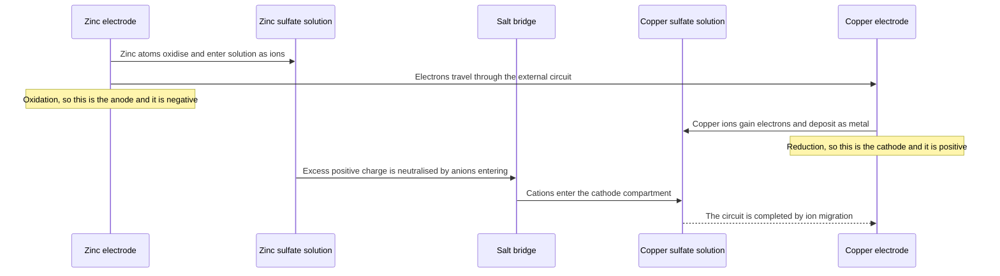
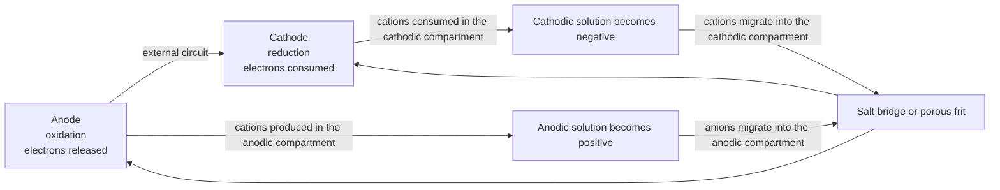
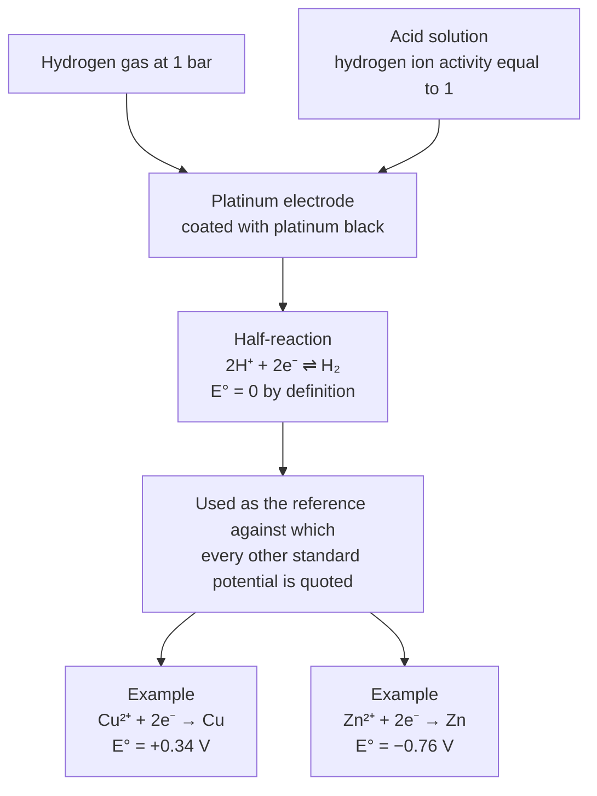
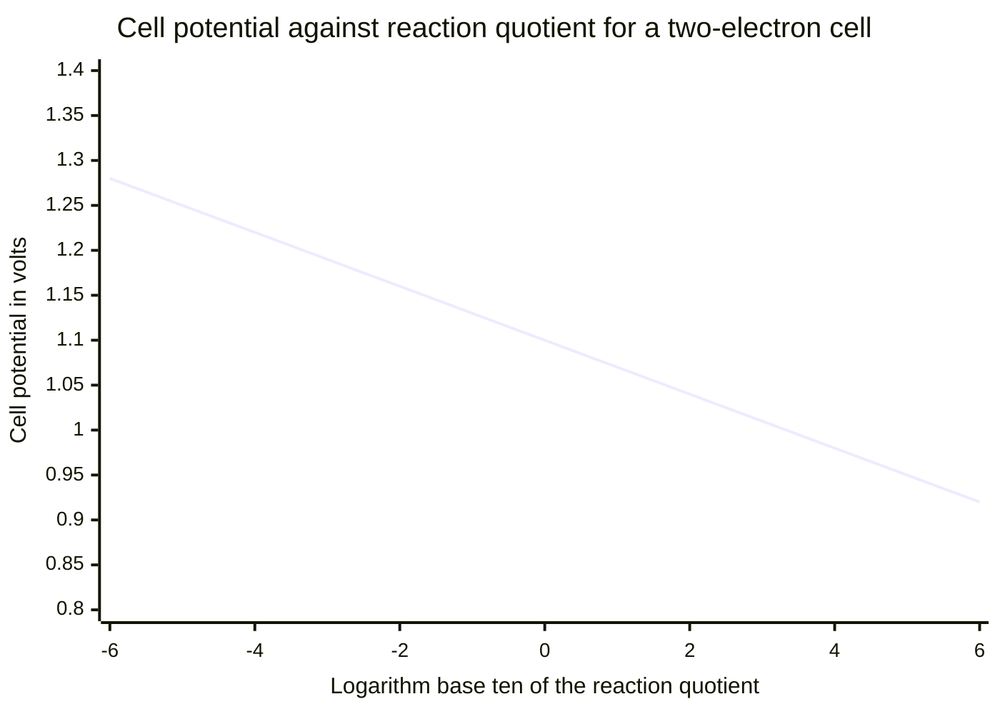
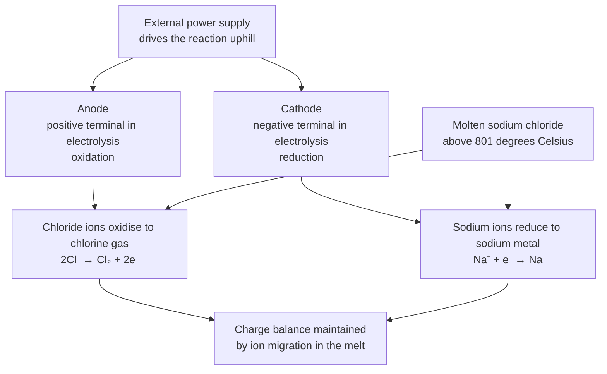
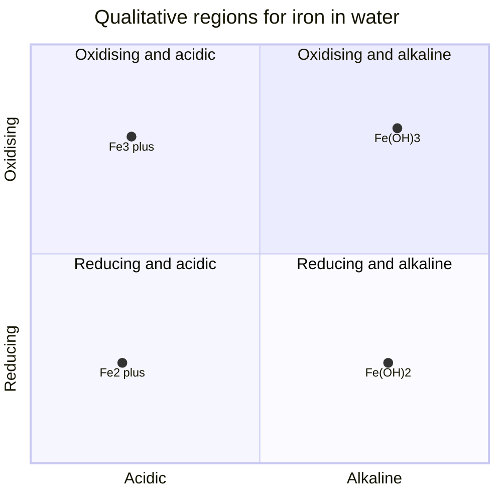
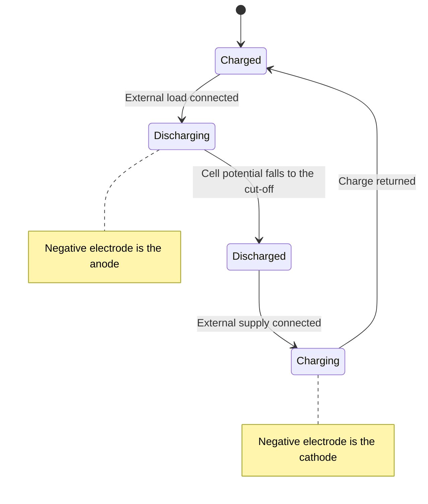

# Electrochemistry — Visual Gallery

> **Level:** 2 and 3 · **Figures:** 7 · **Study time:** 40 minutes
> **Supports:** [Level 2 index](../../03-intermediate-chemistry/README.md) for redox fundamentals and [Level 3 index](../../04-advanced-chemistry/README.md) for cells, the Nernst equation and electrolysis.
> **Companion galleries:** [Thermodynamics](../thermodynamics/README.md) · [Reaction mechanisms](../reaction-mechanisms/README.md)

Electrochemistry is the one part of the curriculum where a single diagram carries the
whole argument: two electrodes, an external circuit, an internal connection, and a
direction of electron flow. Get the directions right and the rest — signs, cell
potentials, the Nernst equation, the difference between a galvanic cell and an
electrolytic one — follows. Get them wrong and every calculation after it inherits the
error.

The convention used throughout: **oxidation at the anode, reduction at the cathode**, in
every electrochemical cell, whether it is galvanic or electrolytic. What changes between
the two is the sign of the electrode and the direction of the spontaneous process, not the
assignment of the names.

---

## 1. The Daniell cell as a sequence of events

**Figure 1 — The Daniell cell.** The diagram encodes the four simultaneous processes that
make a galvanic cell work: oxidation at the zinc electrode, electron conduction through
the external circuit, reduction at the copper electrode, and ion migration through the
salt bridge. It deliberately omits the potentials ($E^\circ_{\text{cell}} = +1.10$ V), the
liquid-junction potential at each end of the bridge, and the fact that the zinc electrode
dissolves and changes mass as the cell runs. **Question it should answer:** why does the
cell stop delivering current if the salt bridge is removed, when the external circuit is
still complete?

The answer is charge balance. Electrons leaving the zinc strip would leave the anodic
compartment with a growing excess of positive charge, and electrons arriving at the copper
strip would create an excess of negative charge; within nanoseconds the electrostatic
potential would oppose further electron flow. The salt bridge is not a conductor of
electrons — it is a conductor of ions, and it is what closes the circuit.

---

## 2. Electrons and ions move in different loops

**Figure 2 — Two loops, not one.** The diagram encodes the essential asymmetry: electrons
travel only through the external circuit, whereas charge inside the cell is carried by
ions moving in the electrolyte and the bridge. It deliberately omits the transference
numbers that describe what fraction of the current each ion carries, the convection and
diffusion that operate in a real unstirred cell, and the electrode reactions themselves.
**Question it should answer:** in the salt bridge of a zinc–copper cell, in which
direction do the potassium ions and the nitrate ions move?

Potassium ions migrate towards the cathode compartment, where copper ions are being
removed from solution, and nitrate ions migrate towards the anode compartment, where zinc
ions are being produced. Every mobile species moves so as to preserve electroneutrality.
A reader who assumes that all ions drift towards the cathode has confused ionic migration
with the direction of electron flow.

---

## 3. The standard hydrogen electrode

**Figure 3 — The standard hydrogen electrode.** The diagram encodes the definition that
makes the whole table of standard potentials possible: the hydrogen half-cell is assigned
$E^\circ = 0.000$ V at all temperatures, and every other half-cell is measured against it
in a cell whose potential is the difference. It deliberately omits the practical
difficulties (the need for platinised platinum, the poisoning of the surface, the
reproducibility of the 1 bar gas delivery), the activity coefficient corrections, and the
alternative reference electrodes — calomel and silver/silver chloride — that are used in
practice. **Question it should answer:** why is the standard potential of the hydrogen
electrode exactly zero at every temperature, and why does that choice not affect any cell
potential?

The zero is a definition, not a measurement: only differences of potential are physically
meaningful, so one point on the scale must be fixed arbitrarily. Because every cell
potential is a difference $E_{\text{cathode}} - E_{\text{anode}}$, adding a constant to
every tabulated value cancels. The convention is therefore free, and the hydrogen
electrode was chosen because it is experimentally convenient and reproducible.

---

## 4. How the Nernst equation shifts a cell potential

**Figure 4 — The Nernst shift for a two-electron cell with $E^\circ = 1.10$ V.** The line
is $E = 1.10 - (0.0592/2)\log Q$ at 298 K, so the slope is $-0.0296$ V per decade of $Q$.
The diagram encodes the direction of the shift: as the reaction quotient grows, the cell
potential falls, and it reaches zero when $Q = K$, at which point the cell is dead. It
deliberately omits the activity coefficients (concentrations are used as though they were
activities), the temperature dependence of the slope, and the liquid-junction potential
that shifts the measured value away from the calculated one. **Question it should answer:**
why does a galvanic cell voltage decrease as the reaction proceeds, even though the
standard potential is a constant?

Because $Q$ is not constant. Initially the products are absent and $Q$ is tiny, so the
logarithm is large and negative and $E$ exceeds $E^\circ$. As products accumulate and
reactants are consumed, $Q$ rises towards $K$ and $E$ falls towards zero. The standard
potential describes only the state in which every species is in its standard state; it is
a reference point on this line, not the value the voltmeter reads.

---

## 5. An electrolytic cell

**Figure 5 — Electrolysis of molten sodium chloride.** The diagram encodes the inversion
that confuses students: in an electrolytic cell the anode is the **positive** terminal,
because the power supply pulls electrons away from it, and oxidation still happens there.
It deliberately omits the competing electrode reactions that appear when the electrolyte is
aqueous (where water is oxidised in preference to chloride at low concentration, and
reduced in preference to sodium), the overpotentials that decide which competing reaction
actually wins, and the Down process details. **Question it should answer:** why does the
electrolysis of aqueous sodium chloride give hydrogen and chlorine rather than sodium and
chlorine?

Because water is easier to reduce than sodium ion: the reduction of water to hydrogen has
a less negative potential than the reduction of $\ce{Na+}$ to sodium metal, so hydrogen
forms at the cathode. At the anode the situation depends on concentration — dilute
chloride gives oxygen from water, concentrated brine gives chlorine. The diagram's
molten-salt case is the one where water is absent and the simple prediction holds.

---

## 6. A qualitative potential–pH region map

**Figure 6 — A qualitative Pourbaix-style map for iron.** The diagram encodes the two
variables that decide the stable iron species in water: pH on the horizontal axis and
electrode potential on the vertical. It deliberately omits the quantitative boundaries —
in a real Pourbaix diagram the lines have slopes fixed by the Nernst equation, and the
regions between them are labelled immune, corrosive and passive — and it omits the
concentration dependence of every boundary. **Question it should answer:** why does iron
dissolve rapidly in acid but become protected by an oxide film in alkaline solution?

The acid region places $\ce{Fe^2+}$ in the stable zone, so the metal corrodes. In the
alkaline region the stable species are oxides and hydroxides, which are insoluble and
form a barrier — passivation. The same metal is therefore attacked or protected depending
on a variable, pH, that has nothing to do with how noble iron is.

Two reference lines are worth remembering even though the figure cannot draw them: water
is oxidised to oxygen above $E = 1.23 - 0.059\,\mathrm{pH}$ and reduced to hydrogen below
$E = -0.059\,\mathrm{pH}$ (in volts, at 298 K). A species whose region lies between them
is stable in water; one whose region lies outside them will react with the solvent.

---

## 7. Charge and discharge in a rechargeable cell

**Figure 7 — The four states of a rechargeable cell.** The diagram encodes the operational
cycle and, in the notes, the reversal of electrode roles: the electrode that is the anode
during discharge becomes the cathode during charge, because the current is forced the other
way. It deliberately omits the side reactions that cause capacity fade, the dependence of
capacity on temperature and rate, and the memory effect that some chemistries show and
lithium-ion does not. **Question it should answer:** during charging, which electrode is
oxidised and which is reduced, and why is the answer different from discharge?

During discharge the negative electrode is oxidised (it is the anode) and the positive
electrode is reduced. During charge the external supply reverses the electron flow, so the
negative electrode is now reduced (it is the cathode) and the positive electrode is
oxidised. The material that stores the charge does not change identity; only the direction
of the redox process reverses.

---

## Reconstruct from memory

1. **The cell.** Draw the Daniell cell with both solutions, both electrodes, the salt
   bridge, the voltmeter and the direction of electron flow. Label anode and cathode.
2. **The loops.** Redraw Figure 2 as two loops, one electronic and one ionic, and mark the
   direction of every arrow.
3. **The reference.** Draw the hydrogen electrode, label the four standard conditions, and
   explain in one sentence why the potential is zero.
4. **The Nernst line.** Sketch $E$ against $\log Q$ for a two-electron cell, mark the
   slope and the intercept, and show where the line crosses zero.
5. **The electrolytic cell.** Redraw the molten NaCl cell and add the aqueous case beside
   it, naming the products that actually form.
6. **The region map.** Draw two axes labelled pH and potential, then place the four iron
   species in the correct quadrants without using Figure 6.
7. **The cycle of states.** Draw the four-state diagram for a rechargeable cell and write
   beside each arrow whether the negative electrode is being oxidised or reduced.

---

## Where the diagram lies

| Figure | Careless reading | What the diagram actually says |
|---|---|---|
| 1 | "Electrons travel through the salt bridge." | Electrons travel only through the external circuit; the bridge carries ions. |
| 2 | "All ions move towards the cathode." | Cations move towards the cathode and anions towards the anode; both directions occur simultaneously. |
| 3 | "The hydrogen electrode has zero potential because hydrogen is inert." | The zero is a definition chosen by convention; only potential differences are measurable. |
| 4 | "The cell potential is constant at 1.10 V while the cell runs." | 1.10 V is the standard value at $Q = 1$; the operating potential falls as $Q$ rises. |
| 5 | "The anode is always the negative electrode." | In a galvanic cell the anode is negative; in an electrolytic cell it is positive. |
| 6 | "The straight quadrant boundaries are the real phase boundaries." | The boundaries in a true Pourbaix diagram are sloped and concentration-dependent; the quadrants are a simplification. |
| 7 | "The anode is a fixed piece of metal." | Anode and cathode are roles defined by the direction of the reaction, and they swap when the current reverses. |

---

## Links back to the chapters

- Oxidation numbers, redox and cell potentials: [Level 2 — Intermediate Chemistry](../../03-intermediate-chemistry/README.md), Chapter 12.
- The Nernst equation, electrolysis and cell thermodynamics: [Level 3 — Advanced Chemistry](../../04-advanced-chemistry/README.md), Chapter 8.
- Buffers and the solubility product, which share the equilibrium logic of Figure 6: [Level 3, Chapter 7 — Advanced Equilibrium: Buffers and Solubility Product](../../04-advanced-chemistry/07-advanced-equilibrium-buffers-and-solubility-product.md).
- The relationship $\Delta G^\circ = -nFE^\circ$: [Thermodynamics gallery](../thermodynamics/README.md).

For the mechanistic view of electron transfer at an electrode, continue to the [Reaction mechanisms gallery](../reaction-mechanisms/README.md).
