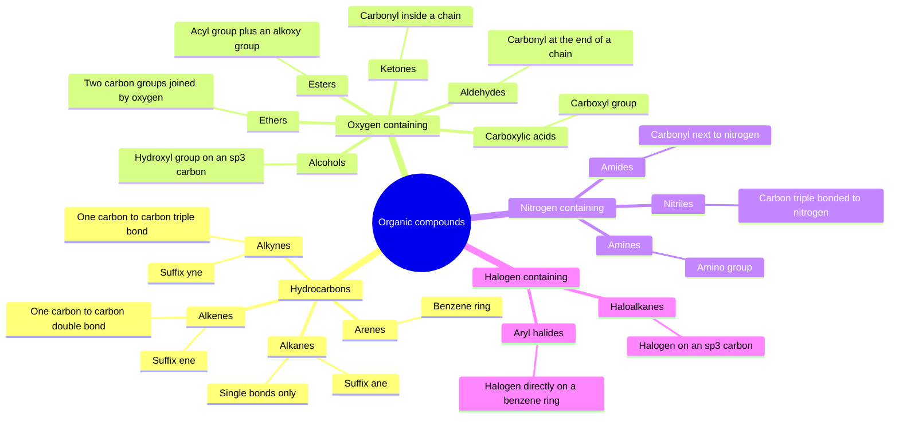
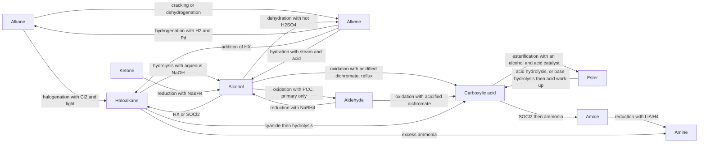
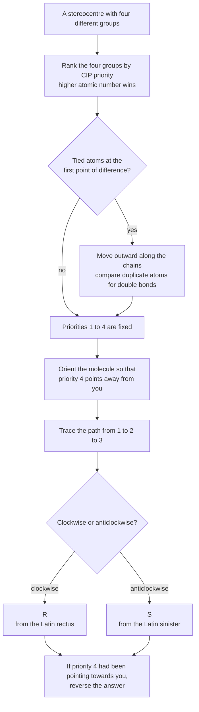
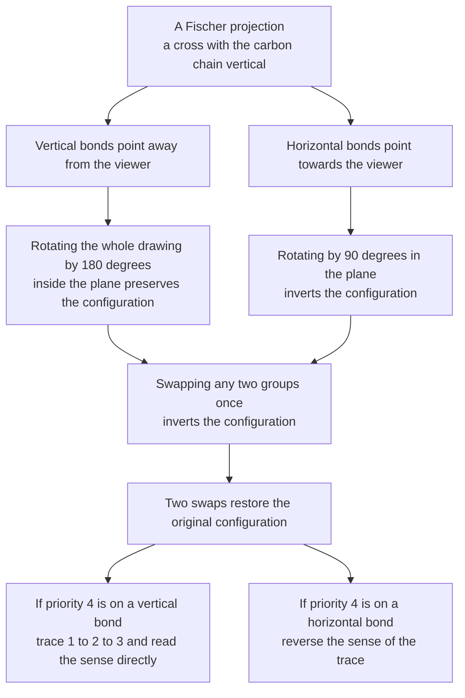
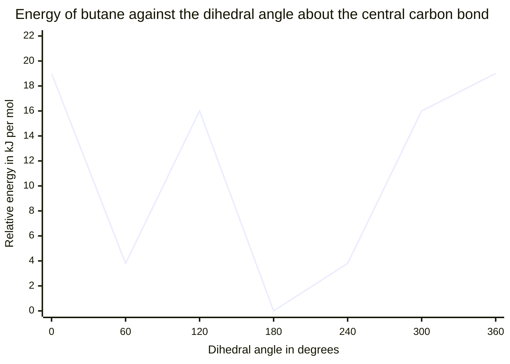
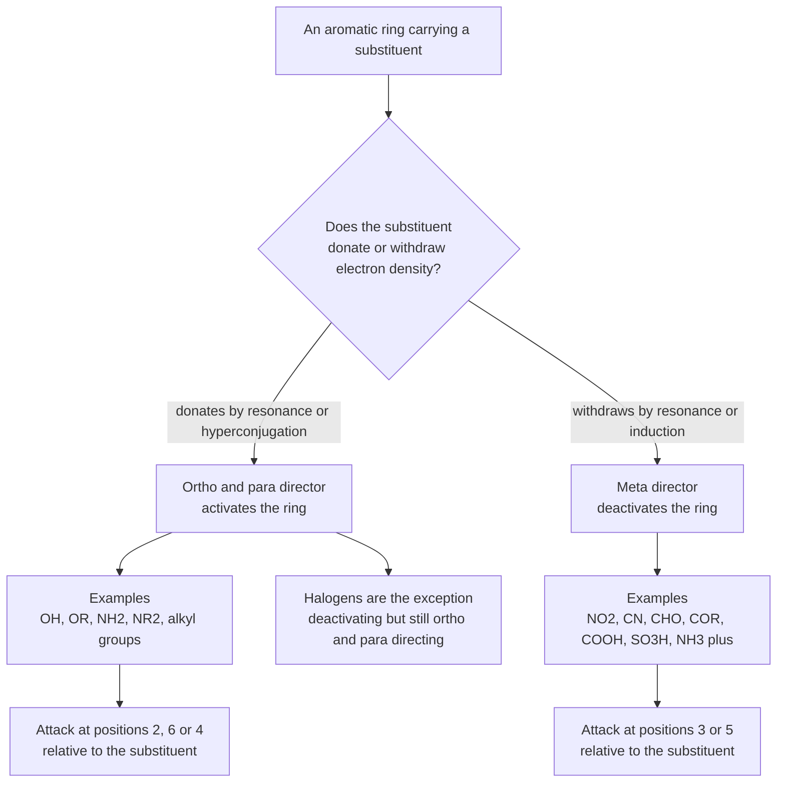
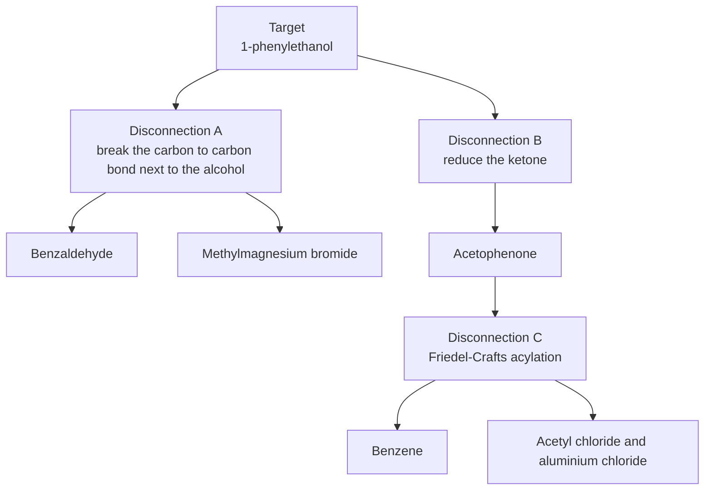

# Organic Chemistry — Visual Gallery

> **Level:** 4 · **Figures:** 7 · **Study time:** 45 minutes
> **Supports:** [Level 4 — Organic Chemistry](../../05-organic-chemistry/README.md), chapters 2 to 14.
> **Companion galleries:** [Reaction mechanisms](../reaction-mechanisms/README.md) · [Biochemistry](../biochemistry/README.md)

Organic chemistry has a reputation for being a memory subject. It is not: it is a small
number of rules applied to a large number of molecules. The seven figures below are the
rules. A functional-group taxonomy tells you what a molecule *is*; an interconversion
roadmap tells you where it can *go*; the stereochemistry flowcharts tell you how to
*describe* it unambiguously; the conformational profile tells you why one shape is
preferred; the orientation map tells you where a substituent will *land*; and the
retrosynthesis tree tells you how to *make* it.

Mermaid cannot draw a tetrahedral carbon, a chair or a curly arrow. Where a figure below
would need one, it draws the decision structure instead and says so. A flowchart that
pretends to be a structure diagram is worse than no diagram at all — the rule stated in
the [gallery index](../README.md).

---

## 1. The functional-group map

**Figure 1 — A functional-group taxonomy.** The map encodes the classification used for
nomenclature and for predicting reactivity: the heteroatom and its immediate
neighbourhood decide the suffix, the priority order and the characteristic reactions. It
deliberately omits the priority ranking itself, the aromatic/aliphatic distinction inside
each family, and the fact that a molecule may contain several functional groups at once,
in which case the highest-priority one names the compound and the others become prefixes.
**Question it should answer:** a compound contains both a ketone and a carboxylic acid.
Which suffix names the molecule, and what happens to the other group in the name?

The carboxylic acid wins: the suffix is *-oic acid* and the ketone becomes the prefix
*oxo-*. The priority order is itself a small diagram — acid > ester > amide > nitrile >
aldehyde > ketone > alcohol > amine > ether > alkene > alkyne > alkane — and it matters
because it decides both the name and, in synthesis, which group must be protected.

---

## 2. The interconversion roadmap

**Figure 2 — The core interconversion roadmap.** The diagram encodes the reactions that
change one functional group into another, together with the reagent that does it. It
deliberately omits the conditions that decide *which* product forms when two are possible
(temperature and concentration in the oxidation of a primary alcohol, for example), the
mechanism of each step, and the protection and deprotection steps needed when a molecule
carries more than one reactive group. **Question it should answer:** starting from a
primary alcohol, what single reagent choice decides whether you obtain an aldehyde or a
carboxylic acid?

The choice is between a mild oxidant used with distillation — pyridinium chlorochromate,
which stops at the aldehyde — and a strong oxidant under reflux — acidified dichromate,
which takes the primary alcohol through the aldehyde to the carboxylic acid. Distillation
removes the aldehyde before it can be oxidised again; reflux keeps it in the flask. The
roadmap shows both arrows leaving the same node, and the difference between them is a
condition, not a reagent class.

---

## 3. Assigning R or S

**Figure 3 — The R/S decision procedure.** The diagram encodes the operational definition:
rank, orient, trace, and reverse if the lowest-priority group is pointing towards you. It
deliberately omits the fully general CIP rules for rings, pseudo-asymmetric centres and
isotopes, and it omits the three-dimensional drawing itself — the flowchart tells you how
to read a drawing, not how to make one. **Question it should answer:** if you have already
traced 1 to 2 to 3 clockwise with priority 4 pointing towards you, what is the
configuration, and why is it not R?

It is S. The trace is only meaningful when you look down the bond from the stereocentre to
group 4, so that group 4 is behind the plane. If it is in front, you are viewing the
molecule from the opposite side and every clockwise sense appears anticlockwise. Reversing
the answer is equivalent to walking around the molecule; it is not a convention that can
be skipped.

---

## 4. Reading a Fischer projection

**Figure 4 — The rules for Fischer projections.** The diagram encodes the two things that
make Fischer projections treacherous: the horizontal bonds come *out* of the page, and a
90° rotation in the plane is not a symmetry operation but a change of configuration. It
deliberately omits the historical derivation from Emil Fischer's sugar work, the
relationship to the more flexible zigzag convention, and the fact that a Fischer
projection of a molecule with several stereocentres must be read one centre at a time.
**Question it should answer:** why does rotating a Fischer projection by 180° leave the
configuration unchanged, while rotating it by 90° inverts every stereocentre?

Because a 180° rotation in the plane maps each vertical bond onto a vertical bond and each
horizontal bond onto a horizontal bond, so every group that pointed away still points away.
A 90° rotation maps vertical onto horizontal, so every group that pointed away now points
towards the viewer: the molecule has been turned inside out. That is why the permitted
manipulations are exactly 180° rotations and pairs of swaps.

---

## 5. The conformational energy profile of butane

**Figure 5 — Torsional and steric strain in butane.** The curve encodes the three
conformations that matter: the anti-periplanar minimum at 180° (0 by definition), the
gauche minima at 60° and 300° (about 3.8 $\mathrm{kJ\ mol^{-1}}$ above anti), and the
eclipsed maxima at 120° and 240° (about 16 $\mathrm{kJ\ mol^{-1}}$) with the
syn-periplanar maximum at 0° and 360° (about 19 $\mathrm{kJ\ mol^{-1}}$). It deliberately
omits the vibrational zero-point contributions, the entropy difference between the
conformers, and the fact that the values are for the isolated molecule in the gas phase.
**Question it should answer:** why is the gauche conformer higher in energy than anti, and
why is it still populated at room temperature?

Gauche costs about 3.8 $\mathrm{kJ\ mol^{-1}}$ of steric repulsion between the two methyl
groups; anti has them as far apart as possible. But $3.8\ \mathrm{kJ\ mol^{-1}}$ is only
about 1.5 times $RT$ at room temperature, so the Boltzmann factor
$e^{-\Delta E/RT} \approx 0.2$ still leaves a substantial population in each gauche well.
A conformer is not a stable species that must be isolated; it is a region of the energy
surface that is visited constantly.

---

## 6. Where an electrophile attacks an aromatic ring

**Figure 6 — Orientation in electrophilic aromatic substitution.** The diagram encodes the
correlation between the electronic character of the substituent and the positions that
are activated, together with the halogen exception. It deliberately omits the resonance
structures that justify the correlation, the steric preference for para over ortho with
bulky substituents, and the fact that a strongly activating group can override a
directing effect elsewhere on the ring. **Question it should answer:** why is nitrobenzene
nitrated hundreds of times more slowly than benzene, and why does the product come out
meta?

The nitro group withdraws electron density by both resonance and induction, so the ring is
deactivated and the rate falls. It also destabilises the arenium ion formed by attack at
ortho or para more than the one formed by attack at meta, because only the ortho and para
intermediates place a positive charge on the carbon bearing the nitro group. Slower and
meta are therefore the same fact, seen twice.

---

## 7. A retrosynthetic tree

**Figure 7 — Two routes to 1-phenylethanol.** The tree encodes the logic of retrosynthetic
analysis: start at the target, break one bond at a time, and check that each precursor is
either commercially available or itself reachable. Route A is a Grignard addition of
methylmagnesium bromide to benzaldehyde; route B is the reduction of acetophenone, which
is itself available by Friedel–Crafts acylation of benzene. It deliberately omits
protecting-group strategy, the yields and selectivities of the two routes, and the
work-up conditions. **Question it should answer:** the Grignard route and the reduction
route both give the same product, so what decides which one is preferred in practice?

The decision is not thermodynamic. The Grignard route builds the carbon skeleton and
needs anhydrous conditions, because the reagent is destroyed by water and by any acidic
proton; the reduction route starts from a ketone that is cheap and available. Cost,
available starting materials, safety and the number of steps decide, which is why the
tree records *routes*, not a single answer. Retrosynthesis generates options; synthesis
chooses among them.

---

## Reconstruct from memory

1. **The taxonomy.** Redraw the mindmap to three levels, then add one example compound to
   each family that has a common name you know.
2. **The roadmap.** From a blank page, draw the alkane, haloalkane, alcohol, aldehyde,
   acid, ester and amide nodes and label every arrow with its reagent.
3. **R/S.** Write the four steps of the CIP procedure and apply them to a drawn
   stereocentre with priority 4 in the plane.
4. **Fischer.** State the two bond directions, the permitted rotations, and the effect of
   a single swap.
5. **Butane.** Sketch the energy curve, mark the anti and gauche wells and the two types
   of eclipsed maximum, and give the approximate energies.
6. **Orientation.** Draw a benzene ring, mark positions 2 to 6, and place four activating
   and four deactivating groups in the correct directing class.
7. **Retrosynthesis.** Draw the tree for 1-phenylethanol from memory, then invent one
   additional disconnection and say whether it is realistic.

---

## Where the diagram lies

| Figure | Careless reading | What the diagram actually says |
|---|---|---|
| 1 | "A molecule belongs to exactly one family." | Families are defined by the functional group present; a molecule with several groups belongs to several families at once. |
| 2 | "Every arrow works in both directions with the same reagents." | Each arrow is a specific forward reaction; the reverse requires different conditions, and some are not practical. |
| 3 | "Clockwise always means R." | Clockwise means R only when priority 4 points away; otherwise the sense must be reversed. |
| 4 | "A Fischer projection can be rotated freely in the plane." | Only 180° rotations preserve configuration; 90° rotations and single swaps invert it. |
| 5 | "The gauche conformer does not exist because it is higher in energy." | It is a shallow minimum, about 3.8 $\mathrm{kJ\ mol^{-1}}$ above anti, and is significantly populated at room temperature. |
| 6 | "Halogens activate the ring because they are ortho and para directors." | Halogens deactivate the ring by induction while still directing ortho and para by resonance. |
| 7 | "The shorter route is the better route." | The tree records possible disconnections; the choice depends on cost, availability, selectivity and safety, not on step count alone. |

---

## Links back to the chapters

- The scope of the subject: [Level 4, Chapter 1 — Introduction to Organic Chemistry](../../05-organic-chemistry/01-introduction-to-organic-chemistry.md).
- Functional groups and nomenclature, the source of Figure 1: [Level 4, Chapter 2 — Functional Groups and IUPAC Nomenclature](../../05-organic-chemistry/02-functional-groups-and-iupac-nomenclature.md).
- Isomerism and stereochemistry, the source of Figures 3 and 4: [Level 4, Chapter 3 — Isomerism and Stereochemistry](../../05-organic-chemistry/03-isomerism-and-stereochemistry.md).
- Haloalkanes, which supply several arrows in Figure 2: [Level 4, Chapter 8 — Haloalkanes: Nucleophilic Substitution and Elimination](../../05-organic-chemistry/08-haloalkanes-substitution-and-elimination.md).
- Alcohols, phenols and ethers: [Level 4, Chapter 9 — Alcohols, Phenols and Ethers](../../05-organic-chemistry/09-alcohols-phenols-and-ethers.md).
- Aldehydes, ketones and carbonyl chemistry: [Level 4, Chapter 10 — Aldehydes, Ketones and Carbonyl Chemistry](../../05-organic-chemistry/10-aldehydes-ketones-and-carbonyl-chemistry.md).

The mechanistic detail behind every arrow in Figure 2 is in the [Reaction mechanisms gallery](../reaction-mechanisms/README.md). For the biological polymers built from these functional groups, continue to the [Biochemistry gallery](../biochemistry/README.md).
