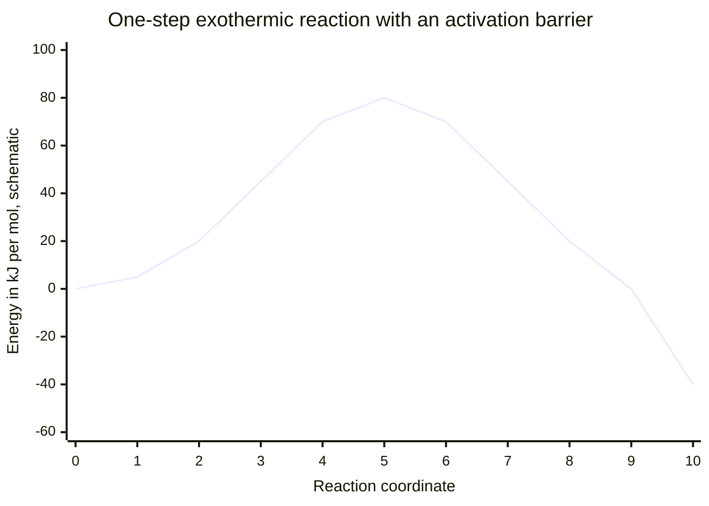
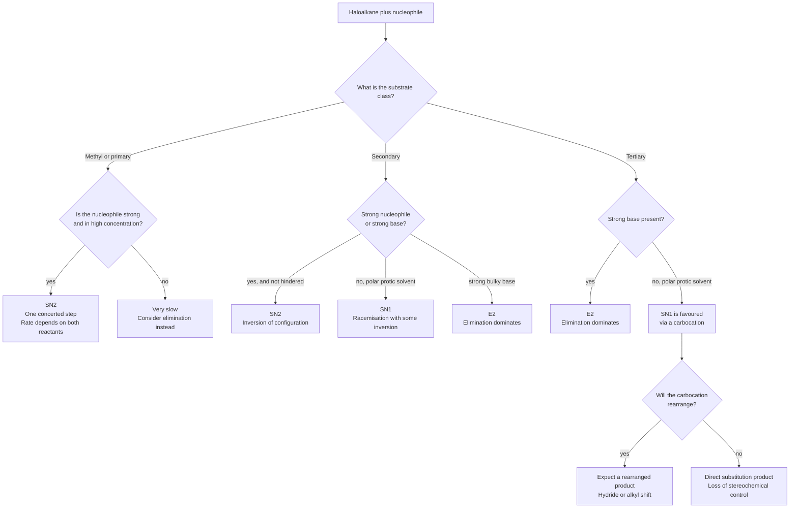
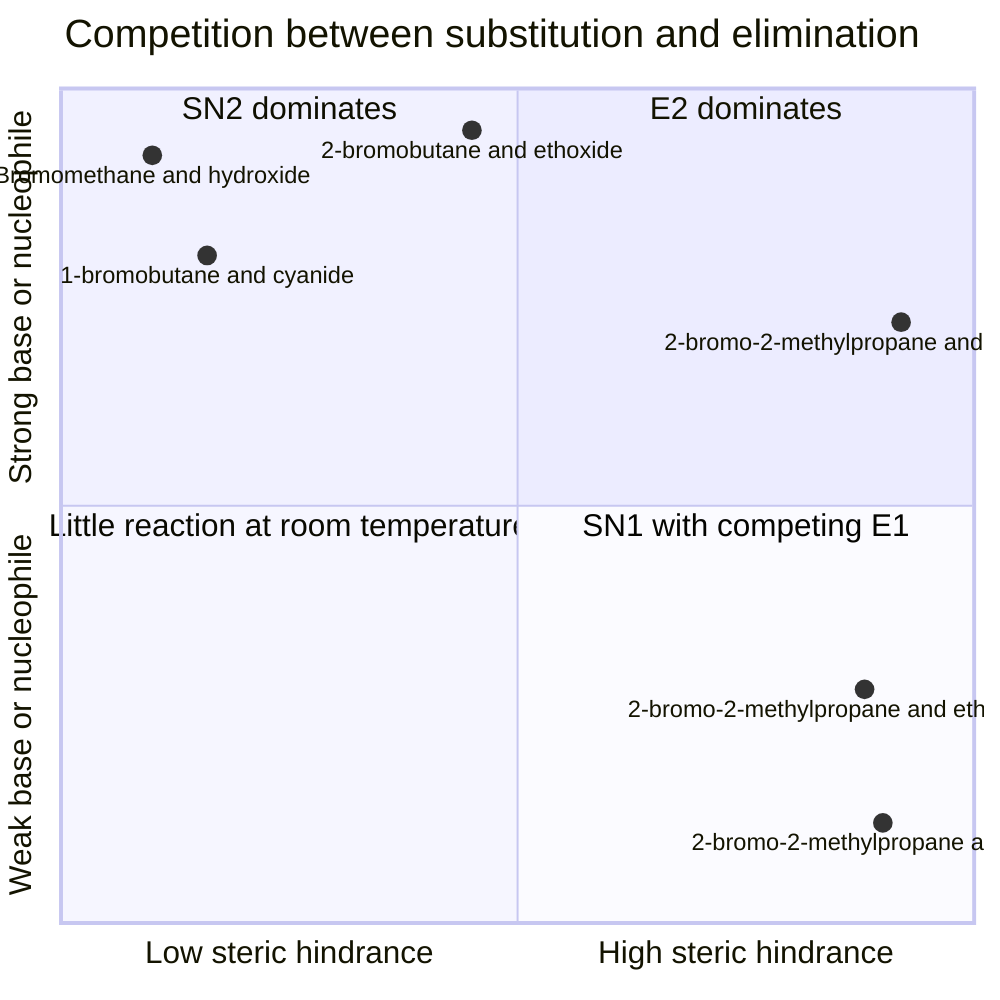
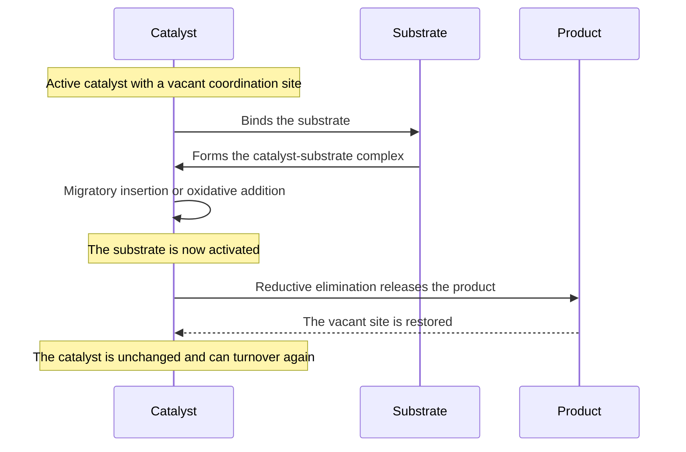
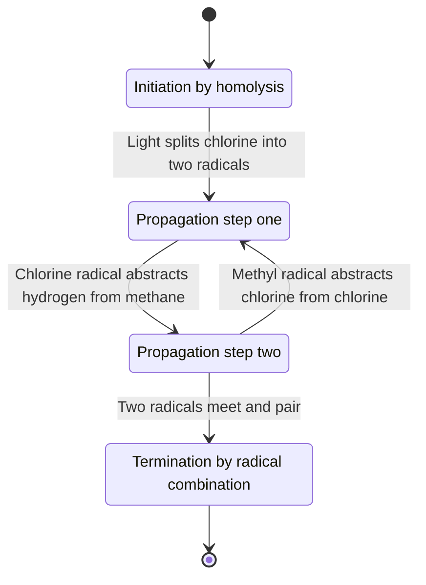
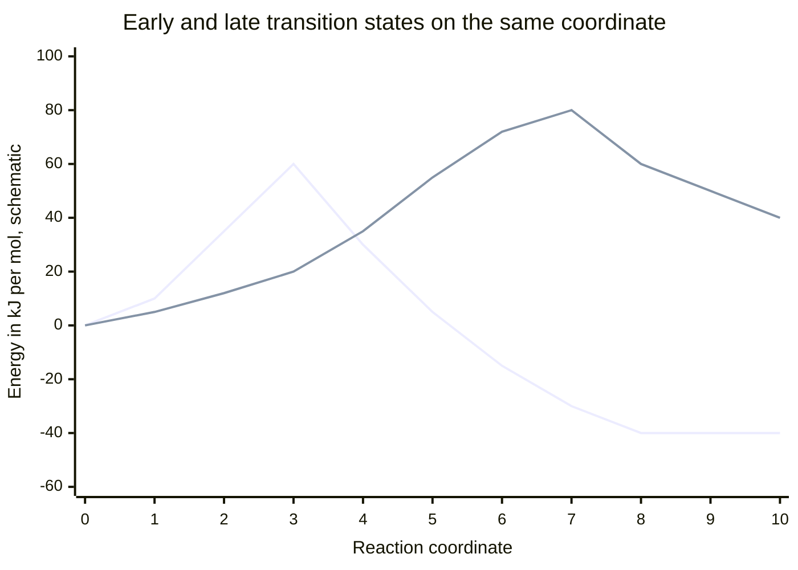

# Reaction Mechanisms — Visual Gallery

> **Level:** 3 and 4 · **Figures:** 6 · **Study time:** 35 minutes
> **Supports:** the Level 3 unit on kinetics and mechanism ([Level 3 index](../../04-advanced-chemistry/README.md)) and the Level 4 unit on haloalkanes ([Level 4 index](../../05-organic-chemistry/README.md)).
> **Companion galleries:** [Organic chemistry](../organic-chemistry/README.md) · [Chemical bonding](../chemical-bonding/README.md)

A mechanism is a claim about *sequence*: which bond breaks first, which intermediate
survives long enough to be observed, and which step limits the rate. Mermaid cannot draw
curly arrows, so this gallery does the next best thing. It draws the **decision
structure** of mechanism problems — the questions you ask about substrate, nucleophile,
solvent and temperature — and the **energy landscapes** that justify the answers.

Read every diagram as an argument, not as a picture. If a figure cannot tell you why one
branch is preferred over another, it is decoration.

---

## 1. The reaction-coordinate diagram

**Figure 1 — A single-step exothermic profile.** The diagram encodes three quantities at
once: the activation energy $E_a$ (the height from the reactant plateau to the peak, here
80 $\mathrm{kJ\ mol^{-1}}$ by construction), the enthalpy change $\Delta H$ (the
difference between the plateaus, here $-40\ \mathrm{kJ\ mol^{-1}}$), and the position of
the transition state along the coordinate. It deliberately omits the fact that the
horizontal axis is a collective coordinate, not a single bond length; it omits the
zero-point energy and the temperature dependence of the barrier; and it omits any
intermediate, because this reaction has none. **Question it should answer:** why does
lowering the barrier raise the rate without changing the position of the product
plateau?

The distinction the figure is built to teach is between thermodynamics and kinetics. The
product plateau is lower than the reactant plateau, so the reaction is exothermic and
favoured at equilibrium. The peak in between has nothing to do with that favour: it is
the price of passing through the transition state. A catalyst changes the peak and leaves
the plateaus alone.

---

## 2. Choosing between SN1 and SN2

**Figure 2 — A decision tree for substitution.** The diagram encodes the four variables
that actually control the outcome: substrate class, nucleophile strength and
concentration, solvent, and steric bulk. It deliberately omits the quantitative rate
constants, the effect of temperature (which shifts the balance towards elimination), and
the special acceleration of allylic and benzylic substrates, which can react by either
pathway. **Question it should answer:** why does the rate of an SN2 reaction double when
the nucleophile concentration is doubled, while the rate of an SN1 reaction does not
change at all?

The rate-law difference is the diagnostic test, and it is encoded in the structure of the
tree rather than in any label. SN2 has one step involving both partners, so
$v = k[\text{substrate}][\text{nucleophile}]$. SN1 has a slow ionisation that involves
only the substrate, so $v = k[\text{substrate}]$; the nucleophile waits until the
carbocation exists and therefore cannot influence the rate-determining step.

---

## 3. Substitution and elimination on one map

**Figure 3 — A heuristic map of the SN1, SN2, E1 and E2 competition.** The diagram
encodes the trade-off that governs every haloalkane problem: a strong base and a crowded
substrate push towards E2, a strong nucleophile and an unhindered substrate push towards
SN2, and a weak nucleophile in a polar protic solvent with a tertiary substrate leaves the
carbocation route open, where SN1 and E1 compete. It deliberately omits temperature as a
third axis, the difference between a strong nucleophile that is a weak base (iodide,
thiolate) and one that is a strong base (ethoxide), and the substrate classes that sit on
the boundaries. **Question it should answer:** why does potassium tert-butoxide give
mainly elimination with 2-bromobutane, while sodium ethoxide gives mainly substitution,
even though both are strong bases?

The quadrant positions are teaching aids, not measurements, and the plotting order is
chosen for legibility. The one relationship worth memorising is the diagonal: the more
crowded the carbon and the stronger the base, the more the elimination pathway wins,
because the base cannot reach the electrophilic carbon and instead removes a $\beta$
hydrogen.

---

## 4. A catalytic cycle

**Figure 4 — A generic catalytic cycle as a sequence.** The diagram encodes the ordering
constraint that defines catalysis: the catalyst must bind the substrate, alter its
electronic environment, and then release the product in a step that regenerates the
original active species. It deliberately omits the oxidation states and ligand counts at
each stage, the equilibrium constants of the individual steps, and the fact that the
turnover-limiting step may be any one of them rather than the one drawn last. **Question
it should answer:** why does a catalyst appear in the rate law but not in the overall
stoichiometry?

The `Note over` lines carry the part of the argument that the arrows cannot: the cycle
closes only if the final state is identical to the initial one. If the catalyst were
consumed — if the vacant site were never restored — the process would be a reagent, not a
catalyst. This is why catalyst poisoning is so damaging: a trace impurity that binds the
active site irreversibly removes cycles from circulation.

---

## 5. Radical chain propagation

**Figure 5 — The radical chlorination of methane.** The diagram encodes the topological
signature of a chain reaction: initiation creates a radical, two propagation steps form a
cycle that consumes reactants and regenerates the chain carrier, and termination removes
radicals from the cycle. It deliberately omits the relative rate constants, the side
reactions that give traces of ethane and chloromethane, and the fact that termination can
remove two different radicals and not only two methyl radicals. **Question it should
answer:** why does the quantum yield of a radical chain reaction often exceed one, and
why does adding a radical inhibitor stop the reaction without lowering the temperature?

The cycle is the explanation of the first question: one photon can produce many product
molecules because the radical is not consumed in propagation, only in termination. The
second question is answered by the arrow into `Termination`: an inhibitor provides a fast
path out of the cycle, so the chain length collapses.

---

## 6. The Hammond postulate

**Figure 6 — Hammond's postulate applied to two reactions.** The first series is an
exothermic reaction whose transition state is early: it sits close to the reactants in
structure and in energy. The second is an endothermic reaction whose transition state is
late: it resembles the products. The diagram encodes the correlation between the position
of the barrier along the coordinate and the thermodynamics of the step. It deliberately
omits the fact that the two curves are not on the same reaction — they are superimposed
for comparison — and it omits tunnelling, which can make a late barrier irrelevant for
light atoms at low temperature. **Question it should answer:** for the endothermic
first step of an SN1 ionisation, would you expect the transition state to resemble the
haloalkane or the carbocation?

The answer is the carbocation, and the consequence is testable: anything that stabilises
the carbocation — a tertiary carbon, an allylic or benzylic position, a polar protic
solvent — lowers the late barrier and speeds the reaction. This is the reasoning that
makes "SN1 is fast for tertiary substrates" a deduced fact rather than a list item.

---

## Reconstruct from memory

1. **The profile.** Draw one exothermic single-step profile and label $E_a$, $\Delta H$,
   the reactant and product plateaus and the transition state.
2. **The tree.** Redraw Figure 2 from the root, adding one example substrate at each
   terminal node.
3. **The map.** Draw the four quadrants and place ethoxide with 2-bromobutane,
   tert-butoxide with 2-bromobutane, water with tert-butyl bromide, and cyanide with
   1-bromobutane.
4. **The cycle.** Draw a catalytic cycle as a sequence diagram with four messages and
   two notes, then state which step must regenerate the catalyst.
5. **The chain.** Draw the radical chlorination cycle with initiation, two propagation
   steps and termination, and mark the chain carriers at every stage.
6. **Hammond.** Draw two profiles on one set of axes, one with an early barrier and one
   with a late barrier, and state which reaction is exothermic.

---

## Where the diagram lies

| Figure | Careless reading | What the diagram actually says |
|---|---|---|
| 1 | "The substance travels over a hill, so the reaction must be slow at the top." | The curve is energy against a collective coordinate; the transition state is a maximum along that coordinate but a minimum in every other direction. |
| 2 | "Tertiary substrates cannot undergo SN2 because the barrier is infinite." | Tertiary substrates are too hindered for the backside attack to be competitive, but the pathway is suppressed, not forbidden. |
| 3 | "A strong base always gives elimination." | Strong bases that are also good nucleophiles and unhindered, such as ethoxide with a primary halide, give mainly substitution. |
| 4 | "The catalyst is consumed in the first step and regenerated in the last, so it must be a reactant." | The catalyst appears in the rate law but not in the balanced equation; the cycle returns it to its initial state unchanged. |
| 5 | "Propagation consumes radicals, so the radical concentration must fall steadily." | Each propagation step consumes one radical and produces another; the concentration falls only in termination. |
| 6 | "The two curves compare two catalysts for one reaction." | They are two different reactions, chosen to contrast an early and a late transition state. |

---

## Links back to the chapters

- Kinetics and mechanism at degree level: [Level 3 — Advanced Chemistry](../../04-advanced-chemistry/README.md), whose Chapter 5 is the mechanism chapter.
- Haloalkane substitution and elimination, the source of Figures 2 and 3: [Level 4, Chapter 8 — Haloalkanes: Nucleophilic Substitution and Elimination](../../05-organic-chemistry/08-haloalkanes-substitution-and-elimination.md).
- Catalysis, the source of Figure 4: [Level 3, Chapter 6 — Catalysis](../../04-advanced-chemistry/06-catalysis.md).
- The orbital and polarity background assumed by Figures 2 and 3: [Chemical bonding gallery](../chemical-bonding/README.md).

For the functional-group context in which these mechanisms are used, continue to the [Organic chemistry gallery](../organic-chemistry/README.md).
