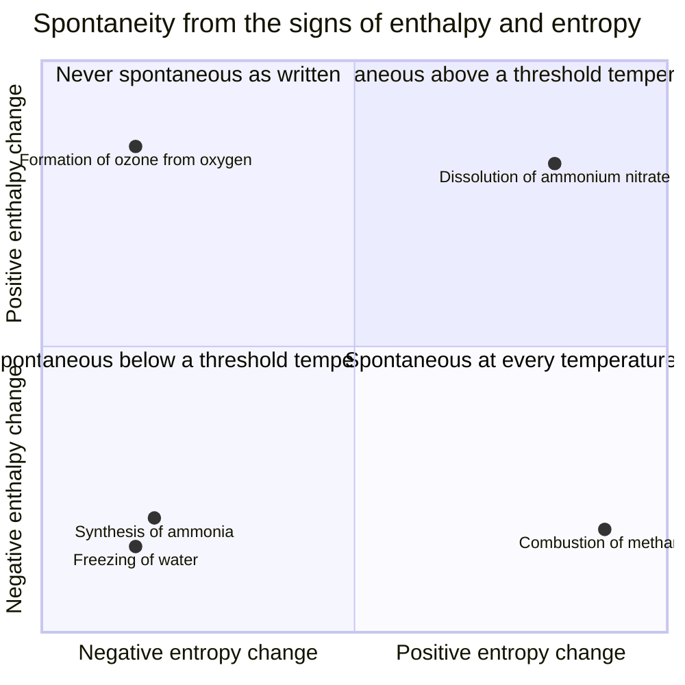
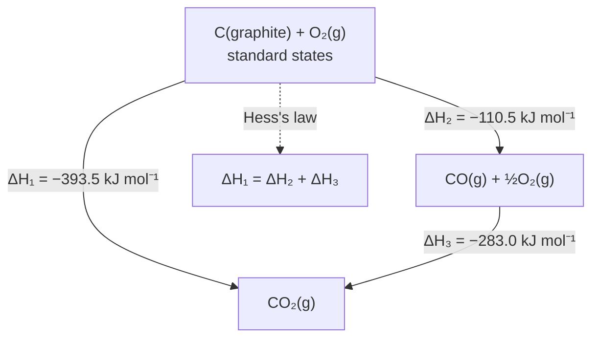
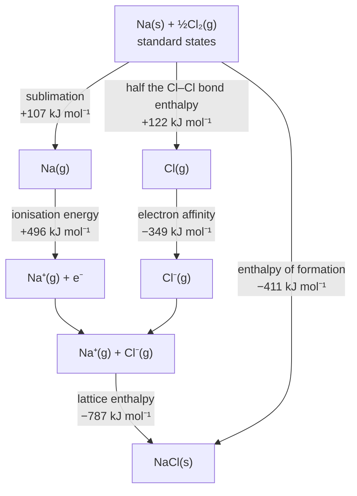
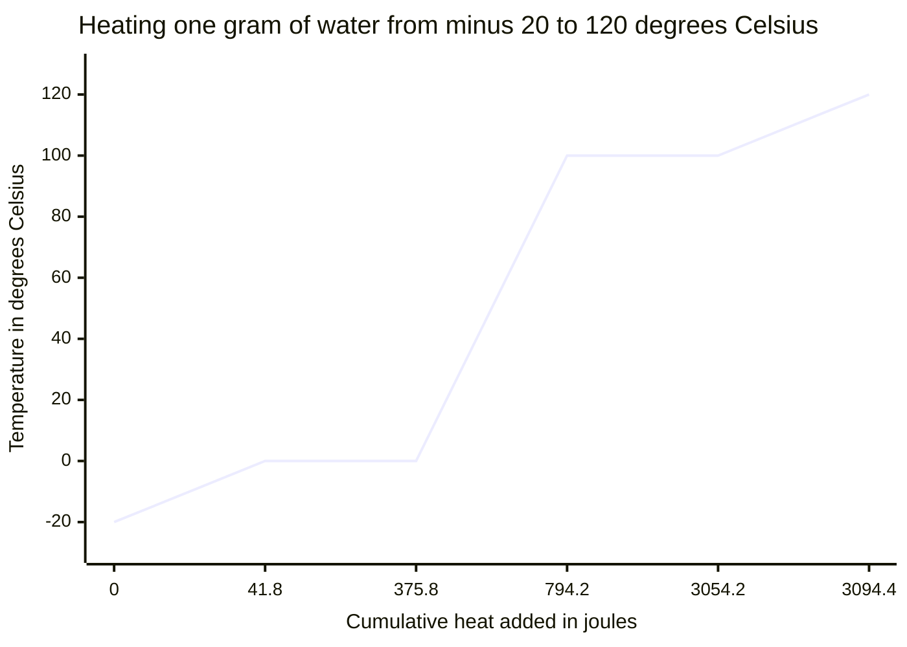
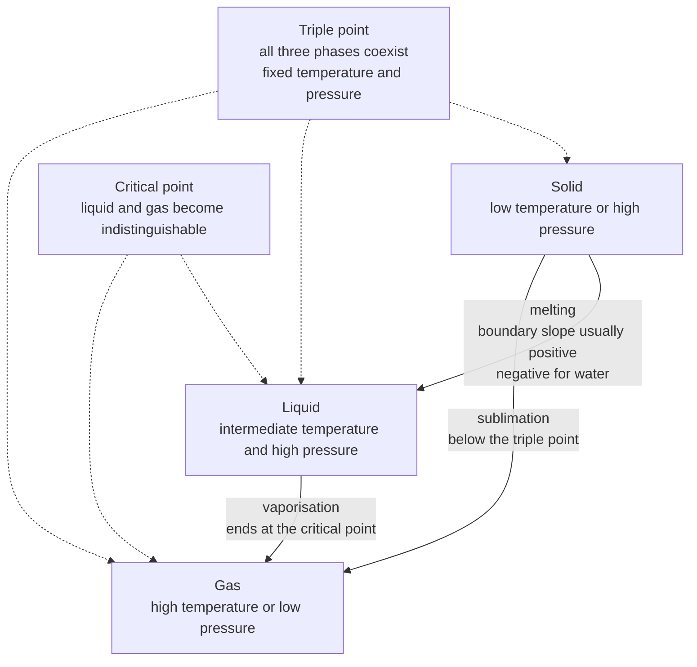
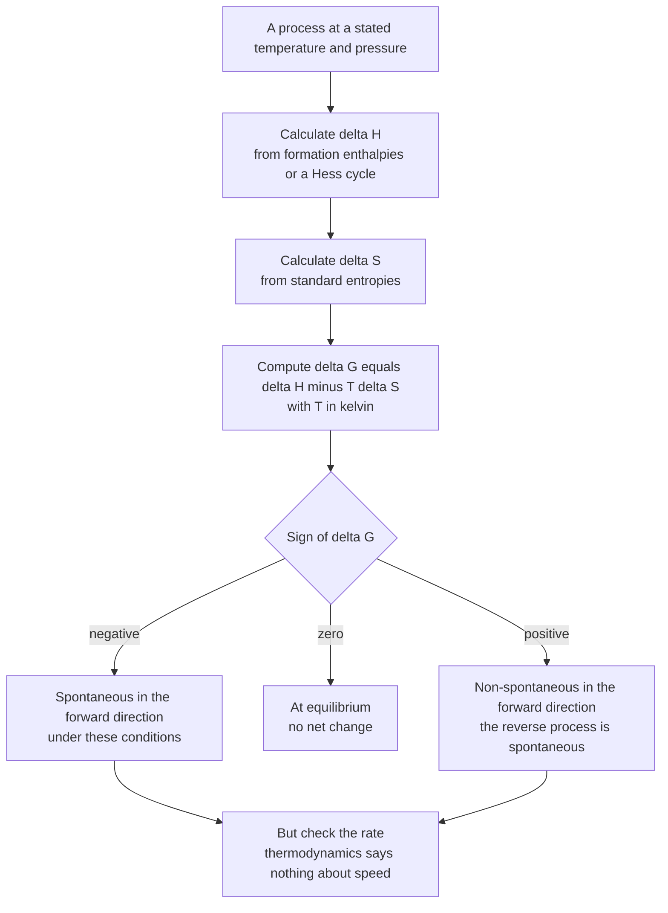
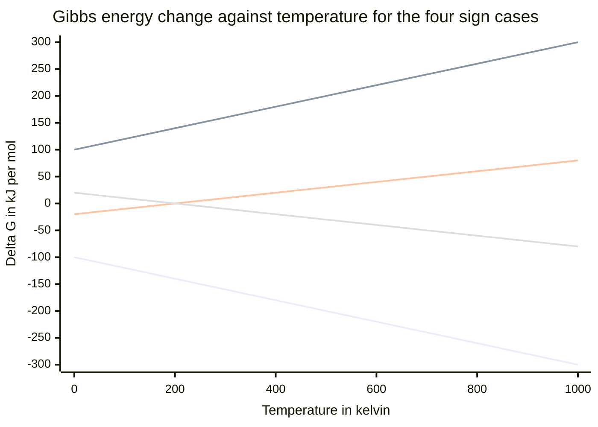

# Thermodynamics — Visual Gallery

> **Level:** 2 and 3 · **Figures:** 7 · **Study time:** 40 minutes
> **Supports:** [Level 2 index](../../03-intermediate-chemistry/README.md) for thermochemistry and [Level 3 index](../../04-advanced-chemistry/README.md) for entropy and Gibbs energy.
> **Companion galleries:** [Electrochemistry](../electrochemistry/README.md) · [Reaction mechanisms](../reaction-mechanisms/README.md)

Thermodynamics is a subject of signs. Almost every error in a thermochemistry answer is a
sign error, a units error, or a failure to say *what is held constant*. The diagrams
below are built to make the signs visible: the four cases of enthalpy against entropy,
the cycles that turn unmeasurable quantities into measurable ones, and the curves that
show how a system crosses from spontaneous to non-spontaneous as temperature changes.

Two conventions apply throughout. Standard states are 1 bar (or 1 atm in older tables)
and, for solutes, 1 mol dm⁻³; the superscript ° means standard, not "at 298 K", even
though most tabulated values are quoted there. And $\Delta G < 0$ means the *forward*
process is spontaneous under the stated conditions — it says nothing about how fast it
goes.

---

## 1. The four sign cases

**Figure 1 — The sign-case matrix for $\Delta G = \Delta H - T\Delta S$.** The diagram
encodes the complete decision table in one picture: the vertical axis is the sign of
$\Delta H$, the horizontal axis the sign of $\Delta S$, and the quadrant fixes the
behaviour of $\Delta G$ as temperature rises. It deliberately omits the magnitude of the
threshold temperature $T = \Delta H/\Delta S$ (which may be far below 298 K, as for
ammonium nitrate, or far above it), and it omits the difference between $\Delta G$ under
actual conditions and $\Delta G^\circ$ under standard conditions. **Question it should
answer:** why is the melting of ice spontaneous above 0 °C and non-spontaneous below it,
even though the enthalpy and entropy changes of melting have the same signs at both
temperatures?

The answer is the competition the equation describes: melting is endothermic
($\Delta H > 0$) and increases entropy ($\Delta S > 0$), so the $-T\Delta S$ term grows
with temperature until it outweighs the enthalpy term. The threshold is the melting
point. Note what the quadrant label does *not* say: "spontaneous above a threshold" is
not the same as "spontaneous when hot". If the threshold is 238 K, the process is
spontaneous in a cold room.

---

## 2. A Hess cycle

**Figure 2 — Hess's law for the combustion of carbon.** The diagram encodes the route
independence of enthalpy: the direct conversion of graphite to carbon dioxide and the
two-step conversion through carbon monoxide give the same total, $-393.5\
\mathrm{kJ\ mol^{-1}}$. It deliberately omits the intermediate species' lifetimes (CO is a
real, isolable intermediate, not a formalism), the dependence of $\Delta H$ on pressure
and on the allotrope of carbon, and the entropy change, which is a separate question.
**Question it should answer:** if the combustion of carbon to carbon monoxide releases
110.5 $\mathrm{kJ\ mol^{-1}}$ and the combustion of carbon monoxide releases 283.0
$\mathrm{kJ\ mol^{-1}}$, what is the enthalpy of the direct route, and why is it
permissible to add the two steps?

The answer follows from state functions: enthalpy depends only on the initial and final
states, so any path between them gives the same $\Delta H$. The addition is legitimate
because the intermediate CO appears once as a product and once as a reactant, and cancels
algebraically. That cancellation is the whole method, and it fails the moment a step is
written with a different stoichiometric coefficient.

---

## 3. The Born–Haber cycle for sodium chloride

**Figure 3 — The Born–Haber cycle for NaCl.** The diagram encodes the five measurable
steps that must sum to the enthalpy of formation: sublimation of sodium, ionisation of
sodium, dissociation of chlorine, electron affinity of chlorine, and lattice enthalpy.
It deliberately omits the sign convention subtleties (the lattice enthalpy is quoted here
as the enthalpy change for forming the solid from gaseous ions, hence negative), the
temperature dependence of each step, and the fact that the electron affinity of chlorine
is exothermic while that of oxygen is not. **Question it should answer:** the lattice
enthalpy of NaCl cannot be measured directly, so how does the cycle allow it to be
obtained from quantities that can be?

The arithmetic is the argument: $107 + 496 + 122 - 349 + \Delta H_{\text{latt}} = -411$,
so $\Delta H_{\text{latt}} = -787\ \mathrm{kJ\ mol^{-1}}$. Every other term is measurable
— sublimation enthalpy by vapour pressure, ionisation energy by spectroscopy, bond
enthalpy by thermochemistry, electron affinity by photoelectron spectroscopy. The cycle
is therefore not a mnemonic; it is an experimental method.

---

## 4. The heating curve of water

**Figure 4 — A heating curve with real data for 1 g of water.** The curve is computed
from $q = mc\Delta T$ with $c_{\text{ice}} = 2.09$, $c_{\text{water}} = 4.18$ and
$c_{\text{steam}} = 2.01\ \mathrm{J\ g^{-1}\ K^{-1}}$, and from $\Delta H_{\text{fus}} =
334$ and $\Delta H_{\text{vap}} = 2260\ \mathrm{J\ g^{-1}}$. It encodes the difference
between sensible heating (the sloping segments) and latent heat (the two plateaus). It
deliberately omits the pressure (the 100 °C plateau is at 1 atm), the gradual rather than
sharp onset of melting in a real sample, and the superheating that can delay boiling.
**Question it should answer:** why does the vapourisation plateau last almost six times
as long as the melting plateau, even though both are first-order phase changes?

The ratio is the ratio of the latent heats: 2260 against 334 $\mathrm{J\ g^{-1}}$. Melting
only loosens the lattice; vaporisation must overcome the whole of the intermolecular
attraction and does work against the atmosphere. The figure makes the point that "heat
the water" is not one process but three, and that the biggest energy cost in boiling a
kettle is the last step, not the heating.

---

## 5. The topology of a phase diagram

**Figure 5 — The topology of a one-component phase diagram.** The diagram encodes which
two phases each boundary separates, the existence of a triple point where three
coexist, and a critical point where the liquid–gas boundary terminates. It deliberately
omits the axes (this is not a pressure–temperature plot and the node positions carry no
quantitative meaning), the curvature of the boundaries, and the fact that the
solid–liquid line for water slopes backwards, so that ice melts under pressure. **Question
it should answer:** why does carbon dioxide sublime at atmospheric pressure rather than
melting, while water melts?

The answer is the position of the triple point relative to atmospheric pressure: the
triple point of CO2 is at about 5.1 atm, so at 1 atm the system crosses the
solid–gas boundary directly. The diagram encodes that reasoning as the arrow labelled
"sublimation, below the triple point", which is the only branch available when the
ambient pressure lies below the triple-point pressure.

---

## 6. Deciding whether a process is spontaneous

**Figure 6 — A decision procedure for spontaneity.** The diagram encodes the order of
operations and the units trap: $\Delta S$ is almost always tabulated in
$\mathrm{J\ K^{-1}\ mol^{-1}}$, so it must be divided by 1000 before it is combined with a
$\Delta H$ in $\mathrm{kJ\ mol^{-1}}$. It deliberately omits the distinction between
$\Delta G$ and $\Delta G^\circ$ (only the latter uses standard states), the coupling of
reactions through shared intermediates, and the possibility that a thermodynamically
favoured reaction is immeasurably slow. **Question it should answer:** a reaction has
$\Delta H = -50\ \mathrm{kJ\ mol^{-1}}$ and $\Delta S = -100\
\mathrm{J\ K^{-1}\ mol^{-1}}$. At what temperature does it stop being spontaneous?

The threshold is $T = \Delta H/\Delta S = (-50\,000)/(-100) = 500$ K. Below 500 K the
negative enthalpy term wins and the reaction is spontaneous; above it, the entropy term
dominates. Substituting the numbers is trivial; the mistake the diagram guards against is
forgetting to convert $\Delta S$ to $\mathrm{kJ}$, which produces a threshold of
0.5 K and an answer that is wrong by three orders of magnitude.

---

## 7. Gibbs energy against temperature

**Figure 7 — $\Delta G$ against $T$ for the four combinations of sign.** The four lines
are $\Delta G = \Delta H - T\Delta S$ plotted for: exothermic with increasing entropy
(always negative), endothermic with decreasing entropy (always positive), exothermic with
decreasing entropy (negative only at low temperature, crossing at 200 K), and endothermic
with increasing entropy (positive only at low temperature, crossing at 200 K). The diagram
encodes the fact that every case is a straight line in $T$, with slope $-\Delta S$ and
intercept $\Delta H$. It deliberately omits the phase changes that make real curves
discontinuous, the non-ideal behaviour at high pressure, and the fact that $\Delta H$ and
$\Delta S$ themselves vary slowly with temperature. **Question it should answer:** why
does the line for an exothermic reaction with decreasing entropy slope upwards, and what
does its intercept tell you?

The slope is $-\Delta S$; when $\Delta S$ is negative, the slope is positive. The
intercept at $T = 0$ is $\Delta H$. That is why the four cases can be read off any
straight line without calculating $\Delta G$ at more than one temperature: the intercept
gives the enthalpy term and the slope gives the entropy term, with its sign reversed.

---

## Reconstruct from memory

1. **The matrix.** Draw two axes, label them with the signs of $\Delta H$ and $\Delta S$,
   and write the spontaneity condition in each of the four quadrants.
2. **The Hess cycle.** Redraw the carbon combustion triangle with all three enthalpy
   values, then state the cancellation that makes the arithmetic work.
3. **The Born–Haber cycle.** Draw the five-step cycle for NaCl and check that the sum is
   $-411\ \mathrm{kJ\ mol^{-1}}$.
4. **The heating curve.** Sketch the two plateaus and three slopes, label the phases, and
   mark the six cumulative energies.
5. **The phase map.** Redraw the three regions, the triple point and the critical point,
   and mark which boundary is crossed when CO2 is warmed at 1 atm.
6. **The decision procedure.** Recite the four steps and the unit conversion, then apply
   them to a reaction of your choice.
7. **The four lines.** Redraw Figure 7 from the intercepts and slopes alone, without
   copying the numbers.

---

## Where the diagram lies

| Figure | Careless reading | What the diagram actually says |
|---|---|---|
| 1 | "The upper-right quadrant means the reaction happens when hot." | The quadrant gives a threshold temperature $T = \Delta H/\Delta S$, which can lie below room temperature. |
| 2 | "The two routes are two different reactions with different products." | Both routes start at graphite and oxygen and end at carbon dioxide; only the path differs. |
| 3 | "Lattice enthalpy is negative because forming a lattice releases energy, so it must be the largest term." | It is negative by the convention used here; whether it is the largest term is a separate, numerical question. |
| 4 | "The two plateaus are at the same temperature because both are phase changes." | The plateaus are at 0 °C and 100 °C; the horizontal axis is cumulative heat, not time. |
| 5 | "The nodes are placed at their real pressures and temperatures." | The figure encodes connectivity only; the triple point of water is at 0.006 atm and 0.01 °C, and is not drawn to scale. |
| 6 | "A negative delta G means the reaction will be observed." | It means the forward process is thermodynamically allowed; kinetics, activation and mixing can still prevent it. |
| 7 | "The line that crosses zero becomes spontaneous in both directions at the crossing." | At the crossing $\Delta G = 0$ and the system is at equilibrium; above or below it, only one direction is spontaneous. |

---

## Links back to the chapters

- Enthalpy, calorimetry and Hess's law: [Level 2, Chapter 8 — Thermochemistry and Enthalpy](../../03-intermediate-chemistry/08-thermochemistry-and-enthalpy.md).
- Entropy and Gibbs energy: [Level 3 — Advanced Chemistry](../../04-advanced-chemistry/README.md), Chapter 4.
- Equilibrium and the reaction quotient: [Level 2, Chapter 10 — Chemical Equilibrium and Le Chatelier's Principle](../../03-intermediate-chemistry/10-chemical-equilibrium-and-le-chateliers-principle.md).
- The electrochemical application of $\Delta G = -nFE$: [Electrochemistry gallery](../electrochemistry/README.md).

For the kinetic counterpart of Figure 1 — why a favourable reaction can still be slow — see the [Reaction mechanisms gallery](../reaction-mechanisms/README.md).
