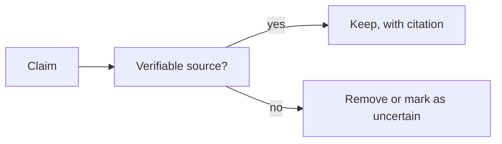

# Contributing to Chemistry Mastery

First: thank you. This repository only becomes useful if chemists, teachers, students
and researchers keep correcting and extending it.

This guide covers **what** to contribute, **how** to write it, and the **quality
gates** your pull request must pass.

---

## 1. Ways to contribute

| Contribution | Where to start |
|---|---|
| Write a missing chapter | [ROADMAP.md](ROADMAP.md) — unchecked items are unclaimed |
| Fix a scientific error | Open an issue tagged `correction` with a source |
| Improve an explanation | Any chapter; keep the section order |
| Add a Mermaid diagram | Chapter section 5, with caption and explanatory paragraph |
| Add exercises or solutions | The level's `exercises/` and `solutions/` folders |
| Improve the tooling | [`scripts/`](scripts) |
| Translate a level | Open an issue first so we can agree on directory naming |

If you are unsure whether a change is wanted, open a **discussion issue** before
writing several thousand words.

---

## 2. Before you write

1. Read [_templates/chapter-template.md](_templates/chapter-template.md). Section
   order is not negotiable — readers navigate by it.
2. Find the chapter's position in [CURRICULUM.md](CURRICULUM.md) and check its
   prerequisites. A chapter that silently assumes untaught material is a bug.
3. Skim two existing chapters at the same level so that tone, depth and notation
   match.
4. Claim the chapter by opening an issue (or commenting on the existing one) so two
   people do not write the same thing.

---

## 3. Writing standards

### 3.1 Science

- **Never invent a fact, a number, an equation or a citation.** If you cannot verify
  it, leave it out.
- **Balance every equation** and show the states: `\ce{2H2(g) + O2(g) -> 2H2O(l)}`.
- **Use IUPAC nomenclature.** Common names may follow in parentheses on first use
  (for example "propan-2-one (acetone)").
- **Use SI units**, with the unit symbol separated from the number by a space
  (`25.0 cm³`, not `25.0cm³`), except for °, ′ and ″.
- **Label models as models.** The Bohr model, VSEPR, the ideal-gas law, the
  steady-state approximation and the Arrhenius equation are all approximations. Say
  what they assume and where they fail.
- **Significant figures must match the data**, not the calculator display.
- **Distinguish** $\Delta H$ (enthalpy change) from $q$ (heat), mass from amount of
  substance, and "weight" from "mass".

### 3.2 Structure

Every substantial chapter follows the fourteen sections of the template. Small
chapters may merge sections, but must still contain: learning objectives,
explanation, at least one diagram, at least one worked example, common mistakes,
summary, exercises and further reading.

### 3.3 Diagrams



The rule above applies to every factual claim you add. For diagrams specifically:

- Use a **fenced ` ```mermaid `** block — never an indented block, never raw HTML.
- Put the **diagram type on the first line** (`flowchart TD`, `sequenceDiagram`, …).
- **Quote node labels** that contain parentheses, slashes, colons or `<br/>`.
- Give every diagram a **bold caption** (`**Figure 3.2 — …**`) followed by a
  paragraph explaining what the reader should conclude.
- Run `python3 scripts/validate_mermaid.py` before pushing.
- If Mermaid cannot represent the chemistry faithfully (orbital shapes, chair
  conformations, stereochemistry), use a balanced equation, a table, or an SVG in
  `assets/structures/` instead of a misleading diagram.

### 3.4 Mathematics

- Display equations: `$$ … $$` on their own lines.
- Inline symbols: `$ … $`.
- Define every symbol immediately after its first appearance, with units.
- Show the algebraic rearrangement in worked examples, then substitute numbers.
- Use `\pu{}` only if the renderer supports it; otherwise write units explicitly.

### 3.5 References

- Cite **author, title, edition, publisher, year, chapter or page** for books.
- Cite **DOI or a stable URL** for papers, and check that the DOI resolves.
- Prefer, in this order: IUPAC recommendations and NIST data → peer-reviewed
  literature → university-level textbooks → reputable encyclopaedias.
- Add every new source to [REFERENCES.md](REFERENCES.md) in the same pull request.
- Wikipedia may be used to *find* sources, never as the cited source for a
  quantitative claim.

---

### 3.6 Keeping the indexes in sync

Chapter titles, numbering, difficulty and study hours live in one place: the
`LEVELS` table at the top of [`scripts/build_indexes.py`](scripts/build_indexes.py).
After adding, renaming or reordering a chapter, edit that table and run:

```bash
python3 scripts/build_indexes.py
```

This rewrites `CURRICULUM.md`, `ROADMAP.md` and the twelve level `README.md` files.
Never hand-edit those generated tables — the next run will overwrite your change.

---

## 4. File and naming conventions

```
NN-kebab-case-title.md          # chapters, numbered within their level folder
exercises/level-N-topic.md      # exercise sets
solutions/level-N-topic.md      # matching solutions
assets/diagrams/<topic>.md      # standalone diagram source, if reused
assets/structures/<name>.svg    # chemical structures
```

- Lower-case, hyphen-separated, ASCII only.
- One H1 per file, matching the file title.
- Relative links only, so the repository works offline and from any mirror.
- No trailing whitespace; no tabs.

---

## 5. Quality gates

Your pull request must pass all four gates.

```bash
python3 scripts/validate_links.py      # every relative link resolves
python3 scripts/validate_mermaid.py    # every Mermaid block is well formed
```

3. **Manual checklist** — [_templates/chapter-review-checklist.md](_templates/chapter-review-checklist.md).
4. **Scientific review** — a second contributor reads the chapter for accuracy.
   For quantitative content, they should re-derive at least one worked example.

CI runs the two scripts on every push and pull request. A red check means the PR
cannot be merged.

---

## 6. Pull-request process

1. Fork, then branch: `git switch -c chapter/level-3-kinetics`.
2. Make focused commits — one logical change per commit.
3. Use the pull-request template; paste the completed checklist.
4. Describe **what changed and why**, and list any source you used for new facts.
5. Address review comments with new commits (do not force-push during review).
6. Squash-merge once approved.

Commit messages follow the conventional style:

```
level3(kinetics): add Arrhenius derivation and three worked examples

Adds the differential and integrated forms of the Arrhenius equation,
derives the two-point form, and adds three worked examples with the
activation energies taken from NIST kinetics tables.

Co-authored-by: ...
```

---

## 7. Adding a new level or section

Adding a whole level is a large change. Open an issue first, and include:

- the intended audience and prerequisites;
- the proposed chapter list, with estimated study time;
- how it connects to existing chapters (both directions);
- at least one fully written sample chapter.

---

## 8. Licensing of contributions

By contributing you agree that your contribution is licensed under the
[MIT License](LICENSE) and that you have the right to submit it. Do not paste text
from textbooks, lecture notes or websites unless the licence permits it and you
attribute the source.
