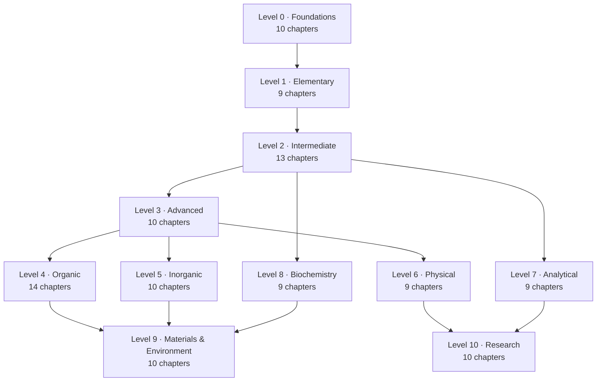

# Curriculum Map

This is the master index of the repository. Every chapter is listed with its
difficulty and prerequisites, so you can plan a route through the material
instead of following the directory numbering blindly.

**Difficulty:** ★☆☆☆☆ = accessible with no background · ★★★★★ = research
fluency expected. **Hours** are realistic estimates for reading, reproducing
the diagrams, and completing the exercises.

---

## Progression at a glance

The graph shows only *hard* dependencies. Within a level, chapters are almost
always sequential; across levels, the arrows mark the minimum prerequisite.

---

## Level 0 — Foundations

**Directory:** [`01-foundations/`](01-foundations/README.md) · **Audience:** Absolute beginner — no prior chemistry · **Chapters:** 10 · **Estimated study time:** ≈ 32 h

The vocabulary and mental models that every later chapter assumes: what chemistry studies, how matter is classified, how it changes state, how atoms and molecules are written down, how measurements are made, and how to work safely.

| # | Chapter | Difficulty | Hours | Prerequisites |
|---|---|---|---|---|
| 1 | [What Is Chemistry?](01-foundations/01-what-is-chemistry.md) | ★☆☆☆☆ | 3 | None |
| 2 | [Matter and Its Classification](01-foundations/02-matter-and-its-classification.md) | ★☆☆☆☆ | 3 | Ch. 1 |
| 3 | [Solids, Liquids, Gases and Plasma](01-foundations/03-states-of-matter.md) | ★☆☆☆☆ | 3 | Ch. 2 |
| 4 | [Physical and Chemical Properties and Changes](01-foundations/04-physical-and-chemical-properties-and-changes.md) | ★☆☆☆☆ | 3 | Ch. 2–3 |
| 5 | [Elements, Compounds and Mixtures](01-foundations/05-elements-compounds-and-mixtures.md) | ★☆☆☆☆ | 3 | Ch. 2, 4 |
| 6 | [Atoms, Molecules and Ions](01-foundations/06-atoms-molecules-and-ions.md) | ★☆☆☆☆ | 3 | Ch. 5 |
| 7 | [Introduction to the Periodic Table](01-foundations/07-introduction-to-the-periodic-table.md) | ★★☆☆☆ | 3 | Ch. 6 |
| 8 | [Chemical Symbols and Formulas](01-foundations/08-chemical-symbols-and-formulas.md) | ★★☆☆☆ | 3 | Ch. 6–7 |
| 9 | [Measurement, Units and Significant Figures](01-foundations/09-measurement-units-and-significant-figures.md) | ★★☆☆☆ | 4 | Ch. 1–8 |
| 10 | [Laboratory Safety, Equipment and the Scientific Method](01-foundations/10-laboratory-safety-equipment-and-methods.md) | ★★☆☆☆ | 4 | Ch. 1–9 |

## Level 1 — Elementary Chemistry

**Directory:** [`02-elementary-chemistry/`](02-elementary-chemistry/README.md) · **Audience:** GCSE / early high-school chemistry · **Chapters:** 9 · **Estimated study time:** ≈ 49 h

The structure of the atom, the logic of the periodic table, the three primary bonding models, Lewis structures, nomenclature and the balanced chemical equation.

| # | Chapter | Difficulty | Hours | Prerequisites |
|---|---|---|---|---|
| 1 | [Atomic Structure](02-elementary-chemistry/01-atomic-structure.md) | ★★☆☆☆ | 5 | Level 0 in full |
| 2 | [Isotopes and Atomic Mass](02-elementary-chemistry/02-isotopes-and-atomic-mass.md) | ★★☆☆☆ | 4 | Ch. 1 |
| 3 | [Electron Shells, Orbitals and Configurations](02-elementary-chemistry/03-electron-shells-and-electron-configurations.md) | ★★★☆☆ | 6 | Ch. 1–2 |
| 4 | [Periodic Table Organization and Periodic Trends](02-elementary-chemistry/04-periodic-table-organization-and-periodic-trends.md) | ★★★☆☆ | 6 | Ch. 1–3 |
| 5 | [Chemical Bonding: Ionic, Covalent and Metallic](02-elementary-chemistry/05-chemical-bonding.md) | ★★★☆☆ | 7 | Ch. 3–4 |
| 6 | [Lewis Structures and Chemical Formulas](02-elementary-chemistry/06-lewis-structures-and-chemical-formulas.md) | ★★★☆☆ | 5 | Ch. 5 |
| 7 | [Chemical Nomenclature](02-elementary-chemistry/07-chemical-nomenclature.md) | ★★☆☆☆ | 5 | Ch. 5–6 |
| 8 | [Chemical Reactions, Balancing and Conservation of Mass](02-elementary-chemistry/08-chemical-reactions-and-balancing-equations.md) | ★★★☆☆ | 6 | Ch. 5–7 |
| 9 | [Introduction to Acids and Bases](02-elementary-chemistry/09-introduction-to-acids-and-bases.md) | ★★★☆☆ | 5 | Ch. 7–8 |

## Level 2 — High School / Intermediate Chemistry

**Directory:** [`03-intermediate-chemistry/`](03-intermediate-chemistry/README.md) · **Audience:** High school / first-year university · **Chapters:** 13 · **Estimated study time:** ≈ 90 h

Quantitative chemistry: the mole, stoichiometry, solutions, gases, intermolecular forces, molecular shape, thermochemistry, rates, equilibrium, pH, redox and solubility.

| # | Chapter | Difficulty | Hours | Prerequisites |
|---|---|---|---|---|
| 1 | [The Mole Concept and Avogadro's Constant](03-intermediate-chemistry/01-the-mole-concept.md) | ★★★☆☆ | 6 | Level 1 in full |
| 2 | [Stoichiometry, Limiting Reactants and Percentage Yield](03-intermediate-chemistry/02-stoichiometry-and-limiting-reactants.md) | ★★★☆☆ | 8 | Ch. 1 |
| 3 | [Solutions, Concentration and Dilution](03-intermediate-chemistry/03-solutions-concentration-and-dilution.md) | ★★★☆☆ | 6 | Ch. 1–2 |
| 4 | [Gas Laws and the Ideal Gas Equation](03-intermediate-chemistry/04-gas-laws-and-the-ideal-gas-equation.md) | ★★★☆☆ | 7 | Ch. 1–3 |
| 5 | [Intermolecular Forces](03-intermediate-chemistry/05-intermolecular-forces.md) | ★★★☆☆ | 6 | Level 1 Ch. 5 |
| 6 | [Molecular Geometry and VSEPR Theory](03-intermediate-chemistry/06-molecular-geometry-and-vsepr-theory.md) | ★★★☆☆ | 6 | Level 1 Ch. 3, 6 |
| 7 | [Hybridization and Molecular Polarity](03-intermediate-chemistry/07-hybridization-and-molecular-polarity.md) | ★★★★☆ | 7 | Ch. 5–6 |
| 8 | [Thermochemistry and Enthalpy](03-intermediate-chemistry/08-thermochemistry-and-enthalpy.md) | ★★★★☆ | 8 | Ch. 2, 4 |
| 9 | [Reaction Rates](03-intermediate-chemistry/09-reaction-rates.md) | ★★★☆☆ | 6 | Ch. 2, 8 |
| 10 | [Chemical Equilibrium and Le Châtelier's Principle](03-intermediate-chemistry/10-chemical-equilibrium-and-le-chateliers-principle.md) | ★★★★☆ | 8 | Ch. 9 |
| 11 | [Acid–Base Chemistry, pH and pOH](03-intermediate-chemistry/11-acid-base-chemistry-and-ph.md) | ★★★★☆ | 8 | Ch. 3, 10 |
| 12 | [Oxidation–Reduction and Electrochemistry Fundamentals](03-intermediate-chemistry/12-redox-reactions-and-electrochemistry-fundamentals.md) | ★★★★☆ | 8 | Ch. 2, 10 |
| 13 | [Solubility and Precipitation](03-intermediate-chemistry/13-solubility-and-precipitation.md) | ★★★★☆ | 6 | Ch. 3, 10 |

## Level 3 — Advanced Chemistry

**Directory:** [`04-advanced-chemistry/`](04-advanced-chemistry/README.md) · **Audience:** Undergraduate chemistry · **Chapters:** 10 · **Estimated study time:** ≈ 89 h

The undergraduate core: quantum mechanics and orbitals, molecular orbital theory, chemical thermodynamics, kinetics and mechanisms, catalysis, advanced equilibria, electrochemistry, coordination chemistry and spectroscopy.

| # | Chapter | Difficulty | Hours | Prerequisites |
|---|---|---|---|---|
| 1 | [Quantum Mechanics Foundations](04-advanced-chemistry/01-quantum-mechanics-foundations.md) | ★★★★★ | 10 | Level 2 Ch. 11; calculus |
| 2 | [Atomic Orbitals, Quantum Numbers and Advanced Configurations](04-advanced-chemistry/02-atomic-orbitals-and-quantum-numbers.md) | ★★★★☆ | 8 | Ch. 1 |
| 3 | [Molecular Orbital Theory](04-advanced-chemistry/03-molecular-orbital-theory.md) | ★★★★★ | 9 | Ch. 2; Level 1 Ch. 6 |
| 4 | [Chemical Thermodynamics: Entropy and Gibbs Energy](04-advanced-chemistry/04-chemical-thermodynamics.md) | ★★★★☆ | 10 | Level 2 Ch. 8 |
| 5 | [Chemical Kinetics and Reaction Mechanisms](04-advanced-chemistry/05-chemical-kinetics-and-reaction-mechanisms.md) | ★★★★☆ | 9 | Level 2 Ch. 9 |
| 6 | [Catalysis](04-advanced-chemistry/06-catalysis.md) | ★★★★☆ | 6 | Ch. 5 |
| 7 | [Advanced Equilibrium: Buffers and Solubility Product](04-advanced-chemistry/07-advanced-equilibrium-buffers-and-solubility-product.md) | ★★★★☆ | 8 | Level 2 Ch. 10–11, 13 |
| 8 | [Electrochemical Cells, the Nernst Equation and Electrolysis](04-advanced-chemistry/08-electrochemical-cells-nernst-equation-and-electrolysis.md) | ★★★★☆ | 9 | Level 2 Ch. 12; Ch. 4 |
| 9 | [Coordination Chemistry, Crystal Field and Ligand Field Theory](04-advanced-chemistry/09-coordination-chemistry-and-crystal-field-theory.md) | ★★★★★ | 10 | Ch. 2–3 |
| 10 | [Advanced Spectroscopy: UV–Vis, IR, NMR and Mass Spectrometry](04-advanced-chemistry/10-advanced-spectroscopy.md) | ★★★★★ | 10 | Ch. 2; Level 2 Ch. 6 |

## Level 4 — Organic Chemistry

**Directory:** [`05-organic-chemistry/`](05-organic-chemistry/README.md) · **Audience:** Undergraduate organic chemistry · **Chapters:** 14 · **Estimated study time:** ≈ 109 h

Structure, stereochemistry and the mechanistic logic of carbon chemistry, moving from functional groups and nomenclature to named reactions, pericyclic chemistry and retrosynthetic design.

| # | Chapter | Difficulty | Hours | Prerequisites |
|---|---|---|---|---|
| 1 | [Introduction to Organic Chemistry](05-organic-chemistry/01-introduction-to-organic-chemistry.md) | ★★★☆☆ | 5 | Level 1 Ch. 5; Level 2 Ch. 7 |
| 2 | [Functional Groups and IUPAC Nomenclature](05-organic-chemistry/02-functional-groups-and-iupac-nomenclature.md) | ★★★☆☆ | 7 | Ch. 1 |
| 3 | [Isomerism and Stereochemistry](05-organic-chemistry/03-isomerism-and-stereochemistry.md) | ★★★★☆ | 9 | Ch. 2 |
| 4 | [Conformations and Conformational Analysis](05-organic-chemistry/04-conformations.md) | ★★★★☆ | 7 | Ch. 3 |
| 5 | [Alkanes](05-organic-chemistry/05-alkanes.md) | ★★★☆☆ | 5 | Ch. 2–4 |
| 6 | [Alkenes, Alkynes and Electrophilic Addition](05-organic-chemistry/06-alkenes-alkynes-and-electrophilic-addition.md) | ★★★★☆ | 9 | Ch. 5 |
| 7 | [Aromatic Compounds and Electrophilic Aromatic Substitution](05-organic-chemistry/07-aromatic-compounds-and-electrophilic-aromatic-substitution.md) | ★★★★☆ | 9 | Ch. 6 |
| 8 | [Haloalkanes: Nucleophilic Substitution and Elimination](05-organic-chemistry/08-haloalkanes-substitution-and-elimination.md) | ★★★★☆ | 9 | Ch. 3–6 |
| 9 | [Alcohols, Phenols and Ethers](05-organic-chemistry/09-alcohols-phenols-and-ethers.md) | ★★★★☆ | 8 | Ch. 8 |
| 10 | [Aldehydes, Ketones and Carbonyl Chemistry](05-organic-chemistry/10-aldehydes-ketones-and-carbonyl-chemistry.md) | ★★★★★ | 10 | Ch. 9 |
| 11 | [Carboxylic Acids, Esters, Amines and Amides](05-organic-chemistry/11-carboxylic-acids-esters-and-amines.md) | ★★★★☆ | 9 | Ch. 10 |
| 12 | [Oxidation, Reduction and Organometallic Chemistry](05-organic-chemistry/12-oxidation-reduction-and-organometallic-chemistry.md) | ★★★★★ | 8 | Ch. 9–11 |
| 13 | [Pericyclic Reactions](05-organic-chemistry/13-pericyclic-reactions.md) | ★★★★★ | 6 | Ch. 6–7 |
| 14 | [Retrosynthetic Analysis and Synthesis Strategy](05-organic-chemistry/14-retrosynthetic-analysis-and-synthesis-strategy.md) | ★★★★★ | 8 | Ch. 8–13 |

## Level 5 — Inorganic Chemistry

**Directory:** [`06-inorganic-chemistry/`](06-inorganic-chemistry/README.md) · **Audience:** Undergraduate inorganic chemistry · **Chapters:** 10 · **Estimated study time:** ≈ 80 h

The chemistry of everything that is not primarily carbon: main-group trends, transition-metal coordination and organometallic chemistry, bioinorganic systems, solid-state structures, magnetism and f-block elements.

| # | Chapter | Difficulty | Hours | Prerequisites |
|---|---|---|---|---|
| 1 | [Periodic Chemistry and the Main-Group Elements](06-inorganic-chemistry/01-periodic-chemistry-and-main-group-elements.md) | ★★★☆☆ | 8 | Level 1 Ch. 4; Level 2 Ch. 5 |
| 2 | [Transition Metals](06-inorganic-chemistry/02-transition-metals.md) | ★★★★☆ | 8 | Ch. 1; Level 3 Ch. 9 |
| 3 | [Coordination Compounds](06-inorganic-chemistry/03-coordination-compounds.md) | ★★★★☆ | 8 | Level 3 Ch. 9 |
| 4 | [Organometallic Compounds](06-inorganic-chemistry/04-organometallic-compounds.md) | ★★★★★ | 9 | Ch. 2–3; Level 4 Ch. 12 |
| 5 | [Bioinorganic Chemistry](06-inorganic-chemistry/05-bioinorganic-chemistry.md) | ★★★★★ | 7 | Ch. 2–3; Level 8 Ch. 3 |
| 6 | [Solid-State Chemistry: Crystal Structures and Defects](06-inorganic-chemistry/06-solid-state-chemistry-crystal-structures-and-defects.md) | ★★★★★ | 9 | Ch. 1; Level 3 Ch. 4 |
| 7 | [Magnetic and Electronic Properties](06-inorganic-chemistry/07-magnetic-and-electronic-properties.md) | ★★★★★ | 7 | Ch. 2, 6 |
| 8 | [Inorganic Reaction Mechanisms](06-inorganic-chemistry/08-inorganic-reaction-mechanisms.md) | ★★★★★ | 8 | Ch. 3–4 |
| 9 | [Lanthanides and Actinides](06-inorganic-chemistry/09-lanthanides-and-actinides.md) | ★★★★★ | 7 | Ch. 2, 7 |
| 10 | [Descriptive Inorganic Chemistry](06-inorganic-chemistry/10-descriptive-inorganic-chemistry.md) | ★★★☆☆ | 9 | Ch. 1–9 |

## Level 6 — Physical Chemistry

**Directory:** [`07-physical-chemistry/`](07-physical-chemistry/README.md) · **Audience:** Advanced undergraduate / postgraduate entry · **Chapters:** 9 · **Estimated study time:** ≈ 87 h

The quantitative framework: classical and statistical thermodynamics, quantum chemistry, molecular spectroscopy, reaction dynamics, surfaces, colloids, photochemistry and computational methods.

| # | Chapter | Difficulty | Hours | Prerequisites |
|---|---|---|---|---|
| 1 | [Classical Thermodynamics](07-physical-chemistry/01-classical-thermodynamics.md) | ★★★★★ | 11 | Level 3 Ch. 4; multivariable calculus |
| 2 | [Statistical Thermodynamics and Statistical Mechanics](07-physical-chemistry/02-statistical-thermodynamics-and-statistical-mechanics.md) | ★★★★★ | 11 | Ch. 1; Level 3 Ch. 1 |
| 3 | [Quantum Chemistry](07-physical-chemistry/03-quantum-chemistry.md) | ★★★★★ | 12 | Level 3 Ch. 1–3; linear algebra |
| 4 | [Molecular Spectroscopy](07-physical-chemistry/04-molecular-spectroscopy.md) | ★★★★★ | 10 | Ch. 3; Level 3 Ch. 10 |
| 5 | [Chemical Kinetics and Reaction Dynamics](07-physical-chemistry/05-chemical-kinetics-and-reaction-dynamics.md) | ★★★★★ | 10 | Level 3 Ch. 5; Ch. 2 |
| 6 | [Surface Chemistry and Colloids](07-physical-chemistry/06-surface-chemistry-and-colloids.md) | ★★★★★ | 8 | Ch. 1 |
| 7 | [Photochemistry](07-physical-chemistry/07-photochemistry.md) | ★★★★★ | 8 | Ch. 3–4 |
| 8 | [Electrochemical Thermodynamics](07-physical-chemistry/08-electrochemical-thermodynamics.md) | ★★★★★ | 8 | Ch. 1; Level 3 Ch. 8 |
| 9 | [Computational Physical Chemistry](07-physical-chemistry/09-computational-physical-chemistry.md) | ★★★★★ | 9 | Ch. 3; Ch. 2 |

## Level 7 — Analytical Chemistry

**Directory:** [`08-analytical-chemistry/`](08-analytical-chemistry/README.md) · **Audience:** Undergraduate / practising analyst · **Chapters:** 9 · **Estimated study time:** ≈ 69 h

How a number becomes trustworthy: sampling, uncertainty, calibration and validation, classical wet methods, titrations, chromatography, spectroscopic analysis and electroanalytical measurement.

| # | Chapter | Difficulty | Hours | Prerequisites |
|---|---|---|---|---|
| 1 | [Introduction to Analytical Chemistry](08-analytical-chemistry/01-introduction-to-analytical-chemistry.md) | ★★★☆☆ | 5 | Level 2 in full |
| 2 | [Sampling and Sample Preparation](08-analytical-chemistry/02-sampling-and-sample-preparation.md) | ★★★★☆ | 6 | Ch. 1 |
| 3 | [Errors, Uncertainty and Statistical Data Treatment](08-analytical-chemistry/03-errors-uncertainty-and-statistical-data-treatment.md) | ★★★★☆ | 8 | Ch. 1; basic statistics |
| 4 | [Calibration, Validation and Quantitative Analysis](08-analytical-chemistry/04-calibration-validation-and-quantitative-analysis.md) | ★★★★☆ | 8 | Ch. 3 |
| 5 | [Gravimetric and Volumetric Analysis](08-analytical-chemistry/05-gravimetric-and-volumetric-analysis.md) | ★★★★☆ | 7 | Ch. 2–4 |
| 6 | [Titrations: Acid–Base, Redox and Complexometric](08-analytical-chemistry/06-titrations.md) | ★★★★☆ | 8 | Level 2 Ch. 11–13; Ch. 5 |
| 7 | [Chromatography: GC, LC and HPLC](08-analytical-chemistry/07-chromatography.md) | ★★★★★ | 10 | Ch. 2–4 |
| 8 | [Spectroscopic Analysis](08-analytical-chemistry/08-spectroscopic-analysis.md) | ★★★★★ | 9 | Level 3 Ch. 10; Ch. 4 |
| 9 | [Electroanalytical Chemistry and Potentiometry](08-analytical-chemistry/09-electroanalytical-chemistry-and-potentiometry.md) | ★★★★★ | 8 | Level 3 Ch. 8; Ch. 4 |

## Level 8 — Biochemistry

**Directory:** [`09-biochemistry/`](09-biochemistry/README.md) · **Audience:** Undergraduate biochemistry · **Chapters:** 9 · **Estimated study time:** ≈ 75 h

The chemistry of living systems: water and non-covalent interactions, amino acids and proteins, enzymes, carbohydrates, lipids, nucleic acids, metabolism, photosynthesis and regulation.

| # | Chapter | Difficulty | Hours | Prerequisites |
|---|---|---|---|---|
| 1 | [Water and Biological Systems](09-biochemistry/01-water-and-biological-systems.md) | ★★★☆☆ | 6 | Level 2 Ch. 5, 11 |
| 2 | [Amino Acids and Proteins](09-biochemistry/02-amino-acids-and-proteins.md) | ★★★★☆ | 9 | Ch. 1; Level 4 Ch. 3 |
| 3 | [Enzymes: Kinetics, Mechanism and Regulation](09-biochemistry/03-enzymes.md) | ★★★★★ | 10 | Ch. 2; Level 3 Ch. 5 |
| 4 | [Carbohydrates](09-biochemistry/04-carbohydrates.md) | ★★★★☆ | 7 | Level 4 Ch. 9 |
| 5 | [Lipids and Membranes](09-biochemistry/05-lipids.md) | ★★★★☆ | 7 | Level 4 Ch. 11 |
| 6 | [Nucleic Acids and DNA/RNA Chemistry](09-biochemistry/06-nucleic-acids-and-dna-rna-chemistry.md) | ★★★★★ | 9 | Ch. 4 |
| 7 | [Metabolism and Bioenergetics: Glycolysis, Krebs Cycle, Oxidative Phosphorylation](09-biochemistry/07-metabolism-and-bioenergetics.md) | ★★★★★ | 12 | Ch. 3–5; Level 3 Ch. 4 |
| 8 | [Photosynthesis](09-biochemistry/08-photosynthesis.md) | ★★★★★ | 7 | Ch. 7; Level 6 Ch. 7 |
| 9 | [Molecular Biology and Biochemical Regulation](09-biochemistry/09-molecular-biology-and-biochemical-regulation.md) | ★★★★★ | 8 | Ch. 6–7 |

## Level 9a — Materials and Industrial Chemistry

**Directory:** [`10-materials-and-industrial-chemistry/`](10-materials-and-industrial-chemistry/README.md) · **Audience:** Applied / industrial chemistry · **Chapters:** 6 · **Estimated study time:** ≈ 45 h

Polymers, nanomaterials, semiconductors, batteries, corrosion and the large-scale catalytic and petrochemical processes that underpin industry.

| # | Chapter | Difficulty | Hours | Prerequisites |
|---|---|---|---|---|
| 1 | [Polymer Chemistry](10-materials-and-industrial-chemistry/01-polymer-chemistry.md) | ★★★★☆ | 8 | Level 4 Ch. 6–8 |
| 2 | [Nanochemistry](10-materials-and-industrial-chemistry/02-nanochemistry.md) | ★★★★★ | 7 | Level 5 Ch. 6 |
| 3 | [Materials and Semiconductor Chemistry](10-materials-and-industrial-chemistry/03-materials-and-semiconductor-chemistry.md) | ★★★★★ | 8 | Level 5 Ch. 6–7 |
| 4 | [Battery Chemistry](10-materials-and-industrial-chemistry/04-battery-chemistry.md) | ★★★★★ | 8 | Level 3 Ch. 8; Level 5 Ch. 7 |
| 5 | [Corrosion](10-materials-and-industrial-chemistry/05-corrosion.md) | ★★★★☆ | 6 | Level 3 Ch. 8 |
| 6 | [Catalytic Industrial Processes and Petroleum Chemistry](10-materials-and-industrial-chemistry/06-catalytic-industrial-processes-and-petroleum-chemistry.md) | ★★★★★ | 8 | Level 3 Ch. 6; Level 6 Ch. 6 |

## Level 9b — Environmental Chemistry

**Directory:** [`11-environmental-chemistry/`](11-environmental-chemistry/README.md) · **Audience:** Applied / environmental chemistry · **Chapters:** 4 · **Estimated study time:** ≈ 28 h

Green chemistry principles, atmospheric chemistry and air pollution, natural and contaminated waters, and waste treatment.

| # | Chapter | Difficulty | Hours | Prerequisites |
|---|---|---|---|---|
| 1 | [Green and Sustainable Chemistry](11-environmental-chemistry/01-green-and-sustainable-chemistry.md) | ★★★★☆ | 6 | Level 4 Ch. 1–8 |
| 2 | [Atmospheric Chemistry](11-environmental-chemistry/02-atmospheric-chemistry.md) | ★★★★★ | 8 | Level 6 Ch. 5, 7 |
| 3 | [Water Chemistry and Water Pollution](11-environmental-chemistry/03-water-chemistry-and-pollution.md) | ★★★★☆ | 8 | Level 2 Ch. 11, 13; Level 7 Ch. 8 |
| 4 | [Waste Treatment and Circular Chemistry](11-environmental-chemistry/04-waste-treatment.md) | ★★★★☆ | 6 | Ch. 1–3 |

## Level 10 — University, Postgraduate and Research Chemistry

**Directory:** [`12-research-and-postgraduate-chemistry/`](12-research-and-postgraduate-chemistry/README.md) · **Audience:** Postgraduate / researcher · **Chapters:** 10 · **Estimated study time:** ≈ 90 h

Research-grade theory and practice: advanced quantum chemistry, DFT, molecular dynamics, advanced synthesis and mechanisms, structure elucidation, research design, literature evaluation, reproducibility, ethics and scientific writing.

| # | Chapter | Difficulty | Hours | Prerequisites |
|---|---|---|---|---|
| 1 | [Advanced Quantum Chemistry](12-research-and-postgraduate-chemistry/01-advanced-quantum-chemistry.md) | ★★★★★ | 12 | Level 6 Ch. 3 |
| 2 | [Computational Chemistry and Density Functional Theory](12-research-and-postgraduate-chemistry/02-computational-chemistry-and-density-functional-theory.md) | ★★★★★ | 11 | Ch. 1 |
| 3 | [Molecular Dynamics](12-research-and-postgraduate-chemistry/03-molecular-dynamics.md) | ★★★★★ | 9 | Ch. 1–2; Level 6 Ch. 2 |
| 4 | [Advanced Organic Synthesis](12-research-and-postgraduate-chemistry/04-advanced-organic-synthesis.md) | ★★★★★ | 10 | Level 4 in full |
| 5 | [Advanced Reaction Mechanisms](12-research-and-postgraduate-chemistry/05-advanced-reaction-mechanisms.md) | ★★★★★ | 9 | Level 4 Ch. 8–13 |
| 6 | [Advanced Spectroscopy and Structure Elucidation](12-research-and-postgraduate-chemistry/06-advanced-spectroscopy-and-structure-elucidation.md) | ★★★★★ | 10 | Level 3 Ch. 10; Level 6 Ch. 4 |
| 7 | [Research Methodology and Experimental Design](12-research-and-postgraduate-chemistry/07-research-methodology-and-experimental-design.md) | ★★★★☆ | 8 | Level 7 Ch. 3–4 |
| 8 | [Scientific Literature and Critical Evaluation](12-research-and-postgraduate-chemistry/08-scientific-literature-and-critical-evaluation.md) | ★★★★☆ | 6 | None |
| 9 | [Scientific Data Analysis and Reproducibility](12-research-and-postgraduate-chemistry/09-scientific-data-analysis-and-reproducibility.md) | ★★★★★ | 8 | Ch. 7 |
| 10 | [Research Ethics and Scientific Writing](12-research-and-postgraduate-chemistry/10-research-ethics-and-scientific-writing.md) | ★★★★☆ | 7 | Ch. 7–9 |

---

## Support tracks

| Track | Contents | Entry point |
|---|---|---|
| Learning guide | Study methods, prerequisite maps, assessment | [00-learning-guide/learning-path.md](00-learning-guide/learning-path.md) |
| Laboratory | Safety, equipment, techniques, calculations, documentation | [13-laboratory/README.md](13-laboratory/README.md) |
| Problem solving | Worked examples, exercise banks, quizzes, solutions | [14-problem-solving/README.md](14-problem-solving/README.md) |
| Visual learning | Diagram-first galleries | [15-visual-learning/README.md](15-visual-learning/README.md) |
| Glossary and references | Terminology and bibliography | [GLOSSARY.md](GLOSSARY.md) · [REFERENCES.md](REFERENCES.md) |

---

## Totals

| | |
|---|---|
| Chapters | 113 |
| Estimated study time | ≈ 843 h |
| Levels | 12 |

Hours are a planning aid, not a promise. A reader with a strong maths
background will move faster through Levels 3 and 6; a reader meeting
thermodynamics for the first time should budget more.
