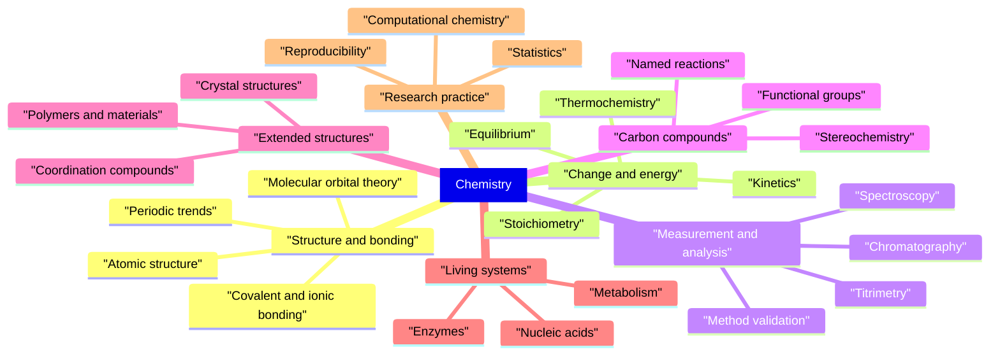

# Glossary

A glossary is a contract about vocabulary. This one fixes the preferred term for
each concept in the curriculum, records the alternatives a reader will meet in
examinations and in the literature, and states the symbol and unit that the term
carries. It spans Levels 0–10: from the classification of matter to density
functional theory.

The entries are deliberately short. Each one identifies a concept, distinguishes it
from its nearest neighbour, and points to the chapter where the concept is developed
properly. Definitions are written to be read on their own, but they are not a
substitute for the derivation, the diagram and the worked example in the chapter.

**Figure 1 — The branches of chemistry covered by the glossary.** The seven
branches are the organizing themes of the curriculum; the entries themselves are
arranged alphabetically, so a term is found by its name rather than by its branch.

## How to read an entry

- **Bold** marks the preferred term. It is the term used elsewhere in the
  repository.
- Parentheses after the preferred term list accepted alternatives: IUPAC variants,
  retained common names, and spellings that a reader may encounter. Alternatives
  are not errors; they are cross-references.
- *(Obsolete)* marks a term that is historically important but no longer
  recommended. *(Discouraged)* marks a term that survives in laboratories but
  conflicts with IUPAC usage. Both labels appear in italics in parentheses after
  the preferred term.
- *Symbol:* gives the italic symbol and, in parentheses, the coherent SI unit.
  Dimensionless quantities are labelled explicitly.
- *See:* links to the chapter that introduces the term in context. Where the
  chapter is still being written, the link points to the level index; where no
  chapter covers the term, no link is given.

**Figure 2 — How to use an entry.** The four fields of an entry answer four
different questions: what the concept is called, what else it is called, how it is
quantified, and where it is taught.

### Ordering

Entries are ordered letter by letter by the preferred term, ignoring spaces,
hyphens, apostrophes and other punctuation. Thus *d-block* is filed under D,
*van der Waals* under V, and *pH* under P.

### Scope and level

Each definition is written at the level at which the term is introduced. A Level 1
definition of *element* does not mention isotopes; a Level 10 definition of *basis
set* assumes linear algebra. The glossary does not attempt to be a textbook, and a
term that is defined simply here may be refined later in the curriculum — the link
identifies where.

### Spelling

The repository uses Oxford British spelling: *-ize* and *-yze*, *-our*, *-re*,
*licence* as a noun, and a doubled *l* before a suffix (*labelled*, *modelling*).
Element names follow IUPAC: *sulfur*, *aluminium*, *caesium*.

---

## Greek letters and symbols used

| Symbol | Name | Used in this glossary for |
|---|---|---|
| $\alpha$ | alpha | degree of dissociation; specific rotation $[\alpha]$; polarizability |
| $\beta$ | beta | anomer designation; beta particle |
| $\gamma$ | gamma | activity coefficient; gyromagnetic ratio; surface tension |
| $\delta$ | delta | chemical shift (ppm); partial charge |
| $\Delta$ | Delta | finite change in a state function; ligand-field splitting $\Delta_\mathrm{o}$ |
| $\varepsilon$ | epsilon | molar absorptivity |
| $\eta$ | eta | viscosity; hapticity; overpotential |
| $\theta$ | theta | Bragg diffraction angle; contact angle |
| $\kappa$ | kappa | conductivity |
| $\lambda$ | lambda | wavelength |
| $\mu$ | mu | dipole moment; chemical potential; the prefix micro- |
| $\nu$ | nu | frequency; stoichiometric coefficient |
| $\tilde{\nu}$ | nu with tilde | wavenumber |
| $\pi$ | pi | pi bond; osmotic pressure |
| $\rho$ | rho | density; charge density |
| $\sigma$ | sigma | sigma bond; standard deviation; shielding constant |
| $\Phi$ | Phi | quantum yield |
| $\chi$ | chi | electronegativity |
| $\psi$ | psi | wavefunction |
| $\omega$ | omega | angular frequency; mass fraction |
| $\nabla$ | nabla | gradient operator; $\nabla^2$ is the Laplacian |

## SI prefixes

| Prefix | Symbol | Factor | Prefix | Symbol | Factor |
|---|---|---|---|---|---|
| quecto | q | $10^{-30}$ | deca | da | $10^{1}$ |
| ronto | r | $10^{-27}$ | hecto | h | $10^{2}$ |
| yocto | y | $10^{-24}$ | kilo | k | $10^{3}$ |
| zepto | z | $10^{-21}$ | mega | M | $10^{6}$ |
| atto | a | $10^{-18}$ | giga | G | $10^{9}$ |
| femto | f | $10^{-15}$ | tera | T | $10^{12}$ |
| pico | p | $10^{-12}$ | peta | P | $10^{15}$ |
| nano | n | $10^{-9}$ | exa | E | $10^{18}$ |
| micro | µ | $10^{-6}$ | zetta | Z | $10^{21}$ |
| milli | m | $10^{-3}$ | yotta | Y | $10^{24}$ |
| centi | c | $10^{-2}$ | ronna | R | $10^{27}$ |
| deci | d | $10^{-1}$ | quetta | Q | $10^{30}$ |

The four prefixes added in 2022 — quecto, ronto, ronna and quetta — extend the
range of the SI to $10^{\pm 30}$. Prefixes apply to the unit as a whole, not to the
numerator of a compound unit: $1\ \mathrm{mmol\ dm^{-3}}$ is $10^{-3}\ \mathrm{mol\ dm^{-3}}$.

## Index of sections

| Section | Principal coverage |
|---|---|
| [A](#a) | Measurement, acids, atomic structure, aromaticity |
| [B](#b) | Bases, bonding, Beer–Lambert, buffers |
| [C](#c) | Calibration, carbonyl chemistry, chirality, chromatography |
| [D](#d) | Dalton's laws, d-block, DFT, dispersion, DNA |
| [E](#e) | Electrochemistry, electron configuration, enthalpy, enzymes |
| [F](#f) | Faraday, functional groups, Fischer projections, FTIR |
| [G](#g) | Galvanic cells, Gibbs energy, greenhouse gases, Grignard |
| [H](#h) | Half-life, heat, Hess's law, Hund's rule, Hückel's rule |
| [I](#i) | Ideal gas, indicators, ionization energy, isotopes |
| [J](#j) | Jablonski diagrams, Jahn–Teller effect, the joule |
| [K](#k) | Kelvin, ketones, kinetic isotope effects |
| [L](#l) | Lanthanides, lattice energy, Le Châtelier, ligands |
| [M](#m) | Molar quantities, mass spectrometry, Michaelis–Menten |
| [N](#n) | Nernst equation, NMR, nucleic acids, nucleophiles |
| [O](#o) | Octet rule, optical activity, oxidation, orbitals |
| [P](#p) | pH, pKa, polymers, proteins, p-hacking |
| [Q](#q) | Quantum numbers, quantum yield, quaternary structure |
| [R](#r) | Rate laws, redox, retention, reproducibility, RSD |
| [S](#s) | Spectroscopy, stereochemistry, stoichiometry, statistics |
| [T](#t) | Temperature, thermodynamics, titration, transition states |
| [U](#u) | Uncertainty, unit cells, UV–Vis, unsaturated compounds |
| [V](#v) | Valence, vapour pressure, viscosity, VSEPR |
| [W](#w) | Wavefunctions, wavenumber, work, Wittig reaction |
| [X](#x) | X-ray diffraction, X-ray fluorescence, XPS |
| [Y](#y) | Ylides, Young–Laplace equation |
| [Z](#z) | Zaitsev's rule, Zeeman effect, zeolites, zwitterions |

---

## A

- **absorbance** (optical density) — a logarithmic measure of the radiant power removed from a beam by a sample, $A = \log_{10}(P_0/P)$. It is dimensionless and additive for non-interacting absorbers. *Symbol:* $A$ (dimensionless). *See:* [Level 7 — Analytical Chemistry](08-analytical-chemistry/README.md).
- **absorption** — the transfer of energy from electromagnetic radiation to a species, which is promoted to a higher energy level. In spectroscopy the term refers to photons removed from a beam; it is distinct from adsorption at a surface.
- **accuracy** — the closeness of a measured value to the true or accepted value. Accuracy is limited by systematic error and is quantified as bias; it is independent of precision.
- **acid** — a species that donates a proton to a base (Brønsted–Lowry) or accepts an electron pair from a Lewis base. The two definitions answer different questions and neither is universally preferred. *See:* [Level 2 — High School / Intermediate Chemistry](03-intermediate-chemistry/README.md).
- **acid deposition** — the transfer of acidic species from the atmosphere to the Earth's surface by wet deposition (rain, snow, fog) or dry deposition (particles and gases). It acidifies soils and fresh water and damages buildings.
- **acid dissociation constant** ($K_\mathrm{a}$) — the equilibrium constant for $\ce{HA + H2O <=> H3O+ + A-}$, written with activities so that it is dimensionless. Its negative decadic logarithm is $\mathrm{p}K_\mathrm{a}$. *Symbol:* $K_\mathrm{a}$ (dimensionless).
- **acid–base titration** — a volumetric method in which a standard solution of an acid or base is added until the protons of the analyte are exactly neutralized. The equivalence point is detected with an indicator or a pH electrode.
- **activated complex** (transition state) — the configuration at the maximum of the minimum-energy path between reactants and products. It is a transient arrangement, not an isolable intermediate, and its energy relative to the reactants is the activation barrier.
- **activation energy** ($E_\mathrm{a}$) — the empirical parameter in the Arrhenius equation that measures how strongly the rate constant rises with temperature. It approximates the height of the energy barrier but is not identical to it for a complex reaction. *Symbol:* $E_\mathrm{a}$ (J mol⁻¹).
- **active site** — the region of an enzyme at which the substrate binds and the chemical transformation occurs. Its shape and functional groups lower the activation barrier and confer specificity.
- **activity** (thermodynamic activity) — a dimensionless quantity that replaces concentration in exact thermodynamic expressions, $a = \gamma c/c^\circ$, where $\gamma$ is the activity coefficient. In ideal dilute solution $\gamma \to 1$ and activity approaches $c/c^\circ$. *Symbol:* $a$ (dimensionless).
- **adiabatic** — describes a process in which no heat crosses the boundary between system and surroundings, so $q = 0$ and $\Delta U = w$. A rapid compression is approximately adiabatic because heat transfer is too slow to matter.
- **alcohol** (alkanol) — a compound in which a hydroxyl group, –OH, is bonded to a saturated carbon atom. The O–H bond makes the group both a hydrogen-bond donor and a weak acid. *See:* [Level 4 — Organic Chemistry](05-organic-chemistry/README.md).
- **aldehyde** — a carbonyl compound in which the carbonyl carbon carries at least one hydrogen atom, written –CHO. Aldehydes are readily oxidized to carboxylic acids, which distinguishes them from ketones.
- **aldol condensation** — base- or acid-catalyzed addition of an enolate or enol to a carbonyl compound, giving a β-hydroxy carbonyl that may dehydrate to an α,β-unsaturated carbonyl. The reaction forms a carbon–carbon bond and is a standard disconnection in synthesis.
- **aliquot** — a measured portion of a sample or solution taken for analysis. The aliquot volume must be known to convert a measured amount in the portion to a concentration in the original sample.
- **alkali metal** — an element of group 1 of the periodic table, excluding hydrogen. Each atom has one valence $s$ electron, low ionization energy and forms a $+1$ ion.
- **alkaline earth metal** — an element of group 2 of the periodic table, whose atoms have two valence $s$ electrons and form $+2$ ions. The group includes beryllium, magnesium, calcium, strontium, barium and radium.
- **alkane** — a saturated hydrocarbon with the general formula $\ce{C_nH_{2n+2}}$ and no multiple bonds. Alkanes undergo free-radical substitution rather than electrophilic addition. *Symbol:* $n$ (dimensionless).
- **alkene** — a hydrocarbon containing a carbon–carbon double bond, $\ce{C=C}$. The π bond restricts rotation and makes cis–trans isomerism possible.
- **alkyne** — a hydrocarbon containing a carbon–carbon triple bond, $\ce{C#C}$. The linear geometry at each carbon follows from $sp$ hybridization.
- **allotrope** — one of two or more structural forms of the same element in the same physical state, such as diamond and graphite, or dioxygen and ozone. Allotropes differ in bonding and therefore in physical properties.
- **alloy** — a solid solution or intimate mixture of two or more metals, or of a metal with a non-metal, whose bulk properties differ from those of its components. Brass and steel are alloys; the former is substitutional, the latter interstitial.
- **amide** — a compound containing the group –CO–N<, formed formally by replacing the –OH of a carboxylic acid with an amino group. The C–N bond has partial double-bond character, which restricts rotation.
- **amine** — a compound formally derived from ammonia by replacing one or more hydrogen atoms by organic groups, classified as primary, secondary or tertiary. Amines are Brønsted bases because the nitrogen lone pair accepts a proton.
- **amino acid** — a compound containing both an amino group and a carboxyl group. The twenty proteinogenic α-amino acids are joined by peptide bonds and differ in the side chain attached to the α-carbon.
- **amount of substance** ($n$) — the quantity that measures the number of specified elementary entities relative to the Avogadro constant. One mole contains $N_\mathrm{A}$ entities. *Symbol:* $n$ (mol). *See:* [Level 2 — High School / Intermediate Chemistry](03-intermediate-chemistry/README.md).
- **amphiprotic** (amphoteric) — describes a species that can both donate and accept a proton, such as water or the hydrogencarbonate ion. The broader term *amphoteric* also covers species that act as either a Lewis acid or a Lewis base.
- **analyte** — the substance whose identity or amount is to be determined in an analysis. Every other component of the sample is, by definition, part of the matrix.
- **anion** — a negatively charged ion, formed by gain of one or more electrons. The name is pronounced with the stress on the first syllable and is not a synonym for *anode*.
- **anode** — the electrode at which oxidation occurs. In a galvanic cell the anode is the negative terminal; in an electrolytic cell it is the positive terminal, because the definitions rest on the reaction, not on the sign.
- **anomer** — one of two cyclic stereoisomers of a monosaccharide that differ only in the configuration at the anomeric carbon, the hemiacetal or hemiketal carbon. In the D-series the α anomer has the anomeric hydroxyl on the opposite side of the ring from the exocyclic $\ce{CH2OH}$ group, and the β anomer has it on the same side.
- **antibonding orbital** — a molecular orbital that has a node between the nuclei and is higher in energy than the atomic orbitals from which it is formed. Occupation of an antibonding orbital weakens or breaks the bond.
- **aromaticity** — the property of a cyclic, planar, fully conjugated system that contains $4n+2$ π electrons (Hückel's rule) and is stabilized by cyclic delocalization. Benzene is the reference case; the criterion is electronic, not olfactory.
- **Arrhenius equation** — the empirical relation $k = A\exp(-E_\mathrm{a}/RT)$ between the rate constant and temperature. The pre-exponential factor $A$ is called the frequency factor. *Symbols:* $k$ (depends on order), $A$ (same units as $k$), $E_\mathrm{a}$ (J mol⁻¹).
- **atom** — the smallest electrically neutral unit of an element that retains its chemical identity. It consists of a nucleus of protons and neutrons surrounded by electrons.
- **atomic mass unit** (unified atomic mass unit, dalton) — one-twelfth of the mass of a carbon-12 atom, equal to $1.660\,539 \times 10^{-27}\ \mathrm{kg}$. It is used for atomic and molecular masses. *Symbol:* $u$ (kg); the alternative symbol is Da. *See:* [Atomic Structure](02-elementary-chemistry/01-atomic-structure.md).
- **atomic number** ($Z$) — the number of protons in the nucleus of an atom, which defines the element. It is a dimensionless integer and is written as a left subscript in nuclide notation. *Symbol:* $Z$ (dimensionless). *See:* [Atomic Structure](02-elementary-chemistry/01-atomic-structure.md).
- **atomic orbital** — a one-electron wavefunction describing the region of space in which an electron in an atom may be found. Each orbital is specified by the quantum numbers $n$, $l$ and $m_l$ and can hold two electrons of opposite spin.
- **atomic radius** — half the distance between the nuclei of two bonded or touching atoms of the same element. The value depends on the definition used, so covalent, metallic and van der Waals radii are tabulated separately. *Symbol:* $r$ (pm or m).
- **ATP** (adenosine triphosphate) — a nucleotide that carries chemical energy between metabolic reactions, releasing about $30\ \mathrm{kJ\ mol^{-1}}$ on hydrolysis to ADP and phosphate under cellular conditions. It is the universal energy currency of the cell.
- **Aufbau principle** — the rule that the ground-state electron configuration is built by placing electrons in orbitals of increasing energy. It is applied together with the Pauli exclusion principle and Hund's rule. *See:* [Atomic Structure](02-elementary-chemistry/01-atomic-structure.md).
- **Avogadro constant** ($N_\mathrm{A}$) — the number of elementary entities in one mole, fixed at $6.022\,140\,76 \times 10^{23}\ \mathrm{mol^{-1}}$. It converts between the microscopic count and the macroscopic amount. *Symbol:* $N_\mathrm{A}$ (mol⁻¹).
- **azeotrope** — a mixture whose vapour has the same composition as the liquid at a given pressure, so that it boils at constant composition and temperature. Ethanol–water at 95.6 % ethanol by mass is the standard example.
- **azeotropic distillation** — a separation technique that exploits an azeotrope by adding a third component that carries one substance out of the mixture. It is used industrially to dry ethanol.

## B

- **back titration** — a volumetric method in which a known excess of reagent is added to the analyte and the unreacted remainder is titrated with a second standard solution. It is used when the direct reaction is slow or has no sharp endpoint. *See:* [Level 7 — Analytical Chemistry](08-analytical-chemistry/README.md).
- **band gap** ($E_\mathrm{g}$) — the energy separation between the top of the valence band and the bottom of the conduction band in a solid. It determines whether the material is an insulator, a semiconductor or a conductor. *Symbol:* $E_\mathrm{g}$ (eV or J).
- **base** — a species that accepts a proton from an acid (Brønsted–Lowry) or donates an electron pair to a Lewis acid. The strength of a base is described by its conjugate acid's $\mathrm{p}K_\mathrm{a}$.
- **base peak** — the most intense peak in a mass spectrum, assigned a relative abundance of 100 %. Other peaks are reported as percentages of the base peak, not of the molecular ion.
- **basis set** — a finite set of spatial functions, usually atom-centred Gaussians, used to expand the molecular orbitals in a quantum-chemistry calculation. Larger and more flexible basis sets reduce the basis-set error but increase computational cost. *See:* [Level 10 — University, Postgraduate and Research Chemistry](12-research-and-postgraduate-chemistry/README.md).
- **battery** — an electrochemical device consisting of one or more cells that converts stored chemical energy into electrical work. A secondary battery is rechargeable; a primary battery is not.
- **Beer–Lambert law** — the relation $A = \varepsilon c l$ between absorbance, molar absorptivity, concentration and path length for a dilute absorbing species. Deviations occur at high concentration, with polychromatic light, and when the analyte associates. *See:* [Level 7 — Analytical Chemistry](08-analytical-chemistry/README.md).
- **bimolecular** — describes an elementary step in which two species collide and react. The rate of a bimolecular step is proportional to the product of the two concentrations.
- **binary compound** — a compound composed of exactly two elements, such as $\ce{NaCl}$ or $\ce{CO2}$. Naming follows the more electropositive element first, with prefixes for stoichiometry where ambiguity exists.
- **biochemical oxygen demand** (BOD) — the mass of dissolved oxygen consumed by microorganisms while oxidizing the organic matter in a water sample over a stated period, usually five days at 20 °C. It is an empirical measure of organic pollution. *Symbol:* BOD (mg dm⁻³).
- **biochemistry** — the study of the molecules, reactions and regulatory mechanisms of living systems. It draws on organic chemistry for structure and on physical chemistry for energy and kinetics. *See:* [Level 8 — Biochemistry](09-biochemistry/README.md).
- **blank** — a sample that contains every reagent and solvent used in an analysis but none of the analyte. Its response measures the background and is subtracted from sample responses.
- **boiling point** — the temperature at which the vapour pressure of a liquid equals the external pressure, so that vapour bubbles form throughout the liquid. The normal boiling point is quoted at $101\,325\ \mathrm{Pa}$.
- **Boltzmann constant** ($k_\mathrm{B}$) — the proportionality constant between temperature and the mean thermal energy per degree of freedom, fixed at $1.380\,649 \times 10^{-23}\ \mathrm{J\ K^{-1}}$. It is the gas constant per molecule. *Symbol:* $k_\mathrm{B}$ (J K⁻¹).
- **Boltzmann distribution** — the population ratio $N_i/N_j = (g_i/g_j)\exp(-\Delta E/k_\mathrm{B}T)$ for two levels in thermal equilibrium. It explains why higher levels are populated only when $k_\mathrm{B}T$ is comparable to the spacing.
- **bond angle** — the angle between two bonds that meet at a common atom, usually quoted in degrees. It is determined experimentally and rationalized by VSEPR theory and hybridization. *Symbol:* $\theta$ (°).
- **bond dissociation energy** (BDE) — the enthalpy change when one mole of a specified bond is broken homolytically in the gas phase. It refers to one particular bond in one particular molecule, unlike an average bond enthalpy. *Symbol:* $D$ (kJ mol⁻¹).
- **bond enthalpy** — the average enthalpy change per bond when all bonds of a given type are broken in the gas phase. Average values allow estimation of reaction enthalpies but cannot replace precise thermochemical data.
- **bond length** — the equilibrium internuclear distance between two bonded atoms. It decreases with increasing bond order and increases with atomic size. *Symbol:* $r$ (pm).
- **bond order** — in molecular orbital theory, half the difference between the numbers of bonding and antibonding electrons. A bond order of zero predicts that the species does not exist.
- **bonding orbital** — a molecular orbital with enhanced electron density between the nuclei and lower energy than the atomic orbitals from which it is formed. Occupation of a bonding orbital strengthens the bond.
- **Born interpretation** — the postulate that the squared modulus of a wavefunction, $|\psi|^2$, gives the probability density of finding the particle at a point. It converts the wavefunction from a mathematical abstraction into a predictive tool.
- **Born–Haber cycle** — a thermochemical cycle that combines sublimation, ionization, bond dissociation, electron attachment and lattice enthalpy to obtain one unknown quantity from the others. It is an application of Hess's law to ionic solids.
- **Born–Oppenheimer approximation** — the approximation that the nuclei of a molecule move so slowly compared with the electrons that the electronic wavefunction can be solved for fixed nuclear positions. It underlies the concept of a potential energy surface.
- **Boyle's law** — for a fixed amount of gas at constant temperature, pressure is inversely proportional to volume, $pV = \text{constant}$. It is a limiting law that real gases approach at low pressure.
- **Bragg's law** — the condition for constructive diffraction from parallel lattice planes, $n\lambda = 2d\sin\theta$. It converts a measured diffraction angle into an interplanar spacing. *Symbols:* $n$ (dimensionless), $\lambda$ (m), $d$ (m), $\theta$ (°). *See:* [Solid-State Chemistry: Crystal Structures and Defects](06-inorganic-chemistry/06-solid-state-chemistry-crystal-structures-and-defects.md).
- **Bravais lattice** — one of the fourteen distinct three-dimensional arrays of points generated by integer combinations of three translation vectors. Every crystal structure is described by a Bravais lattice plus a basis.
- **Brønsted–Lowry theory** — the acid–base theory in which an acid is a proton donor and a base is a proton acceptor. Every acid has a conjugate base and every base a conjugate acid.
- **buffer** (buffer solution) — a solution that resists change in pH when small amounts of strong acid or base are added. It contains a weak acid and its conjugate base, or a weak base and its conjugate acid, in comparable amounts.
- **buffer capacity** — the amount of strong acid or base that one litre of buffer can absorb with a specified change in pH. It is greatest when the concentrations of the conjugate pair are equal. *Symbol:* $\beta$ (mol dm⁻³).
- **burette** — a graduated vertical tube with a stopcock, used to deliver a measured volume of titrant to within one drop. Readings are taken at the bottom of the meniscus. *See:* [Laboratory](13-laboratory/README.md).

## C

- **Cahn–Ingold–Prelog rules** (CIP rules) — the sequence rules used to assign the descriptors *R*/*S* to stereocentres and *E*/*Z* to double bonds. Substituents are ranked by atomic number, and ties are broken by exploring outward atom by atom. *See:* [Level 4 — Organic Chemistry](05-organic-chemistry/README.md).
- **calibration** — the process of establishing, with standards of known composition, the relation between the response of an instrument and the amount of analyte. Calibration is a measurement operation, not a judgement about whether the method is fit for purpose.
- **calibration curve** (working curve) — a plot of instrument response against the concentration of a series of standards, usually fitted by least squares. The slope is the sensitivity and the intercept estimates the blank response.
- **calorimetry** — the measurement of the heat exchanged in a physical or chemical process. Constant-pressure calorimetry gives $\Delta H$; constant-volume bomb calorimetry gives $\Delta U$.
- **carbohydrate** — a polyhydroxy aldehyde or ketone, or a derivative of one, with the approximate formula $\ce{C_n(H2O)_m}$. Deoxy sugars and amino sugars show that the formula is a guide, not a definition.
- **carbonyl group** — the divalent group $\ce{C=O}$, in which the carbon is electrophilic and the oxygen is basic. Its polarization governs the reactivity of aldehydes, ketones, esters and amides.
- **carboxyl group** — the group –COOH, which combines a carbonyl and a hydroxyl on the same carbon. It is acidic because the conjugate base delocalizes the negative charge over two oxygen atoms.
- **carboxylic acid** — a compound containing the carboxyl group, $\ce{R-COOH}$. Typical $\mathrm{p}K_\mathrm{a}$ values of 4–5 make these weak acids that are deprotonated by aqueous hydrogencarbonate.
- **catabolism** — the set of metabolic pathways that break larger molecules into smaller ones and release energy. It is balanced by anabolism, which consumes energy to build molecules. *See:* [Level 8 — Biochemistry](09-biochemistry/README.md).
- **catalyst** — a substance that increases the rate of a reaction by providing an alternative pathway with a lower Gibbs energy of activation, and is regenerated overall. A catalyst changes the rate and the path, never the position of equilibrium.
- **cathode** — the electrode at which reduction occurs. In a galvanic cell the cathode is the positive terminal; in an electrolytic cell it is the negative terminal.
- **cation** — a positively charged ion, formed by loss of one or more electrons. In ionic solids cations and anions alternate to maintain electrical neutrality.
- **cell potential** ($E_\mathrm{cell}$) — the electromotive force of an electrochemical cell, equal to the difference between the electrode potentials of the cathode and the anode. It is related to the Gibbs energy of reaction by $\Delta G = -nFE_\mathrm{cell}$. *Symbol:* $E_\mathrm{cell}$ (V).
- **certified reference material** (CRM) — a material whose property values are certified by a metrologically valid procedure, with stated uncertainty and traceability to a stated reference. It is the anchor of method validation and proficiency testing.
- **Charles's law** — at constant pressure, the volume of a fixed amount of gas is directly proportional to its thermodynamic temperature. It is a limiting law obeyed closely by real gases at low pressure.
- **chelate** — a complex in which a ligand binds through two or more donor atoms, forming one or more rings with the central metal. Chelation usually increases stability relative to comparable monodentate ligands.
- **chemical equation** — a symbolic statement of a reaction that shows formulas, phases and stoichiometric coefficients. A valid equation is balanced in both atoms and charge.
- **chemical equilibrium** — the dynamic state in which the forward and reverse reactions proceed at equal rates, so that the composition of the system no longer changes. Equilibrium is a property of the whole system, not of a single species.
- **chemical formula** — a representation of the composition of a substance by element symbols and subscripts. Empirical, molecular, structural and skeletal formulas carry different amounts of information.
- **chemical kinetics** — the study of the rates of chemical reactions and of the sequence of elementary steps by which they occur. Kinetics says how fast, thermodynamics says how far. *See:* [Level 3 — Advanced Chemistry](04-advanced-chemistry/README.md).
- **chemical potential** ($\mu_i$) — the partial molar Gibbs energy of component $i$, $\mu_i = (\partial G/\partial n_i)_{T,p,n_{j\neq i}}$. It is the quantity that determines the direction of matter flow and of phase change. *Symbol:* $\mu_i$ (J mol⁻¹).
- **chemical shift** ($\delta$) — the difference between the resonance frequency of a nucleus and that of a reference, divided by the reference frequency and expressed in parts per million. Its field independence makes spectra from different instruments comparable. *Symbol:* $\delta$ (ppm). *See:* [Level 3 — Advanced Chemistry](04-advanced-chemistry/README.md).
- **chirality** — the geometric property of an object that cannot be superimposed on its mirror image. In chemistry the usual cause is a carbon atom bearing four different substituents. *See:* [Isomerism and Stereochemistry](05-organic-chemistry/03-isomerism-and-stereochemistry.md).
- **chromatography** — a separation method in which components distribute themselves differently between a mobile phase and a stationary phase. Differential migration, not differential adsorption alone, is the general principle. *See:* [Level 7 — Analytical Chemistry](08-analytical-chemistry/README.md).
- **chromophore** — the part of a molecule responsible for its absorption of ultraviolet or visible radiation. Conjugation extends the chromophore and usually shifts absorption to longer wavelength.
- **cofactor** — a non-protein species required for the activity of an enzyme, either a metal ion or a small organic molecule. An organic cofactor that is tightly bound is often called a prosthetic group.
- **colligative property** — a property that depends on the number of dissolved particles rather than on their identity. Osmotic pressure, boiling-point elevation, freezing-point depression and vapour-pressure lowering are the four classical examples.
- **collision theory** — a model in which a reaction occurs when molecules collide with at least the activation energy and in a geometry that allows the necessary bonds to form. It explains the temperature dependence of rates but not the details of a mechanism.
- **column chromatography** — chromatography performed in a tube packed with a stationary phase through which the mobile phase flows. It is the basis of preparative separation and of HPLC and GC.
- **combustion** — a rapid, exothermic oxidation of a fuel by dioxygen, usually proceeding by a radical chain mechanism. Complete combustion of a hydrocarbon gives carbon dioxide and water.
- **complex ion** (coordination entity) — an ion consisting of a central metal atom or ion surrounded by ligands. Its charge is the sum of the metal oxidation state and the ligand charges. *See:* [Level 5 — Inorganic Chemistry](06-inorganic-chemistry/README.md).
- **complexometric titration** — a titration in which the titrant is a chelating agent, usually EDTA, that forms a stable 1:1 complex with the metal ion being determined. The endpoint is shown by a metal-ion indicator.
- **composite** — a material made from two or more distinct phases whose combined properties are superior to those of either component alone. Fibre-reinforced polymers and metal matrix composites are examples.
- **concentration** ($c$) — the amount of solute per volume of solution, $c = n/V$. In chemistry the SI-coherent unit is mol m⁻³, but mol dm⁻³ is conventional. *Symbol:* $c$ (mol dm⁻³). *See:* [Level 2 — High School / Intermediate Chemistry](03-intermediate-chemistry/README.md).
- **condensation reaction** — a reaction in which two molecules join with the elimination of a small molecule such as water or methanol. Esterification and peptide-bond formation are condensations.
- **confidence interval** — a range of values, calculated from sample data, within which the true value of a parameter is expected to lie with a stated probability. Its width decreases as the sample size increases.
- **conjugate acid–base pair** — two species that differ by one proton, such as $\ce{CH3COOH}$ and $\ce{CH3COO-}$. The stronger the acid, the weaker its conjugate base.
- **coordinate bond** (dative covalent bond) — a covalent bond in which both electrons of the shared pair originate from the same atom. Once formed it is indistinguishable from any other covalent bond.
- **coordination number** — the number of donor atoms bonded directly to the central atom or ion in a complex. It is not in general equal to the number of ligands, because a ligand may be polydentate.
- **copolymer** — a polymer built from two or more different monomers. The arrangement may be random, alternating, block or graft, and the arrangement changes the properties.
- **corrosion** — the electrochemical degradation of a metal by its environment. It requires an anodic site, a cathodic site, an electrolyte and an electrical connection between the two.
- **coupling constant** ($J$) — the separation in hertz between the lines of a multiplet produced by spin–spin coupling. It is independent of the applied field and reports on the number and arrangement of neighbouring nuclei. *Symbol:* $J$ (Hz).
- **covalent bond** — a bond formed by the sharing of one or more electron pairs between atoms. The sharing lowers the energy of the system relative to the separated atoms. *See:* [Lewis Structures and Chemical Formulas](02-elementary-chemistry/06-lewis-structures-and-chemical-formulas.md).
- **critical point** — the end of the liquid–vapour coexistence curve, defined by a critical temperature $T_\mathrm{c}$ and critical pressure $p_\mathrm{c}$. Above that point the two phases are indistinguishable and the substance is a supercritical fluid. *Symbols:* $T_\mathrm{c}$ (K), $p_\mathrm{c}$ (Pa).
- **crystal field theory** — an electrostatic model in which ligands are treated as point charges or dipoles that split the energies of the metal d orbitals. It explains colour and magnetism qualitatively but ignores covalency.
- **crystallinity** — the fraction of a solid, especially a polymer, in which the chains or ions are arranged in an ordered lattice. It controls density, stiffness, opacity and melting behaviour.

## D

- **Dalton's atomic theory** — the early nineteenth-century theory that matter consists of indivisible atoms, that the atoms of an element are identical, and that compounds contain fixed whole-number ratios of atoms. The first two postulates were later revised by the discovery of isotopes and subatomic particles.
- **Dalton's law of partial pressures** — the total pressure of a mixture of non-reacting gases equals the sum of the pressures each gas would exert alone in the same volume. It follows from the ideal-gas assumption of independent particles. *Symbol:* $p_\text{total}$ (Pa).
- **d-block element** — an element in which the d subshell is being filled across the period. Not every d-block element is a transition metal, because a transition metal is defined by forming at least one ion with an incomplete d subshell.
- **degeneracy** — the number of distinct quantum states that share the same energy. An orbital triply degenerate in a spherical field, such as a set of p orbitals, is split by a ligand field. *Symbol:* $g$ (dimensionless).
- **degree of dissociation** — the fraction of a specified species that has dissociated under the stated conditions. For a weak acid it is related to the concentration and $K_\mathrm{a}$ by Ostwald's dilution law. *Symbol:* $\alpha$ (dimensionless).
- **degree of polymerization** — the average number of monomer units in a polymer molecule. It determines the molar mass and, through entanglement, the mechanical behaviour.
- **delocalization** — the spreading of electron density over three or more atoms, which lowers the energy of the system. It is the reason benzene is more stable than a hypothetical cyclohexatriene. *See:* [Molecular Orbital Theory](04-advanced-chemistry/03-molecular-orbital-theory.md).
- **denaturation** — the loss of the native secondary, tertiary or quaternary structure of a protein or nucleic acid. It is usually caused by heat, extremes of pH or chaotropic agents and is often irreversible.
- **density** ($\rho$) — mass per unit volume, $\rho = m/V$. For a gas it falls sharply with temperature at constant pressure. *Symbol:* $\rho$ (kg m⁻³).
- **density functional theory** (DFT) — a computational method in which the ground-state energy is written as a functional of the electron density rather than the wavefunction. Practical calculations use the Kohn–Sham equations and an approximate exchange–correlation functional. *See:* [Level 10 — University, Postgraduate and Research Chemistry](12-research-and-postgraduate-chemistry/README.md).
- **deoxyribonucleic acid** (DNA) — a polymer of deoxyribonucleotides linked by phosphodiester bonds, normally found as a double helix held together by adenine–thymine and guanine–cytosine base pairs. It carries the hereditary information in cells. *See:* [Level 8 — Biochemistry](09-biochemistry/README.md).
- **deprotonation** — the loss of a proton from a species, producing its conjugate base. The ease of deprotonation is measured by $\mathrm{p}K_\mathrm{a}$.
- **derived unit** — an SI unit formed as a product or quotient of the seven base units, such as the joule, $\mathrm{kg\ m^2\ s^{-2}}$. Some derived units have special names; others are written in base-unit form.
- **deuterium** — the stable isotope of hydrogen with one proton and one neutron in the nucleus, written $^{2}\mathrm{H}$ or D. Its compounds show a kinetic isotope effect because the heavier nucleus vibrates more slowly.
- **diastereomer** — a stereoisomer that is not the mirror image of the other, such as cis- and trans-2-butene. Diastereomers differ in physical properties and can be separated by ordinary methods.
- **Diels–Alder reaction** — a concerted [4+2] cycloaddition between a conjugated diene and a dienophile that forms a six-membered ring. It is suprafacial with respect to both components and is stereospecific.
- **diffusion** — the net movement of particles from a region of higher concentration to one of lower concentration caused by random thermal motion. The flux is proportional to the concentration gradient (Fick's first law).
- **dilution** — the reduction of the concentration of a solution by adding more solvent. The amount of solute is unchanged, so $c_1V_1 = c_2V_2$.
- **dipole moment** — the vector quantity $\mu = Qr$ for two charges $+Q$ and $-Q$ separated by a distance $r$. It is measured in coulomb metres, though the debye is still used. *Symbol:* $\mu$ (C m).
- **dispersion force** (London dispersion force) — the weakest class of intermolecular force, arising from instantaneous and induced dipoles. It acts between all atoms and molecules, including the noble gases.
- **disproportionation** — a redox reaction in which the same element is simultaneously oxidized and reduced, as when chlorine forms chloride and chlorate in alkali. The reverse process is comproportionation.
- **dissociation** — the separation of a compound into ions or simpler species without a change in oxidation state. It may be complete (strong electrolyte) or partial (weak electrolyte).
- **distillation** — a separation technique based on differences in volatility, in which vapour is generated and then condensed. Fractional distillation repeats the vaporization–condensation cycle to improve separation.
- **doping** — the deliberate introduction of a controlled impurity into a semiconductor to raise its conductivity. Donor impurities give n-type material and acceptor impurities p-type material.
- **double bond** — a bond consisting of one σ and one π component between two atoms. It is shorter and stronger than a single bond and prevents free rotation.
- **downfield** — describes the region of an NMR spectrum at higher frequency and larger chemical shift, where nuclei are less shielded by electron density. The opposite direction is upfield.
- **dynamic equilibrium** — an equilibrium in which both the forward and the reverse processes continue at equal rates. The constancy of composition hides continuous microscopic change. *See:* [Chemical Equilibrium and Le Châtelier's Principle](03-intermediate-chemistry/10-chemical-equilibrium-and-le-chateliers-principle.md).

## E

- **effect size** — the magnitude of a difference or association expressed on a standardized scale, such as Cohen's $d$ for a difference between means. It is independent of sample size, unlike a p-value. *Symbol:* $d$ (dimensionless). *See:* [Level 10 — University, Postgraduate and Research Chemistry](12-research-and-postgraduate-chemistry/README.md).
- **effective nuclear charge** ($Z_\mathrm{eff}$) — the net positive charge experienced by an electron after accounting for the shielding of the nucleus by other electrons, $Z_\mathrm{eff} = Z - \sigma$. It increases across a period and explains the contraction of atomic radius. *Symbol:* $Z_\mathrm{eff}$ (dimensionless).
- **effusion** — the escape of a gas through an aperture small compared with the mean free path. The rate is inversely proportional to the square root of the molar mass.
- **electrochemical cell** — a device that either converts chemical energy into electrical work (galvanic cell) or uses electrical work to drive a chemical reaction (electrolytic cell). It consists of two electrodes in contact with one or more electrolytes.
- **electrode potential** — the potential of an electrode measured relative to the standard hydrogen electrode under specified conditions. Absolute single-electrode potentials cannot be measured. *Symbol:* $E$ (V).
- **electrolysis** — the use of an external electrical potential to drive a non-spontaneous chemical reaction. The products are determined by the electrode potentials and by the overpotentials of the competing reactions.
- **electromagnetic spectrum** — the ordered range of electromagnetic radiation from gamma rays to radio waves, characterized by wavelength or frequency. Only the ultraviolet, visible and infrared regions excite the electronic, vibrational and rotational transitions used routinely in chemistry.
- **electron** — a fundamental particle with charge $-1.602\,176\,634 \times 10^{-19}\ \mathrm{C}$ and rest mass $9.109\,383\,7 \times 10^{-31}\ \mathrm{kg}$. Chemical bonding and reactivity are governed by electrons.
- **electron affinity** — the enthalpy change when one mole of gaseous atoms each gain an electron, $\ce{X(g) + e- -> X-(g)}$. By the IUPAC convention the value is negative when the process releases energy, as it does for chlorine. *Symbol:* $E_\mathrm{ea}$ (kJ mol⁻¹).
- **electron configuration** — the distribution of electrons among atomic orbitals, written in order of increasing principal quantum number, for example $1s^2\,2s^2\,2p^6$. The configuration of the lowest-energy state is obtained from the Aufbau principle, the Pauli exclusion principle and Hund's rule.
- **electronegativity** — the tendency of an atom in a molecule to attract the electrons of a shared bond towards itself. The Pauling scale is dimensionless and assigns fluorine the value 3.98. *Symbol:* $\chi$ (dimensionless).
- **electrophile** — a species that accepts an electron pair from a nucleophile, typically a cation or a polarized functional group. It is the electron-poor partner in a polar reaction.
- **electrophilic addition** — an addition reaction in which an electrophile attacks a multiple bond to form a carbocation or comparable intermediate, which is then captured by a nucleophile. It is characteristic of alkenes and alkynes.
- **electrophoresis** — the migration of charged species through a buffer or gel under an applied electric field. It separates molecules by charge-to-size ratio.
- **electrospray ionization** (ESI) — a soft ionization method that produces multiply charged ions from a fine spray of solution. It is widely used for proteins, nucleic acids and other large molecules in mass spectrometry.
- **elimination reaction** — a reaction in which two atoms or groups are removed from adjacent atoms of a molecule, generating a multiple bond. E1 and E2 mechanisms differ in whether the leaving group departs before or at the same time as the proton.
- **emission spectrum** — the spectrum of radiation emitted when excited species return to lower energy levels. Line spectra identify elements; band spectra identify molecules.
- **empirical formula** — the simplest whole-number ratio of the atoms of each element in a compound, such as $\ce{CH2O}$ for glucose. It may be a multiple of the molecular formula.
- **enantiomer** — one of a pair of stereoisomers that are non-superimposable mirror images of each other. Enantiomers have identical physical properties except for the direction of optical rotation and their behaviour in a chiral environment.
- **endothermic** — describes a process that absorbs heat from the surroundings, so that $\Delta H > 0$ at constant pressure. Dissolving ammonium nitrate in water is endothermic.
- **endpoint** — the point in a titration at which the indicator changes colour or the instrument records the chosen signal. A good method makes the endpoint coincide with the equivalence point within the required uncertainty.
- **energy** — the capacity of a system to do work or transfer heat. Its SI unit is the joule, and it is conserved in every chemical process. *Symbol:* $E$ (J).
- **enthalpy** ($H$) — the thermodynamic function $H = U + pV$. Its change at constant pressure equals the heat exchanged with the surroundings. *Symbol:* $H$ (J).
- **entropy** ($S$) — a state function that measures the dispersal of energy among the accessible microstates of a system, $S = k_\mathrm{B}\ln W$. Its SI unit is the joule per kelvin. *Symbol:* $S$ (J K⁻¹).
- **enzyme** — a biological catalyst, almost always a protein, that binds a substrate at an active site and lowers the activation barrier of a specific reaction. Enzymes accelerate reactions by factors of $10^6$ or more without altering the equilibrium constant. *See:* [Level 8 — Biochemistry](09-biochemistry/README.md).
- **enzyme inhibition** — the reduction of an enzyme-catalyzed rate by a species that binds the enzyme or the enzyme–substrate complex. Inhibition is classified as competitive, non-competitive or uncompetitive from the pattern of changes in $K_\mathrm{M}$ and $V_\mathrm{max}$.
- **epimer** — a diastereomer that differs from another in the configuration at exactly one stereocentre. D-Glucose and D-mannose are C-2 epimers.
- **equation of state** — an equation relating the pressure, volume, temperature and amount of a substance. The ideal-gas law is the simplest; the van der Waals equation is the simplest that allows for intermolecular forces and molecular volume.
- **equilibrium constant** ($K$) — the dimensionless ratio of the activities of products to reactants at equilibrium, each raised to its stoichiometric coefficient. Its value depends on temperature and on how the equation is written. *Symbol:* $K$ (dimensionless).
- **equivalence point** — the point in a titration at which the amount of titrant added is exactly the stoichiometric amount required to react with the analyte. It is a theoretical point; the endpoint is the observable signal that aims to coincide with it.
- **equivalent** *(discouraged)* — the amount of a substance that reacts with, or supplies, one mole of protons or one mole of electrons, depending on the reaction. The term is discouraged because the reference unit changes with the reaction; amount of substance is preferred.
- **ester** — a compound of the form $\ce{R-COO-R'}$, formed by condensation of a carboxylic acid with an alcohol. Esters are hydrolyzed by acid or base and are responsible for many fruit flavours.
- **ether** — a compound of the form $\ce{R-O-R'}$ in which oxygen is bonded to two carbon atoms. Ethers are relatively inert and are widely used as solvents.
- **eutrophication** — the enrichment of a water body with nutrients, especially nitrogen and phosphorus, leading to excessive algal growth and oxygen depletion. It is a major consequence of agricultural runoff and wastewater discharge.
- **exchange–correlation functional** — the functional of the electron density that approximates the exchange and correlation contributions to the energy in density functional theory. The accuracy of a DFT calculation depends mainly on the choice of this functional.
- **excited state** — any quantum state of a system with energy above the ground state. An excited state has a finite lifetime and returns to a lower state by emission of radiation or by non-radiative decay.
- **exothermic** — describes a process that releases heat to the surroundings, so that $\Delta H < 0$ at constant pressure. Combustion of methane is strongly exothermic.
- **extensive property** — a property whose value depends on the amount of material, such as mass, volume and enthalpy. Dividing an extensive property by the amount of substance gives an intensive molar quantity.
- **E/Z isomerism** — stereoisomerism about a double bond in which the two substituents at each end are arranged either on the same side (Z, from *zusammen*) or on opposite sides (E, from *entgegen*). It replaces the older cis/trans notation when the substituents are not obvious.

## F

- **Faraday constant** ($F$) — the charge carried by one mole of electrons, $F = N_\mathrm{A}e = 96\,485.332\,12\ \mathrm{C\ mol^{-1}}$. It converts charge to amount of substance in electrolysis and in the relation $\Delta G = -nFE$. *Symbol:* $F$ (C mol⁻¹).
- **Faraday's laws of electrolysis** — the mass of substance deposited or liberated at an electrode is proportional to the charge passed, and the masses produced by the same charge are proportional to their molar masses divided by the number of electrons transferred. Together they give $m = QM/(nF)$.
- **fatty acid** — a long, unbranched aliphatic carboxylic acid, usually with an even number of carbon atoms. Saturated fatty acids have no $\ce{C=C}$ bonds; unsaturated ones contain one or more, which lowers their melting points.
- **Fick's laws of diffusion** — the first law states that the flux of a species is proportional to the negative of its concentration gradient, $J = -D\,\mathrm{d}c/\mathrm{d}x$. The second law combines this with conservation of mass to give $\partial c/\partial t = D\,\nabla^2 c$. *Symbol:* $D$ (m² s⁻¹).
- **fingerprint region** — the region of an infrared spectrum below about $1500\ \mathrm{cm^{-1}}$, where the pattern of bands is characteristic of the whole molecule. It is used for identification by comparison with a reference spectrum.
- **first law of thermodynamics** — the statement that energy is conserved: $\Delta U = q + w$, where $q$ is heat added to the system and $w$ is work done on the system. The sign convention must be stated whenever the equation is used.
- **Fischer esterification** — the acid-catalyzed reaction of a carboxylic acid with an alcohol to give an ester and water. It is an equilibrium reaction, so an excess of one reactant or removal of water is used to drive it to completion.
- **Fischer projection** — a two-dimensional representation of a stereocentre in which vertical bonds point away from the viewer and horizontal bonds point towards the viewer. It is used mainly for carbohydrates and amino acids.
- **fission** — the splitting of a heavy nucleus into two lighter nuclei with the release of energy and neutrons. It is a nuclear process, not a chemical one, because the nuclei themselves are changed.
- **flame test** — the identification of a metal ion from the colour emitted when a sample is heated in a flame. The colour arises from electronic transitions in excited gaseous atoms and ions.
- **fluorescence** — the emission of radiation accompanying a spin-allowed transition from an excited singlet state to the ground state. Because the emission follows absorption immediately, the lifetime is short, typically nanoseconds.
- **force field** — the set of functional forms and parameters that approximates the potential energy of a molecular system in molecular mechanics and molecular dynamics. A force field trades electronic detail for speed.
- **formal charge** — the charge assigned to an atom in a Lewis structure by assuming equal sharing of bonding electrons, $\mathrm{FC} = V - N - B/2$, where $V$ is the valence electron count, $N$ the non-bonding electrons and $B$ the bonding electrons. The sum of formal charges equals the overall charge.
- **formation constant** (stability constant, $K_\mathrm{f}$) — the equilibrium constant for the assembly of a complex from a metal ion and its ligands. Stepwise constants describe each ligand addition; the overall constant is their product. *Symbol:* $K_\mathrm{f}$ (dimensionless).
- **free radical** (radical) — a species with one or more unpaired electrons, usually highly reactive. Radical reactions proceed by initiation, propagation and termination steps.
- **freezing-point depression** — the lowering of the freezing point of a solvent by a dissolved solute, $\Delta T_\mathrm{f} = K_\mathrm{f}b$ for a dilute solution. It is a colligative property. *Symbol:* $\Delta T_\mathrm{f}$ (K).
- **Friedel–Crafts reaction** — an electrophilic aromatic substitution in which an alkyl group (alkylation) or an acyl group (acylation) is attached to an aromatic ring, usually with a Lewis acid catalyst. The reaction is prone to polyalkylation and carbocation rearrangement.
- **FTIR** (Fourier-transform infrared spectroscopy) — an infrared technique that records an interferogram and converts it to a spectrum by Fourier transformation. It gives high sensitivity and rapid acquisition compared with dispersive instruments.
- **fuel cell** — a galvanic cell in which the reactants are supplied continuously from outside the cell, so that it produces electrical work as long as fuel and oxidant are available. A hydrogen–oxygen fuel cell produces only water as the exhaust.
- **functional group** — an atom or group of atoms within a molecule that is responsible for a characteristic set of chemical reactions. The group determines the compound's class and much of its physical behaviour.
- **fusion** (melting) — the transition from solid to liquid, characterized by the enthalpy of fusion. It is a first-order phase transition at the melting point. *Symbol:* $\Delta_\mathrm{fus}H$ (kJ mol⁻¹).

## G

- **galvanic cell** (voltaic cell) — an electrochemical cell in which a spontaneous redox reaction produces an electric current. The reaction is split into oxidation at the anode and reduction at the cathode. *See:* [Electrochemical Cells, the Nernst Equation and Electrolysis](04-advanced-chemistry/08-electrochemical-cells-nernst-equation-and-electrolysis.md).
- **gas constant** ($R$) — the molar constant in the ideal-gas law, $R = 8.314\,462\,618\,153\ \mathrm{J\ mol^{-1}\ K^{-1}}$. It is the product of the Boltzmann constant and the Avogadro constant. *Symbol:* $R$ (J mol⁻¹ K⁻¹).
- **Gay-Lussac's law** — at constant volume and amount of gas, the pressure of a fixed mass of gas is directly proportional to its thermodynamic temperature. Gay-Lussac is also associated with the law of combining volumes.
- **geometry optimization** — the computational search for a stationary point on a potential energy surface, at which the forces on all nuclei vanish. A minimum gives a stable structure; a first-order saddle point gives a transition state.
- **Gibbs energy** ($G$) — the thermodynamic potential $G = H - TS$. At constant temperature and pressure a process is spontaneous in the forward direction only if $\Delta G < 0$. *Symbol:* $G$ (J).
- **glass transition temperature** ($T_\mathrm{g}$) — the temperature below which an amorphous polymer becomes rigid and glassy rather than rubbery. It is not a melting point, because no long-range order is lost. *Symbol:* $T_\mathrm{g}$ (K).
- **global warming potential** (GWP) — the radiative forcing produced by a unit mass of a greenhouse gas over a stated time horizon, expressed relative to carbon dioxide. The 100-year GWP of methane is about 28. *Symbol:* GWP (dimensionless).
- **glycosidic bond** — the bond formed between the anomeric carbon of a sugar and a hydroxyl group of another molecule, usually with loss of water. It links monosaccharides into disaccharides and polysaccharides.
- **gradient elution** — a chromatographic technique in which the composition of the mobile phase is changed during the run. It improves the separation of components with a wide range of retention while shortening the run.
- **Graham's law** — the rate of effusion of a gas is inversely proportional to the square root of its molar mass, a consequence of the molecular-speed distribution. It is the basis of the classic separation of uranium isotopes by gaseous diffusion.
- **graphene** — a single layer of $sp^2$-hybridized carbon atoms arranged in a hexagonal lattice. It is a zero-gap semiconductor with exceptionally high mechanical strength and thermal conductivity.
- **gravimetric analysis** — a quantitative method in which the analyte is converted into a pure, insoluble or volatile substance that is weighed. Accuracy depends on complete precipitation, a known composition and careful drying.
- **green chemistry** — the design of chemical products and processes that reduce or eliminate the use and generation of hazardous substances. Its twelve principles include atom economy, safer solvents and energy efficiency.
- **greenhouse gas** — a gas that absorbs infrared radiation emitted by the Earth's surface and re-emits it, warming the lower atmosphere. Water vapour, carbon dioxide, methane, nitrous oxide and ozone are the principal natural examples.
- **Grignard reagent** — an organomagnesium compound of the form $\ce{RMgX}$, in which the carbon attached to magnesium is strongly nucleophilic and basic. It reacts with carbonyl compounds to form alcohols after aqueous work-up.
- **ground state** — the lowest-energy quantum state of an atom, molecule or system. Every other allowed state is an excited state.
- **group** — a vertical column of the periodic table whose members share the number of valence electrons and therefore similar chemical properties. Group numbering runs from 1 to 18 under the IUPAC system.
- **gyromagnetic ratio** ($\gamma$) — the ratio of the magnetic moment of a nucleus to its angular momentum, which determines its resonance frequency in a given magnetic field. *Symbol:* $\gamma$ (rad s⁻¹ T⁻¹).

## H

- **half-cell** — one electrode and its surrounding electrolyte in an electrochemical cell, at which either oxidation or reduction occurs. Two half-cells are connected by a salt bridge or a porous frit to complete the circuit.
- **half-life** ($t_{1/2}$) — the time required for the concentration of a reactant to fall to half of its initial value. For a first-order reaction it is independent of concentration and equals $\ln 2/k$. *Symbol:* $t_{1/2}$ (s).
- **half-reaction** — the oxidation or reduction part of a redox reaction, written separately with the appropriate number of electrons. Adding the two balanced half-reactions gives the overall equation.
- **haloalkane** (alkyl halide) — a compound in which one or more hydrogen atoms of an alkane are replaced by halogen atoms. The carbon–halogen bond is polarized, making the carbon electrophilic and the compound a substrate for substitution and elimination.
- **halogen** — an element of group 17: fluorine, chlorine, bromine, iodine, astatine and tennessine. The atoms have seven valence electrons and typically gain one to form halide ions.
- **heat** ($q$) — energy transferred between a system and its surroundings because of a temperature difference. Heat is a process quantity, not a state function. *Symbol:* $q$ (J).
- **heat capacity** ($C$) — the heat required to raise the temperature of a system by one kelvin, $C = q/\Delta T$. The specific heat capacity is per unit mass and the molar heat capacity per mole. *Symbol:* $C$ (J K⁻¹).
- **Helmholtz energy** ($A$) — the thermodynamic potential $A = U - TS$. At constant temperature and volume a process is spontaneous in the forward direction only if $\Delta A < 0$. *Symbol:* $A$ (J).
- **Henderson–Hasselbalch equation** — the approximate relation $\mathrm{pH} = \mathrm{p}K_\mathrm{a} + \log_{10}([\ce{A-}]/[\ce{HA}])$ for a buffer. It is exact only when activities are used in place of concentrations.
- **Henry's law** — at constant temperature the solubility of a gas in a liquid is proportional to its partial pressure above the liquid, $p = K_\mathrm{H}x$. The constant $K_\mathrm{H}$ depends on the gas, the solvent and the temperature. *Symbol:* $K_\mathrm{H}$ (Pa).
- **Hess's law** — the enthalpy change of a reaction is independent of the route by which the reaction is carried out, provided the initial and final states are the same. It follows from the fact that enthalpy is a state function.
- **heterogeneous catalysis** — catalysis in which the catalyst and the reactants are in different phases, usually a solid catalyst and gaseous or liquid reactants. The reaction occurs on the surface, at specific active sites.
- **heterolytic fission** — cleavage of a covalent bond in which both bonding electrons remain with one fragment, producing a cation and an anion. It is the usual bond-breaking step in polar organic reactions.
- **high-spin complex** — a coordination complex in which the ligand-field splitting is smaller than the electron-pairing energy, so electrons occupy the higher-energy orbitals singly before pairing. Such complexes are usually paramagnetic.
- **HOMO** (highest occupied molecular orbital) — the highest-energy molecular orbital that contains electrons in the ground state. Its energy and shape dominate nucleophilic and electrophilic frontier-orbital reactivity.
- **homogeneous catalysis** — catalysis in which the catalyst and the reactants are in the same phase, typically a soluble transition-metal complex in solution. Homogeneous catalysts are selective but harder to separate from the product.
- **homolytic fission** — cleavage of a covalent bond in which one bonding electron goes to each fragment, producing two radicals. It is favoured by heat or ultraviolet light and by non-polar bonds.
- **HPLC** (high-performance liquid chromatography) — liquid chromatography performed with small-particle stationary phases and high inlet pressures. It gives rapid, high-resolution separations of non-volatile and thermally labile compounds.
- **Hückel's rule** — a cyclic, planar, fully conjugated species is aromatic if it contains $4n+2$ π electrons, where $n$ is a non-negative integer. The rule follows from the solution of the particle-on-a-ring model. *Symbol:* $n$ (dimensionless).
- **Hund's rule** — for a given electron configuration, the state of maximum total spin lies lowest in energy, so degenerate orbitals are singly occupied with parallel spins before pairing. It is a consequence of exchange energy and electron repulsion.
- **hybrid orbital** — a linear combination of atomic orbitals on the same atom that reproduces the observed molecular geometry. The $sp$, $sp^2$ and $sp^3$ sets are models for linear, trigonal planar and tetrahedral arrangements.
- **hydration** — the addition of water across a multiple bond, or the surrounding of an ion or molecule by water molecules. Hydration enthalpy is the enthalpy change when gaseous ions are dissolved in water.
- **hydrogen bond** — a directional attraction between a hydrogen atom bonded to N, O or F and a lone pair on another electronegative atom. It is stronger than a typical dipole–dipole interaction but much weaker than a covalent bond.
- **hydrolysis** — the cleavage of a chemical bond by reaction with water. Ester hydrolysis, amide hydrolysis and the hydrolysis of ATP are central to organic and biological chemistry.
- **hyperconjugation** — the interaction of a σ bond, usually C–H, with an adjacent empty or partially filled p orbital or π system. It stabilizes carbocations and substituted alkenes and contributes to the anomeric effect.

## I

- **ideal gas** — a model gas whose particles have negligible volume and exert no intermolecular forces. Real gases approach ideal behaviour at low pressure and high temperature.
- **ideal gas law** — the equation of state $pV = nRT$, which combines Boyle's, Charles's and Avogadro's laws. It is exact only for an ideal gas. *Symbols:* $p$ (Pa), $V$ (m³), $n$ (mol), $R$ (J mol⁻¹ K⁻¹), $T$ (K).
- **indicator** — a weak acid or weak base whose two forms have different colours, used to mark the endpoint of a titration. The useful range lies approximately within one pH unit of its $\mathrm{p}K_\mathrm{a}$.
- **inductive effect** — the polarization of σ bonds transmitted along a chain by differences in electronegativity. It is weaker and shorter-ranged than resonance and is often invoked qualitatively.
- **infrared spectroscopy** — the study of the absorption of infrared radiation by molecular vibrational transitions. It identifies functional groups through their characteristic band positions and is used for structural fingerprinting. *See:* [Level 3 — Advanced Chemistry](04-advanced-chemistry/README.md).
- **inorganic chemistry** — the chemistry of elements and compounds other than the hydrocarbons and their derivatives, including coordination compounds, main-group chemistry, solid-state chemistry and organometallics. *See:* [Level 5 — Inorganic Chemistry](06-inorganic-chemistry/README.md).
- **integration** (NMR) — the area under an NMR peak, which is proportional to the number of equivalent nuclei giving rise to that signal. Ratios of integrals therefore give the relative numbers of each type of hydrogen.
- **intensive property** — a property whose value does not depend on the amount of material, such as temperature, pressure, density and molar volume. Intensive properties characterize the state of a substance.
- **intercalation** — the reversible insertion of ions, atoms or molecules into the spaces between the layers of a host structure. It is the basis of the lithium-ion battery and of many host–guest materials.
- **interference** — a change in the response of an analytical method caused by a component of the sample other than the analyte. Interferences may be additive, multiplicative or spectral and must be identified during validation.
- **intermolecular force** — an attractive or repulsive force between molecules, as distinct from a chemical bond within a molecule. Dispersion forces, dipole–dipole interactions and hydrogen bonds are the principal types.
- **internal energy** ($U$) — the total kinetic and potential energy of the particles in a system, excluding external motion and the energy of the system as a whole. Only changes in internal energy can be measured. *Symbol:* $U$ (J).
- **internal standard** — a substance added in a constant, known amount to every sample and standard in an analysis. The ratio of analyte response to internal-standard response corrects for variations in injection volume and detector sensitivity.
- **ion** — an atom or group of atoms with a net electric charge produced by the loss or gain of electrons. A cation is positive and an anion is negative.
- **ionic bond** — the electrostatic attraction between oppositely charged ions, usually formed by transfer of electrons between atoms of very different electronegativity. Ionic solids form extended lattices rather than discrete molecules.
- **ionization energy** — the minimum energy required to remove an electron from a gaseous atom or ion, usually quoted for the first electron in kJ mol⁻¹. It increases across a period and decreases down a group. *Symbol:* $IE$ (kJ mol⁻¹).
- **ion-selective electrode** — an electrode whose potential responds selectively to the activity of one ion through a membrane. The glass electrode used in pH measurement is the most familiar example.
- **isobar** — one of two or more nuclides with the same mass number but different atomic numbers, such as $^{40}\mathrm{Ar}$ and $^{40}\mathrm{Ca}$. Isobars are not isotopes.
- **isoelectric point** — the pH at which a zwitterionic molecule such as an amino acid carries no net charge. At that pH its electrophoretic mobility is zero. *Symbol:* $\mathrm{p}I$ (dimensionless).
- **isomer** — one of two or more compounds with the same molecular formula but different structures or arrangements of atoms in space. Constitutional isomers differ in connectivity; stereoisomers differ only in spatial arrangement.
- **isothermal** — describes a process carried out at constant temperature. For an ideal gas the internal energy does not change in an isothermal process, so $q = -w$.
- **isotope** — one of two or more nuclides of the same element, with the same number of protons but different numbers of neutrons. Isotopes of an element have nearly identical chemistry but different masses.
- **IUPAC** — the International Union of Pure and Applied Chemistry, the body that publishes the recommended nomenclature, symbols, units and terminology used throughout this repository.

## J

- **Jablonski diagram** — an energy-level diagram that summarizes the radiative and non-radiative transitions between electronic states of a molecule, including fluorescence, phosphorescence and intersystem crossing. Time is not represented; the vertical axis is energy.
- **Jahn–Teller effect** — the distortion of a non-linear molecule in a degenerate electronic state that removes the degeneracy and lowers the energy. It is most pronounced for octahedral complexes with unevenly occupied $e_g$ orbitals.
- **joule** — the SI derived unit of energy, work and heat, equal to one newton metre and to $\mathrm{kg\ m^2\ s^{-2}}$. *Symbol:* J.

## K

- **Kekulé structure** — a representation of benzene with alternating single and double bonds, used as a valence-bond shorthand. The real molecule has all six carbon–carbon bonds equal, and the two Kekulé structures are resonance contributors.
- **kelvin** — the SI base unit of thermodynamic temperature, defined by fixing the Boltzmann constant at $1.380\,649 \times 10^{-23}\ \mathrm{J\ K^{-1}}$. *Symbol:* K.
- **ketone** — a carbonyl compound in which the carbonyl carbon is bonded to two carbon atoms. Unlike an aldehyde, a ketone cannot be oxidized without breaking a carbon–carbon bond.
- **kinetic energy** — the energy that a body possesses by virtue of its motion, $\tfrac{1}{2}mv^2$ in classical mechanics. For a gas, the mean translational kinetic energy is $\tfrac{3}{2}k_\mathrm{B}T$. *Symbol:* $E_\mathrm{k}$ (J).
- **kinetic isotope effect** — the ratio of the rate constant of a reaction with a light isotope to that with a heavy isotope at the same conditions, commonly $k_\mathrm{H}/k_\mathrm{D}$. A value well above 1 indicates that bond breaking at that position limits the rate. *Symbol:* KIE (dimensionless).

## L

- **lanthanide** — one of the fourteen elements following lanthanum in the f-block, from cerium to lutetium, together with lanthanum itself in most usages. Their chemistry is dominated by the $+3$ oxidation state.
- **lanthanide contraction** — the steady decrease in ionic radius across the lanthanides caused by the poor shielding of the nuclear charge by 4f electrons. It explains the similarity in size of zirconium and hafnium.
- **latent heat** *(discouraged)* — the heat absorbed or released during a phase change at constant temperature. The modern quantities are the enthalpy of fusion and the enthalpy of vaporization.
- **lattice energy** — the standard enthalpy change when one mole of an ionic solid is formed from its constituent gaseous ions. By the IUPAC convention it is negative for a stable lattice; older texts define it with the opposite sign. *Symbol:* $\Delta_\mathrm{latt}H$ (kJ mol⁻¹).
- **law of conservation of mass** — in a closed system the total mass remains constant during a chemical reaction. The law holds to the precision of ordinary chemistry; nuclear reactions convert mass into energy.
- **law of definite proportions** — a pure compound contains the same elements in the same mass ratio regardless of its source or method of preparation. It is one of the foundations of Dalton's atomic theory.
- **Le Châtelier's principle** — when a system at equilibrium is disturbed, the equilibrium shifts in the direction that partly opposes the disturbance. It is a qualitative statement about the direction of shift, not a quantitative law. *See:* [Chemical Equilibrium and Le Châtelier's Principle](03-intermediate-chemistry/10-chemical-equilibrium-and-le-chateliers-principle.md).
- **Lewis acid** — a species that accepts an electron pair. The definition includes protons, metal cations and electron-deficient molecules such as $\ce{BF3}$.
- **Lewis structure** — a diagram that shows valence electrons as dots and bonds as lines, used to predict connectivity and formal charge. It does not represent molecular shape directly.
- **ligand** — an ion or molecule that binds to a central metal atom or ion by donating one or more electron pairs. Ligands are classified as monodentate, bidentate or polydentate according to the number of donor atoms.
- **ligand field splitting** ($\Delta_\mathrm{o}$) — the energy separation between the $t_{2g}$ and $e_g$ d orbitals of a metal ion in an octahedral ligand field. Its magnitude determines colour, spin state and magnetic behaviour. *Symbol:* $\Delta_\mathrm{o}$ (J or cm⁻¹).
- **limit of detection** (LOD) — the smallest amount or concentration of analyte that can be detected with a stated confidence, conventionally $3\sigma$ of the blank divided by the slope of the calibration curve. It is not the smallest amount that can be quantified. *See:* [Level 7 — Analytical Chemistry](08-analytical-chemistry/README.md).
- **limit of quantification** (LOQ) — the smallest amount or concentration of analyte that can be determined with acceptable precision and accuracy, conventionally $10\sigma$ of the blank divided by the calibration slope. It is always larger than the limit of detection.
- **limiting reactant** — the reactant that is completely consumed first and therefore determines the maximum amount of product. The other reactants are in excess.
- **linear combination of atomic orbitals** (LCAO) — the construction of molecular orbitals by adding and subtracting atomic orbitals with appropriate coefficients. The number of molecular orbitals equals the number of atomic orbitals combined.
- **linear range** — the concentration interval over which the calibration response is proportional to the amount of analyte within a stated tolerance. Results outside this range must be diluted or reported as approximate.
- **lipid** — a member of a broad class of biological molecules that are soluble in organic solvents rather than water, including fats, oils, phospholipids, steroids and waxes. The definition is operational, not structural.
- **lone pair** — a pair of valence electrons not shared with another atom. Lone pairs occupy space, influence molecular geometry and often act as Lewis bases.
- **low-spin complex** — a coordination complex in which the ligand-field splitting exceeds the electron-pairing energy, so electrons pair in the lower-energy orbitals before occupying the higher ones. Such complexes are often diamagnetic.
- **LUMO** (lowest unoccupied molecular orbital) — the lowest-energy molecular orbital that is empty in the ground state. Its energy and shape control the molecule's behaviour as an electrophile.

## M

- **macromolecule** — a molecule of high molar mass, typically thousands to millions of grams per mole, built from many repeat units or monomers. Proteins, nucleic acids and synthetic polymers are macromolecules.
- **Markovnikov's rule** — in the addition of HX to an unsymmetrical alkene, the hydrogen atom becomes attached to the carbon that already carries more hydrogen atoms. The modern explanation is that the more stable carbocation intermediate is formed preferentially.
- **mass number** ($A$) — the total number of protons and neutrons in a nucleus, so that $A = Z + N$. It is a dimensionless integer written as a left superscript in nuclide notation. *Symbol:* $A$ (dimensionless).
- **mass spectrometry** (mass spectroscopy, *discouraged*) — an analytical technique in which molecules are ionized, separated according to their mass-to-charge ratio in electric and magnetic fields, and detected. The spectrum gives molecular mass, isotopic composition and fragmentation information. *See:* [Level 10 — University, Postgraduate and Research Chemistry](12-research-and-postgraduate-chemistry/README.md).
- **mass-to-charge ratio** ($m/z$) — the quantity by which ions are separated in a mass spectrometer, equal to the ion mass in unified atomic mass units divided by the number of elementary charges. It is dimensionless, although the unit thomson is sometimes used. *Symbol:* $m/z$ (dimensionless).
- **matrix effect** — the influence of the components of the sample other than the analyte on the measured response. It is assessed by comparing calibration in solvent with calibration by standard addition or in a matrix-matched standard.
- **matter** — anything that has mass and occupies volume. Chemistry studies the composition, structure, properties and transformations of matter. *See:* [Matter and Its Classification](01-foundations/02-matter-and-its-classification.md).
- **mean** (arithmetic mean) — the sum of a set of values divided by the number of values. It is the usual estimate of the central value of a measurement set. *Symbol:* $\bar{x}$ (same unit as the data).
- **measurement** — the assignment of a number and a unit to a property of an object or system by comparison with a standard. Every measurement carries an uncertainty that must be stated.
- **mechanism** (reaction mechanism) — the sequence of elementary steps by which an overall reaction proceeds, including intermediates, transition states and the rate-determining step. A mechanism is a model supported by kinetic and spectroscopic evidence, never a direct observation.
- **melting point** — the temperature at which the solid and liquid phases of a pure substance coexist in equilibrium at a stated pressure. It is a characteristic property and a criterion of purity.
- **meso compound** — a molecule that contains stereocentres but is achiral because it has an internal plane of symmetry. The two halves are mirror images that cancel each other's optical rotation.
- **metabolism** — the complete set of enzyme-catalyzed chemical reactions that sustain a living organism, including catabolic and anabolic pathways. *See:* [Level 8 — Biochemistry](09-biochemistry/README.md).
- **metallic bond** — the electrostatic attraction between a lattice of metal cations and the delocalized sea of valence electrons. It explains electrical conductivity, malleability and the high melting points of many metals.
- **metalloid** — an element whose properties lie between those of metals and non-metals, such as boron, silicon, germanium and arsenic. Metalloids are semiconductors and are central to the electronics industry.
- **micelle** — a colloidal aggregate of amphiphilic molecules in which the hydrophobic tails cluster in the interior and the hydrophilic heads face the water. Micelles form above the critical micelle concentration.
- **Michaelis constant** ($K_\mathrm{M}$) — the substrate concentration at which an enzyme-catalyzed reaction proceeds at half its maximum rate under the Michaelis–Menten model. A small value indicates strong substrate binding. *Symbol:* $K_\mathrm{M}$ (mol dm⁻³).
- **Michaelis–Menten kinetics** — the rate law $v = V_\mathrm{max}[\ce{S}]/(K_\mathrm{M} + [\ce{S}])$ for a single-substrate enzyme reaction at steady state. It predicts first-order behaviour at low substrate concentration and zero-order behaviour at saturation. *Symbols:* $v$ (mol dm⁻³ s⁻¹), $V_\mathrm{max}$ (mol dm⁻³ s⁻¹).
- **mobile phase** — the phase that moves through or over the stationary phase in chromatography, carrying the sample with it. Its composition and flow rate control retention and resolution.
- **molality** ($b$) — the amount of solute per unit mass of solvent, $b = n_\text{solute}/m_\text{solvent}$. Unlike concentration, it does not change with temperature. *Symbol:* $b$ (mol kg⁻¹).
- **molar absorptivity** (molar extinction coefficient) — the proportionality constant in the Beer–Lambert law that expresses how strongly a species absorbs at a given wavelength. It is a property of the species and the wavelength. *Symbol:* $\varepsilon$ (L mol⁻¹ cm⁻¹; SI: m² mol⁻¹).
- **molar mass** ($M$) — the mass of one mole of a substance, $M = m/n$. It is numerically equal to the relative molecular mass but carries the unit g mol⁻¹. *Symbol:* $M$ (g mol⁻¹).
- **molarity** *(discouraged)* — the former name for amount concentration in mol dm⁻³. It is discouraged because it conflicts with the IUPAC definition of molar quantities; *concentration* is preferred.
- **mole** ($n$) — the SI base unit of amount of substance, defined as exactly $6.022\,140\,76 \times 10^{23}$ elementary entities. The entities must be specified. *Symbol:* mol.
- **mole fraction** ($x_i$) — the amount of component $i$ divided by the total amount of all components, $x_i = n_i/\sum n_j$. It is dimensionless and is used in Raoult's law and in the definition of partial pressure. *Symbol:* $x_i$ (dimensionless).
- **molecular dynamics** (MD) — a simulation method that integrates Newton's equations of motion for all atoms in a system using a force field. It yields time-resolved trajectories and thermodynamic averages. *See:* [Level 10 — University, Postgraduate and Research Chemistry](12-research-and-postgraduate-chemistry/README.md).
- **molecular formula** — a formula giving the actual number of atoms of each element in one molecule, such as $\ce{C6H12O6}$ for glucose. It is a whole-number multiple of the empirical formula.
- **molecular ion** — the ion formed when a molecule loses one electron during ionization without fragmentation. Its $m/z$ value gives the molecular mass in electron-ionization mass spectrometry.
- **molecular orbital** (MO) — a one-electron wavefunction that extends over the whole molecule. Molecular orbitals are labelled bonding, antibonding or non-bonding according to their effect on the energy of the molecule.
- **molecularity** — the number of reactant species that collide in an elementary step, such as unimolecular or bimolecular. It is defined only for elementary reactions, not for an overall reaction.
- **monomer** — a molecule that can be joined to others to form a polymer. The repeat unit of the polymer usually retains the atoms of the monomer, sometimes minus a small molecule.
- **multiplet** — an NMR signal split into several lines by spin–spin coupling to neighbouring nuclei. The number of lines follows the $n+1$ rule when all coupled nuclei are equivalent.
- **muriatic acid** *(obsolete)* — the historical name for hydrochloric acid, from the Latin *muria*, brine. It survives in commerce and in older technical literature but has no place in systematic nomenclature.

## N

- **nanoparticle** — a particle with at least one dimension between about 1 and 100 nm, whose properties differ from those of the bulk material because of the high surface-to-volume ratio and quantum confinement. *See:* [Level 9a — Materials and Industrial Chemistry](10-materials-and-industrial-chemistry/README.md).
- **Nernst equation** — the relation between the cell potential and the reaction quotient, $E = E^\circ - (RT/nF)\ln Q$. At 298 K it is commonly written with $0.0592/n$ and $\log_{10} Q$. *See:* [Electrochemical Cells, the Nernst Equation and Electrolysis](04-advanced-chemistry/08-electrochemical-cells-nernst-equation-and-electrolysis.md).
- **neutralization** — the reaction of an acid with a base to produce a salt and, in aqueous Brønsted systems, water. The enthalpy of neutralization of a strong acid by a strong base is approximately constant at $-57.3\ \mathrm{kJ\ mol^{-1}}$.
- **neutron** — an electrically neutral nucleon with a mass slightly greater than that of a proton. The number of neutrons determines the isotope of an element.
- **Newman projection** — a representation of a molecule viewed along a carbon–carbon single bond, showing the front carbon as a point and the rear carbon as a circle. It is used to analyze conformational isomers and torsional strain.
- **NMR** (nuclear magnetic resonance) — a spectroscopic method in which nuclei with non-zero spin absorb radiofrequency radiation in a strong magnetic field. The chemical shift and coupling pattern report on the local electronic environment and on connectivity. *See:* [Level 10 — University, Postgraduate and Research Chemistry](12-research-and-postgraduate-chemistry/README.md).
- **noble gas** — an element of group 18: helium, neon, argon, krypton, xenon, radon and oganesson. Their filled valence shells make them chemically unreactive, although xenon forms compounds with fluorine and oxygen.
- **node** — a surface, plane or point at which a wavefunction passes through zero. An orbital with $n-1$ nodes has a corresponding increase in energy.
- **nonpolar** — describes a bond or molecule with no permanent electric dipole moment. Non-polar substances dissolve in non-polar solvents and interact mainly by dispersion forces.
- **normal distribution** — the continuous bell-shaped probability distribution defined by its mean $\mu$ and variance $\sigma^2$. Many measurement errors approximate it, which justifies the use of the mean and standard deviation. *Symbols:* $\mu$ (same unit as data), $\sigma$ (same unit as data).
- **normal-phase chromatography** — liquid chromatography in which the stationary phase is polar (for example silica) and the mobile phase is less polar. Polar analytes are retained more strongly.
- **nucleic acid** — a polymer of nucleotides linked by phosphodiester bonds, such as DNA and RNA. Nucleic acids store, transmit and express genetic information.
- **nucleophile** — a species that donates an electron pair to an electrophile. It is the electron-rich partner in a polar reaction; nucleophilicity and basicity are related but not identical.
- **nucleotide** — the monomer unit of nucleic acids, consisting of a nitrogenous base, a five-carbon sugar and one or more phosphate groups. The base may be a purine (adenine, guanine) or a pyrimidine (cytosine, thymine, uracil).
- **nuclide** — a specific nuclear species characterized by its atomic number and mass number, written as $^{A}_{Z}\mathrm{X}$. The term refers to the nucleus, not to the chemical behaviour of the element.
- **null hypothesis** — the hypothesis that there is no effect or no difference between the groups being compared. Statistical tests estimate the probability of the observed data, or more extreme data, if the null hypothesis were true.
- **number-average molar mass** ($M_\mathrm{n}$) — the total mass of a polymer sample divided by the total number of molecules, $M_\mathrm{n} = \sum N_iM_i/\sum N_i$. It is sensitive to low-molar-mass chains and is lower than the mass-average molar mass for a polydisperse sample. *Symbol:* $M_\mathrm{n}$ (g mol⁻¹).

## O

- **octet rule** — the tendency of atoms in main-group compounds to be surrounded by eight valence electrons. It is a useful heuristic, but many stable species have more or fewer, such as $\ce{BF3}$, $\ce{NO}$ and $\ce{SF6}$.
- **oligomer** — a polymer containing only a small number of monomer units, usually fewer than about ten. Oligomers have properties intermediate between those of the monomer and the high polymer.
- **optical activity** — the rotation of the plane of plane-polarized light by a chiral substance. The rotation is measured with a polarimeter and expressed as the specific rotation. *Symbol:* $[\alpha]$ (° dm⁻¹ g⁻¹ mL).
- **optical isomer** *(discouraged)* — an older term for an enantiomer, referring to its effect on plane-polarized light. *Enantiomer* is preferred because optical activity is a consequence of chirality, not its definition.
- **orbital overlap** — the spatial coincidence of two atomic orbitals that allows a bond to form. Effective overlap requires compatible symmetry and similar energies.
- **order of reaction** — the exponent of the concentration of a species in the experimentally determined rate law. Orders are determined by experiment and need not be integers or equal to the stoichiometric coefficients.
- **organic chemistry** — the chemistry of carbon compounds, especially those containing C–H bonds, and of their derivatives. Its vocabulary is dominated by functional groups and reaction mechanisms. *See:* [Level 4 — Organic Chemistry](05-organic-chemistry/README.md).
- **osmotic pressure** ($\Pi$) — the pressure that must be applied to a solution to prevent the net flow of solvent across a semipermeable membrane. For dilute solutions $\Pi = iRTc$, where $i$ is the van't Hoff factor. *Symbol:* $\Pi$ (Pa).
- **outlier** — an observation that is inconsistent with the remaining data. An outlier may be a genuine extreme value or a mistake, and must be investigated before it is rejected.
- **overpotential** ($\eta$) — the additional potential beyond the thermodynamic value required to drive an electrode reaction at a specified current density. It arises from activation, concentration and resistance effects. *Symbol:* $\eta$ (V).
- **oxidation** — the loss of electrons by a species, accompanied by an increase in oxidation state. It is always coupled to a reduction.
- **oxidation state** (oxidation number) — the charge that an atom would carry if all its bonds were treated as fully ionic. The sum of the oxidation states of the atoms in a neutral species is zero, and in an ion equals its charge. *Symbol:* OS (dimensionless).
- **oxidative phosphorylation** — the synthesis of ATP from ADP and phosphate driven by the proton gradient generated by electron transport in mitochondria. It couples redox chemistry to the phosphorylation of ADP. *See:* [Level 8 — Biochemistry](09-biochemistry/README.md).
- **oxidizing agent** (oxidant) — a species that accepts electrons from another species and is thereby reduced. It causes the other species to be oxidized.
- **oxoacid** — an acid in which the acidic hydrogen is bonded to an oxygen atom that is itself attached to a central atom, such as sulfuric acid or nitric acid. Their strength increases with the electronegativity and oxidation state of the central atom.
- **ozone depletion** — the thinning of the stratospheric ozone layer by catalytic cycles involving chlorine and bromine radicals released from chlorofluorocarbons and halons. It increases the ultraviolet radiation reaching the surface.

## P

- **partial pressure** ($p_i$) — the pressure that a component of a gas mixture would exert if it occupied the whole volume alone at the same temperature. For an ideal mixture it equals the mole fraction times the total pressure. *Symbol:* $p_i$ (Pa).
- **particle in a box** — a model quantum system in which a particle is confined to a one-dimensional region between impenetrable walls, giving energies $E_n = n^2h^2/(8mL^2)$. It illustrates quantization, nodes and the dependence of energy on confinement.
- **partition coefficient** ($K_\mathrm{D}$) — the ratio of the concentrations of a solute in two immiscible phases at equilibrium, usually octan-1-ol and water. It measures hydrophobicity and is used to predict drug distribution. *Symbol:* $K_\mathrm{D}$ (dimensionless).
- **passivation** — the formation of a thin, adherent oxide film on a metal surface that slows further corrosion. Stainless steel and aluminium owe their corrosion resistance to passivation.
- **Pauli exclusion principle** — no two electrons in the same atom may have the same values of all four quantum numbers, which restricts each orbital to two electrons of opposite spin. It underlies the shell structure of atoms.
- **p-block** — the region of the periodic table containing elements in which the p subshell is being filled, groups 13 to 18. It includes the non-metals, the metalloids and most of the post-transition metals.
- **peptide bond** — the amide bond formed between the carboxyl group of one amino acid and the amino group of another, with loss of water. Its partial double-bond character makes the peptide unit planar.
- **percentage yield** — the actual mass or amount of product obtained expressed as a percentage of the theoretical yield. It measures the efficiency of a preparation and is always less than 100 % for a real synthesis.
- **period** — a horizontal row of the periodic table, whose members have the same highest principal quantum number. Moving across a period, the nuclear charge increases and the atomic radius contracts.
- **periodic trend** — the systematic variation of a property such as atomic radius, ionization energy or electronegativity with position in the periodic table. Trends are explained by effective nuclear charge and shielding. *See:* [Introduction to the Periodic Table](01-foundations/07-introduction-to-the-periodic-table.md).
- **persistent organic pollutant** (POP) — a halogenated organic compound that resists degradation, bioaccumulates through food chains and is toxic to humans and wildlife. Many are restricted by the Stockholm Convention.
- **pH** — the negative decadic logarithm of the hydrogen-ion activity in a solution, $\mathrm{pH} = -\log_{10}a_{\ce{H+}}$. It is a dimensionless scale on which 7 is neutral only at 25 °C. *Symbol:* pH (dimensionless).
- **p-hacking** — the practice of analyzing data in many ways, or selecting among many tests, until a result with $p < 0.05$ appears. It inflates the false-positive rate and is a major contributor to irreproducibility. *See:* [Level 10 — University, Postgraduate and Research Chemistry](12-research-and-postgraduate-chemistry/README.md).
- **phase** — a physically distinct and mechanically separable portion of a system, uniform in composition and properties. A system may contain one phase (homogeneous) or several (heterogeneous).
- **phase diagram** — a graph of pressure against temperature showing the regions in which each phase is stable and the boundaries where two phases coexist. The triple point and critical point are its characteristic features.
- **phlogiston** *(obsolete)* — a hypothetical fire-like substance once thought to be released during combustion. The theory was displaced by Lavoisier's oxygen theory, which explained the mass changes that phlogiston could not.
- **photochemistry** — the study of chemical processes initiated by the absorption of light. Photochemical reactions can access excited states that are inaccessible thermally.
- **photon** — a quantum of electromagnetic radiation with energy $E = h\nu$. A mole of photons of wavelength $\lambda$ carries energy $N_\mathrm{A}hc/\lambda$. *Symbol:* $h\nu$ (J).
- **pi bond** ($\pi$ bond) — a bond formed by the side-on overlap of two p or d orbitals, with electron density on both sides of the internuclear axis. Pi bonds are weaker than sigma bonds and restrict rotation.
- **pKa** — the negative decadic logarithm of the acid dissociation constant, $\mathrm{p}K_\mathrm{a} = -\log_{10}K_\mathrm{a}$. A smaller value indicates a stronger acid. *Symbol:* $\mathrm{p}K_\mathrm{a}$ (dimensionless).
- **Planck constant** ($h$) — the fundamental constant relating the energy of a photon to its frequency, $E = h\nu$, fixed at $6.626\,070\,15 \times 10^{-34}\ \mathrm{J\ s}$. *Symbol:* $h$ (J s).
- **polarizability** ($\alpha$) — the ease with which the electron cloud of an atom or molecule is distorted by an electric field, so that an induced dipole is produced. It increases with the number of electrons and with molecular size. *Symbol:* $\alpha$ (C m² V⁻¹).
- **polymer** — a macromolecule built by linking many monomer units, usually through covalent bonds. Its properties depend on molar mass, chain architecture and the degree of crystallinity. *See:* [Level 9a — Materials and Industrial Chemistry](10-materials-and-industrial-chemistry/README.md).
- **polymorphism** — the existence of two or more crystal structures of the same chemical compound. Polymorphs differ in physical properties such as solubility and melting point, which matters for pharmaceuticals.
- **potential energy surface** (PES) — the hypersurface that gives the potential energy of a molecular system as a function of its nuclear coordinates. Minima correspond to stable structures and saddle points to transition states.
- **potentiometric titration** — a titration in which the endpoint is located from the potential of an indicator electrode rather than from a colour change. The method is objective and works for coloured or turbid samples.
- **precipitate** — an insoluble solid that forms from a solution as the result of a chemical reaction. Its formation is described quantitatively by the solubility product.
- **precipitation titration** — a titration in which the titrant reacts with the analyte to form a sparingly soluble precipitate, as in the determination of chloride with silver nitrate. The endpoint is shown by an indicator or by an instrument.
- **precision** — the closeness of repeated measurements to one another, limited by random error. Precision is quantified by the standard deviation and is independent of accuracy.
- **pressure** ($p$) — the force exerted per unit area on a surface, measured in pascals. For a gas in a container it is the average force per unit area exerted by collisions with the walls. *Symbol:* $p$ (Pa).
- **primary standard** — a highly pure, stable substance of known composition that can be weighed directly to prepare a standard solution. Potassium hydrogen phthalate and sodium carbonate are common examples.
- **principal quantum number** ($n$) — the integer that labels the electron shell of an atomic orbital and largely determines its energy and size. Values run from 1 upward, and each shell contains at most $2n^2$ electrons. *Symbol:* $n$ (dimensionless).
- **protein** — a macromolecule composed of one or more polypeptide chains folded into a defined three-dimensional structure. Its function depends on that structure, which is described at four levels. *See:* [Level 8 — Biochemistry](09-biochemistry/README.md).
- **proton** — a positively charged nucleon with unit atomic number. In acid–base chemistry the term usually means the solvated hydrogen ion, $\ce{H+(aq)}$.
- **protonation** — the addition of a proton to a species, producing its conjugate acid. The extent of protonation depends on the pH relative to the $\mathrm{p}K_\mathrm{a}$.
- **pseudo-first-order** — describes a reaction that is second-order overall but is treated as first-order because one reactant is present in large excess, so its concentration is effectively constant. The observed rate constant then includes the excess concentration.

## Q

- **quantum** (plural quanta) — the smallest discrete amount of a physical quantity that can be exchanged, such as the energy $h\nu$ of a photon. The concept replaces the classical assumption that energy is continuous.
- **quantum number** — an integer or half-integer that labels an allowed quantum state and often fixes a conserved quantity. The four numbers $n$, $l$, $m_l$ and $m_s$ specify the state of an electron in an atom.
- **quantum yield** ($\Phi$) — the number of specified photophysical or photochemical events per photon absorbed, $\Phi = \Delta n/(\text{photons absorbed})$. It is dimensionless and cannot exceed 1 for a simple photophysical process, though chain reactions can exceed it. *Symbol:* $\Phi$ (dimensionless).
- **quaternary structure** — the arrangement of two or more folded polypeptide chains, or subunits, in a multi-subunit protein. Haemoglobin, with four subunits, is the standard example.
- **quenching** — the deactivation of an excited state by another species, which removes energy without emission of a photon. It reduces fluorescence intensity and is the basis of oxygen sensors.

## R

- **racemic mixture** (racemate) — a mixture containing equal amounts of two enantiomers, which is therefore optically inactive. The two enantiomers rotate plane-polarized light equally in opposite directions.
- **radioactive decay** — the spontaneous transformation of an unstable nucleus into another nucleus with the emission of particles or radiation. The rate follows first-order kinetics and is characterized by a half-life.
- **Raoult's law** — the partial vapour pressure of each component of an ideal solution is its mole fraction times the vapour pressure of the pure component, $p_i = x_ip_i^\circ$. Positive and negative deviations indicate non-ideal mixing. *Symbol:* $p_i$ (Pa).
- **rate constant** ($k$) — the proportionality constant that relates the rate of a reaction to the concentrations in the rate law. Its units depend on the overall order. *Symbol:* $k$ (units depend on order).
- **rate law** (rate equation) — an experimentally determined expression for the rate of a reaction as a function of the concentrations of reactants and, sometimes, products. The exponents are the orders with respect to each species.
- **rate-determining step** — the elementary step in a mechanism that is slowest relative to the others and therefore controls the overall rate. Only steps at or before the rate-determining step affect the experimental rate law.
- **reactant** — a species consumed in a chemical reaction. Its concentration decreases as the reaction proceeds.
- **reaction quotient** ($Q$) — the product of the activities of the products divided by those of the reactants, each raised to its stoichiometric coefficient, evaluated at any moment. Comparing $Q$ with $K$ predicts the direction of reaction. *Symbol:* $Q$ (dimensionless).
- **reagent** — a substance added to bring about a desired transformation. The term usually implies a formulated chemical, while *reactant* refers to a species consumed in the balanced equation.
- **redox reaction** — a reaction in which electrons are transferred from one species to another, so that oxidation and reduction occur simultaneously. Oxidation numbers of at least two elements change.
- **redox titration** — a titration in which the analyte and the titrant undergo a redox reaction, such as the permanganate titration of iron(II). The endpoint is detected by a redox indicator or by potentiometry.
- **reducing agent** (reductant) — a species that donates electrons to another species and is thereby oxidized. It causes the other species to be reduced.
- **reduction** — the gain of electrons by a species, accompanied by a decrease in oxidation state. It is always coupled to an oxidation.
- **reflux** — the continuous boiling and condensation of a reaction mixture so that the vapour returns to the flask. It allows prolonged heating without loss of solvent.
- **relative atomic mass** ($A_\mathrm{r}$) — the weighted average mass of the atoms of an element in a sample, divided by one-twelfth of the mass of a carbon-12 atom. It is dimensionless; the weighted average reflects natural isotopic abundance. *Symbol:* $A_\mathrm{r}$ (dimensionless). *See:* [Atomic Structure](02-elementary-chemistry/01-atomic-structure.md).
- **relative molecular mass** ($M_\mathrm{r}$) — the mass of one molecule divided by one-twelfth of the mass of a carbon-12 atom. It is dimensionless and numerically equal to the molar mass in g mol⁻¹. *Symbol:* $M_\mathrm{r}$ (dimensionless).
- **relative standard deviation** (RSD, coefficient of variation) — the standard deviation expressed as a percentage of the mean, $\mathrm{RSD} = 100\,s/\bar{x}$. It allows the variability of measurements with different units or magnitudes to be compared. *Symbol:* RSD (%).
- **repeatability** — the closeness of agreement between independent results obtained with the same method, on identical test items, in the same laboratory, by the same operator, with the same equipment, over a short interval. It measures the short-term precision of a method.
- **reproducibility** — the closeness of agreement between results obtained with the same method, on identical test items, in different laboratories, with different operators and equipment. It defines the between-laboratory precision of a method.
- **resolution** ($R_\mathrm{s}$) — a measure of the separation of two chromatographic peaks, $R_\mathrm{s} = 2(t_{\mathrm{R},2} - t_{\mathrm{R},1})/(w_1 + w_2)$. Baseline resolution is conventionally taken as $R_\mathrm{s} \geq 1.5$. *Symbol:* $R_\mathrm{s}$ (dimensionless).
- **resonance** — the representation of a delocalized electronic structure as a weighted combination of two or more contributing Lewis structures. The molecule is not oscillating between the contributors; the contributions are a bookkeeping device.
- **retention factor** ($R_\mathrm{f}$) — in planar chromatography, the distance travelled by the centre of a spot divided by the distance travelled by the mobile-phase front. It lies between 0 and 1 and is dimensionless. *Symbol:* $R_\mathrm{f}$ (dimensionless).
- **retention time** ($t_\mathrm{R}$) — the time between injection of a sample and the maximum of the peak of a component at the detector. It is used for qualitative identification when conditions are held constant. *Symbol:* $t_\mathrm{R}$ (s).
- **reversible reaction** — a reaction that can proceed in both directions under the conditions used, so that it may reach equilibrium. In thermochemical equations reversibility is denoted by a double arrow.
- **RNA** (ribonucleic acid) — a polymer of ribonucleotides linked by phosphodiester bonds, usually single-stranded, in which uracil replaces the thymine of DNA. Messenger, transfer and ribosomal RNAs carry out the transfer and expression of genetic information.
- **robustness** — the ability of an analytical method to remain unaffected by small, deliberate variations in method parameters, such as pH, temperature or flow rate. It is a formal validation characteristic.
- **root-mean-square speed** ($v_\mathrm{rms}$) — the square root of the mean of the squared molecular speeds, $v_\mathrm{rms} = \sqrt{3RT/M}$ for an ideal gas. It is the speed that, together with the molecular mass, reproduces the mean kinetic energy. *Symbol:* $v_\mathrm{rms}$ (m s⁻¹).

## S

- **salt** — an ionic compound formed when the hydrogen of an acid is wholly or partly replaced by a metal or another cation. Salts are named with the cation first and the anion second.
- **salt bridge** — a tube or frit containing a concentrated electrolyte that connects the two half-cells of an electrochemical cell. It completes the circuit and minimizes the liquid-junction potential.
- **sampling** — the process of taking a representative portion of a material for analysis. The uncertainty introduced by sampling is often larger than the uncertainty of the analytical measurement itself.
- **saturated compound** — a compound containing only single bonds between carbon atoms, so that no further atoms can be added without substitution. Alkanes and cycloalkanes are saturated hydrocarbons.
- **saturated solution** — a solution in equilibrium with undissolved solute at a stated temperature, so that no more solute dissolves. Its concentration is the solubility at that temperature.
- **s-block** — the region of the periodic table containing the elements in which the s subshell is being filled, namely groups 1 and 2 together with helium. Its chemistry is dominated by ionic compounds and low oxidation states.
- **Schrödinger equation** — the fundamental equation of quantum mechanics, $\hat{H}\psi = E\psi$ for a stationary state, in which the Hamiltonian operator acts on the wavefunction to give the energy. *See:* [Quantum Mechanics Foundations](04-advanced-chemistry/01-quantum-mechanics-foundations.md).
- **second law of thermodynamics** — the entropy of the universe increases in every spontaneous process, $\Delta S_\text{universe} \geq 0$. It gives a direction to time and forbids a perfect heat engine.
- **selectivity** — the ability of a method or a reagent to respond to the analyte in the presence of other components of the sample. A selective method can distinguish the analyte from interferents.
- **semiconductor** — a material whose band gap is small enough that thermal excitation populates the conduction band at ordinary temperatures. Doping controls its conductivity and makes it the basis of electronic devices.
- **sensitivity** — the change in the response of an analytical method produced by unit change in the quantity being measured, usually the slope of the calibration curve. It is not the same as the limit of detection. *Symbol:* $S$ (response unit per concentration unit).
- **shielding** (screening) — the reduction of the full nuclear charge experienced by an electron caused by the repulsion of the other electrons. Shielding increases down a group and explains the expansion of atomic radius.
- **SI** (International System of Units) — the coherent system of units built on seven base units: metre, kilogram, second, ampere, kelvin, mole and candela. Every other unit is a derived unit.
- **sigma bond** ($\sigma$ bond) — a bond formed by the head-on overlap of orbitals, with electron density concentrated along the internuclear axis. Sigma bonds allow rotation and are stronger than pi bonds.
- **significant figures** — the digits in a measured value that carry meaningful information about its precision, including the last estimated digit. The number of significant figures, not the number of decimal places, determines the precision.
- **skeletal formula** — a line drawing of an organic molecule in which carbon atoms are implied at the vertices and ends of lines, and hydrogen atoms attached to carbon are omitted. Heteroatoms and their hydrogens are shown explicitly.
- **SN1 reaction** — a unimolecular nucleophilic substitution that proceeds through a carbocation intermediate and shows first-order kinetics. It is favoured by tertiary substrates, weak nucleophiles and polar protic solvents, and gives racemization.
- **SN2 reaction** — a bimolecular nucleophilic substitution in which the nucleophile attacks from the side opposite the leaving group in a single concerted step. It shows second-order kinetics and gives inversion of configuration.
- **solid-state chemistry** — the study of the synthesis, structure, bonding, defects and properties of solids. It connects crystallography with materials behaviour. *See:* [Solid-State Chemistry, Crystal Structures and Defects](06-inorganic-chemistry/06-solid-state-chemistry-crystal-structures-and-defects.md).
- **solubility** ($s$) — the maximum amount of a substance that dissolves in a stated amount of solvent at equilibrium under specified conditions. It is usually expressed in mol dm⁻³ or g per 100 g of solvent. *Symbol:* $s$ (mol dm⁻³).
- **solubility product** ($K_\mathrm{sp}$) — the equilibrium constant for the dissolution of a sparingly soluble ionic solid, written as the product of the activities of the ions in solution. It is dimensionless when activities are used. *Symbol:* $K_\mathrm{sp}$ (dimensionless).
- **solute** — the substance dissolved in a solution, present in smaller amount than the solvent. Its amount per volume or per mass of solvent defines the concentration or molality.
- **solution** — a homogeneous mixture of two or more substances in a single phase. The components cannot be separated by filtration or simple sedimentation.
- **solvent** — the component of a solution present in the greatest amount, which dissolves the solute. Solvents are classified as polar protic, polar aprotic or non-polar.
- **specific heat capacity** ($c_p$) — the heat required to raise the temperature of unit mass of a substance by one kelvin at constant pressure, $c_p = q/(m\Delta T)$. For water it is about $4.18\ \mathrm{J\ K^{-1}\ g^{-1}}$. *Symbol:* $c_p$ (J K⁻¹ kg⁻¹).
- **spectrochemical series** — the empirical ordering of ligands by the magnitude of the ligand-field splitting they produce, from weak-field iodide to strong-field cyanide. It correlates with the ability of the ligand to donate or accept electron density.
- **spectroscopy** — the study of the interaction of electromagnetic radiation with matter, particularly absorption, emission and scattering as a function of wavelength or frequency. Structure and concentration are inferred from the resulting spectra. *See:* [Level 3 — Advanced Chemistry](04-advanced-chemistry/README.md).
- **spin–spin coupling** — the interaction between nuclear spins transmitted through the bonding electrons, which splits NMR signals into multiplets. The splitting pattern reveals the number of neighbouring non-equivalent nuclei.
- **standard addition** — an analytical calibration method in which known amounts of analyte are added to portions of the sample itself, and the response is extrapolated back to zero added analyte. It compensates for matrix effects.
- **standard deviation** ($s$) — a measure of the spread of repeated measurements about their mean, $s = \sqrt{\sum (x_i - \bar{x})^2/(n-1)}$ for a sample. Its square is the variance. *Symbol:* $s$ (same unit as the data).
- **standard electrode potential** ($E^\circ$) — the potential of a half-cell relative to the standard hydrogen electrode when all species are in their standard states at 298 K. It is an intensive property and is not multiplied when a half-reaction is multiplied. *Symbol:* $E^\circ$ (V).
- **standard enthalpy of formation** ($\Delta_\mathrm{f}H^\circ$) — the enthalpy change when one mole of a compound is formed from its elements in their standard states. By definition it is zero for an element in its standard state. *Symbol:* $\Delta_\mathrm{f}H^\circ$ (kJ mol⁻¹).
- **standard hydrogen electrode** (SHE) — the reference electrode consisting of platinum in contact with hydrogen gas at $100\ \mathrm{kPa}$ and aqueous hydrogen ions at unit activity, assigned a potential of exactly zero at all temperatures. *Symbol:* $E^\circ = 0\ \mathrm{V}$.
- **standard state** — the reference state of a substance used in thermodynamic tables: a pure substance at $100\ \mathrm{kPa}$, or a solute in a hypothetical ideal solution at unit activity. Standard-state values are marked with a superscript $\circ$.
- **state function** — a property whose value depends only on the current state of the system, not on the path by which that state was reached. Internal energy, enthalpy, entropy and Gibbs energy are state functions; heat and work are not.
- **stationary phase** — the fixed phase in chromatography through or over which the mobile phase moves. Separation depends on the relative affinity of each component for the stationary and mobile phases.
- **statistical significance** — the conclusion that an observed result is unlikely to have arisen by chance if the null hypothesis were true, conventionally declared when $p < 0.05$. It is not a measure of the size or importance of an effect.
- **steady-state approximation** — the assumption that the concentration of a reactive intermediate remains small and effectively constant during most of a reaction, so that its rate of change is set to zero. It is used to derive rate laws for multi-step mechanisms.
- **stereocentre** (stereogenic centre) — an atom at which the interchange of two substituents produces a stereoisomer. The most common case is a carbon atom with four different groups.
- **stereoisomer** — one of two or more compounds with the same molecular formula and the same connectivity but a different spatial arrangement of atoms. Enantiomers and diastereomers are the two classes.
- **steric hindrance** — the slowing or prevention of a reaction by the physical bulk of groups near the reaction centre. It is a major determinant of regioselectivity and of SN2 versus SN1 behaviour.
- **stoichiometry** — the quantitative relationship between the amounts of reactants and products in a balanced chemical equation. It rests on the conservation of atoms and charge.
- **strong acid** — an acid that is fully dissociated in water, so that its conjugate base is a very weak base. Hydrochloric, nitric and sulfuric acids are the common strong acids.
- **structural isomer** (constitutional isomer) — one of two or more compounds with the same molecular formula but a different connectivity of atoms. They may belong to different functional-group classes.
- **sublimation** — the direct transition of a solid to a vapour without passing through the liquid state. It occurs below the triple point and is used to purify solids such as iodine and carbon dioxide.
- **substrate** — the species that is acted upon in a reaction. In organic chemistry it is the molecule whose bonds are broken; in enzymology it is the reactant bound at the active site.
- **supercritical fluid** — a substance above its critical temperature and pressure, in which liquid and gas are indistinguishable. Supercritical carbon dioxide is used as a tunable, non-toxic extraction solvent.
- **surface tension** ($\gamma$) — the energy required to increase the surface area of a liquid by unit area, equivalently the force per unit length along a surface. It arises from the imbalance of intermolecular forces at the interface. *Symbol:* $\gamma$ (N m⁻¹).
- **systematic error** (bias) — a reproducible deviation of measurements from the true value, arising from calibration faults, reagent impurities or flawed method design. Unlike random error, it is not reduced by repeating the measurement.

## T

- **tautomerism** — constitutional isomerism in which a hydrogen atom migrates between two positions with a simultaneous shift of a double bond, as in the keto–enol equilibrium. The isomers are called tautomers.
- **temperature** ($T$) — a measure of the mean thermal energy of the particles in a system, formally defined through the zeroth law of thermodynamics. Its SI base unit is the kelvin. *Symbol:* $T$ (K).
- **tetrahedral intermediate** — a transient species formed when a nucleophile adds to a carbonyl carbon, in which that carbon is bonded to four groups. It collapses by expelling a leaving group in nucleophilic acyl substitution.
- **theoretical yield** — the maximum amount of product calculated from the balanced equation and the amount of the limiting reactant. It assumes complete conversion and no losses.
- **thermochemistry** — the branch of thermodynamics concerned with the heat changes that accompany chemical reactions and phase changes. It is the source of enthalpies of reaction, formation and combustion.
- **thermodynamic control** — the selection of the product that is most stable under the reaction conditions, regardless of which forms fastest. It is contrasted with kinetic control.
- **thermodynamics** — the study of energy, work, heat and the direction of spontaneous change in macroscopic systems. It is built on four laws and makes no assumption about molecular detail.
- **thermogravimetric analysis** (TGA) — a technique that measures the mass of a sample as its temperature is raised at a controlled rate. The mass loss identifies decomposition steps and volatile content.
- **thin-layer chromatography** (TLC) — planar chromatography on a thin layer of adsorbent spread on a plate, used for rapid qualitative analysis and reaction monitoring. Retention is reported as the $R_\mathrm{f}$ value.
- **third law of thermodynamics** — the entropy of a perfect crystal is zero at absolute zero, so entropies can be measured on an absolute scale. It implies that absolute zero cannot be reached in a finite number of steps.
- **titration** — a volumetric method in which a standard solution is added progressively to a measured amount of analyte until the reaction is just complete. The volume required, together with the stoichiometry, gives the amount of analyte. *See:* [Level 7 — Analytical Chemistry](08-analytical-chemistry/README.md).
- **titre** (titer) — the volume of titrant delivered from a burette to reach the endpoint. The term also denotes the concentration of a standard solution expressed as the mass of a substance it will react with.
- **TMS** (tetramethylsilane) — the reference compound for $^{1}\mathrm{H}$ and $^{13}\mathrm{C}$ NMR spectroscopy, assigned a chemical shift of zero. It is chemically inert, volatile and soluble in organic solvents.
- **traceability** — the property of a measurement result whereby it can be related to a stated reference through an unbroken chain of calibrations, each with stated uncertainty. Traceability is the metrological basis of comparability.
- **transition metal** — a d-block element that forms at least one ion with an incomplete d subshell. Zinc is a d-block element but not a transition metal by this definition.
- **transition state** — the configuration at a saddle point of the potential energy surface, at which the reaction coordinate is at a maximum and every perpendicular coordinate is at a minimum. It has one imaginary vibrational frequency.
- **transmittance** ($T$) — the fraction of incident radiant power that passes through a sample, $T = P/P_0$. It is dimensionless and related to absorbance by $A = -\log_{10}T$. *Symbol:* $T$ (dimensionless).
- **triple point** — the unique temperature and pressure at which the solid, liquid and vapour phases of a pure substance coexist in equilibrium. It is a fixed point used in thermometer calibration.
- **t-test** — a family of statistical tests that compare a mean with a hypothesized value, or two means with each other, using the Student t distribution. The choice of test depends on whether the variances are assumed equal and whether the samples are paired.
- **turnover number** (TON) — the total number of substrate molecules converted per active site of a catalyst before it is deactivated. In enzymology the related quantity $k_\mathrm{cat}$, the number of cycles per second at saturation, is often called the turnover number; the intended meaning and its unit must be stated. *Symbol:* TON (dimensionless) or $k_\mathrm{cat}$ (s⁻¹).
- **Tyndall effect** — the scattering of light by colloidal particles, which makes a colloid appear cloudy while a true solution remains clear. It is used to distinguish colloids from solutions.

## U

- **uncertainty** (measurement uncertainty) — a parameter that characterizes the dispersion of values attributable to a measurand. The standard uncertainty is expressed as a standard deviation. *Symbol:* $u$ (same unit as the measurand).
- **uncertainty budget** — a systematic tabulation of every identified source of measurement uncertainty, with its magnitude and distribution, combined to give the combined standard uncertainty. It makes the origin of an uncertainty statement auditable.
- **uncertainty principle** — Heisenberg's relation $\Delta x\,\Delta p_x \geq \hbar/2$, which states that position and momentum cannot both be known with arbitrary precision. It is a consequence of the wave nature of matter, not a limitation of instruments.
- **unimolecular reaction** — an elementary reaction in which a single molecule rearranges or decomposes, usually after collisional activation. Unimolecular steps show first-order kinetics at ordinary pressures.
- **unit cell** — the smallest repeating parallel-sided block that generates the whole crystal when translated along its lattice vectors. It is described by its edge lengths and the angles between them.
- **unsaturated compound** — a compound containing one or more multiple bonds, or a ring, so that additional atoms can be added by addition reactions. Alkenes, alkynes and aromatic compounds are unsaturated.
- **upfield** — describes the region of an NMR spectrum at lower frequency and smaller chemical shift, where nuclei are more shielded by electron density. The opposite direction is downfield.
- **UV–Vis spectroscopy** — absorption spectroscopy in the ultraviolet and visible regions, probing electronic transitions between molecular orbitals. It is used for quantitative analysis through the Beer–Lambert law and for studying conjugation.

## V

- **valence bond theory** — a model in which a covalent bond is described as the overlap of half-filled atomic orbitals on two atoms, with hybridization invoked to explain observed geometries. It is complementary to molecular orbital theory.
- **valence electron** — an electron in the outermost shell of an atom that is available for bonding or ionization. The number of valence electrons determines the group and the characteristic chemistry of an element.
- **validation** (method validation) — the documented process of demonstrating that an analytical method is fit for its intended purpose. It establishes accuracy, precision, specificity, linearity, range, detection and quantification limits, robustness and, where relevant, uncertainty.
- **van der Waals equation** — the corrected equation of state $(p + an^2/V^2)(V - nb) = nRT$ for a real gas, with constants $a$ and $b$ accounting for attractive forces and molecular volume. *Symbols:* $a$ (Pa m⁶ mol⁻²), $b$ (m³ mol⁻¹).
- **van der Waals forces** — the weak intermolecular attractions between neutral molecules, including dispersion forces and dipole–dipole interactions. They are much weaker than covalent or ionic bonds but determine boiling points and physical state.
- **van't Hoff equation** — the relation $\mathrm{d}\ln K/\mathrm{d}T = \Delta H^\circ/(RT^2)$ between the temperature dependence of the equilibrium constant and the standard enthalpy of reaction. Integrated, it gives a linear plot of $\ln K$ against $1/T$.
- **vapour pressure** — the pressure exerted by the vapour in equilibrium with a liquid or solid at a given temperature. A liquid boils when its vapour pressure equals the external pressure. *Symbol:* $p^\star$ (Pa).
- **vibrational mode** — one of the independent normal modes in which a molecule can vibrate, each with its own frequency. A non-linear molecule with $N$ atoms has $3N-6$ vibrational modes, and a linear molecule has $3N-5$.
- **viscosity** ($\eta$) — the resistance of a fluid to flow, equal to the shear stress divided by the velocity gradient. Its SI unit is the pascal second. *Symbol:* $\eta$ (Pa s).
- **voltammetry** — a family of electroanalytical techniques in which the current through an electrode is measured as the applied potential is varied. The position and height of the resulting peak identify and quantify the analyte.
- **volumetric analysis** (titrimetric analysis) — quantitative analysis in which the volume of a standard solution required to react completely with an analyte is measured. It requires a stoichiometric reaction and a sharp endpoint.
- **VSEPR theory** (valence shell electron pair repulsion) — the model that predicts molecular geometry from the number of electron domains around a central atom, which repel one another and adopt the arrangement that minimizes repulsion. Lone pairs occupy more space than bonding pairs.

## W

- **water of crystallization** — the water that occupies fixed sites in a crystal lattice in a definite stoichiometric ratio, such as five molecules per formula unit in copper(II) sulfate pentahydrate. It is released as vapour on heating.
- **wavefunction** ($\psi$) — the mathematical function that contains all the information obtainable about a quantum system. Its squared modulus gives the probability density of finding a particle at a point. *Symbol:* $\psi$ (units depend on normalization).
- **wavelength** ($\lambda$) — the distance between successive equivalent points of a periodic wave, such as two maxima. It is related to frequency by $\lambda\nu = c$. *Symbol:* $\lambda$ (m).
- **wavenumber** ($\tilde{\nu}$) — the reciprocal of the wavelength, $\tilde{\nu} = 1/\lambda$, proportional to photon energy. Its SI unit is m⁻¹, but infrared spectroscopists conventionally use cm⁻¹. *Symbol:* $\tilde{\nu}$ (m⁻¹, conventionally cm⁻¹).
- **weak acid** — an acid that is only partially dissociated in water, so that an equilibrium exists between the undissociated acid and its ions. Its strength is quantified by $K_\mathrm{a}$ or $\mathrm{p}K_\mathrm{a}$.
- **Wittig reaction** — the reaction of a phosphonium ylide with an aldehyde or ketone to give an alkene and a phosphine oxide. It is a reliable method for forming carbon–carbon double bonds at a chosen position.
- **Woodward–Hoffmann rules** — symmetry-based rules that predict whether a pericyclic reaction is allowed under thermal or photochemical conditions, from the number of electrons and the mode of overlap. They explain why the Diels–Alder reaction is thermally allowed.
- **work** ($w$) — energy transferred between a system and its surroundings by a force acting through a distance. By the IUPAC sign convention, work done on the system is positive, and expansion work against a constant external pressure is $w = -p_\mathrm{ext}\Delta V$. *Symbol:* $w$ (J).

## X

- **X-ray crystallography** — the determination of the arrangement of atoms in a crystal from the diffraction pattern produced by X-rays. It provides bond lengths and angles directly, and is the definitive method for structure determination of solids.
- **X-ray fluorescence** (XRF) — an elemental analysis technique in which atoms excited by an X-ray beam emit characteristic X-rays. The energies and intensities of the emitted lines identify and quantify the elements present.
- **X-ray photoelectron spectroscopy** (XPS) — a surface-sensitive technique that measures the kinetic energies of photoelectrons ejected by X-rays to determine core-electron binding energies. The binding energies reveal elemental composition and oxidation state.

## Y

- **ylide** — a neutral molecule in which adjacent atoms carry opposite formal charges, such as a phosphonium ylide $\ce{R3P+-C-R2-}$. Ylides are nucleophilic at the carbanion centre and are key intermediates in the Wittig reaction.
- **Young–Laplace equation** — the relation between the pressure difference across a curved interface and its curvature, $\Delta p = \gamma(1/R_1 + 1/R_2)$. It explains capillary rise and the excess pressure inside a bubble or droplet.

## Z

- **Zaitsev's rule** — in an elimination reaction, the more substituted, more stable alkene is formed preferentially. The rule is a generalization about product distribution, not a law of nature.
- **Zeeman effect** — the splitting of an atomic spectral line into several components in the presence of a magnetic field. The splitting arises from the interaction of the magnetic moment of the atom with the field.
- **zeolite** — a microporous aluminosilicate with a framework of $\ce{SiO4}$ and $\ce{AlO4}$ tetrahedra, containing exchangeable cations and water in its channels. Zeolites are used as molecular sieves, ion exchangers and solid acid catalysts.
- **zero-order reaction** — a reaction whose rate is independent of the concentration of the reactant, so that a plot of concentration against time is linear. It typically occurs when a surface or an enzyme is saturated.
- **Ziegler–Natta catalyst** — a transition-metal catalyst, typically titanium tetrachloride with an organoaluminium co-catalyst, that polymerizes alkenes to stereoregular polymers. It made isotactic polypropene commercially possible.
- **zwitterion** — a molecule that contains both a positive and a negative charge but carries no net charge overall. Amino acids exist mainly as zwitterions near neutral pH.
