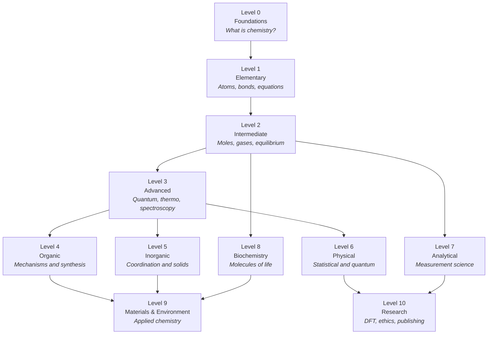

# Chemistry Mastery

**A complete, open-source, Mermaid-illustrated chemistry curriculum — from "what is an atom?" to research-level computational chemistry.**

[](https://www.markdownguide.org/)
[](https://mermaid.js.org/)
[](https://www.latex-project.org/)
[](LICENSE)

---

## What this repository is

Chemistry Mastery is a self-contained chemistry textbook, curriculum, illustrated
encyclopedia, problem-solving workbook and scientific reference library — written
entirely in Markdown, so it renders on GitHub, in VS Code, in Obsidian, and in any
static-site generator.

It is designed around one idea: **a learner should be able to move from zero
chemistry knowledge to reading a research paper in physical chemistry without ever
hitting a gap that the repository does not fill.** Every chapter therefore carries
explicit prerequisites, a difficulty label, cross-links to the chapters it depends
on, and cross-links to the chapters that depend on it.

- **113 chapters** across 11 levels, 13 sections and a dedicated laboratory track
  — 88,800 lines of chapter text plus 12 fully worked exercise and solution banks.
- **525 Mermaid diagrams**, each with a caption and an explanation, and more than
  12,500 balanced chemical equations.
- **LaTeX mathematics** and **balanced chemical equations** with phases and conditions.
- **Worked examples, exercises, and fully worked solutions** for every level.
- **Honest science**: simplifications are labelled as simplifications, and citations
  point to real, verifiable sources.

> **Status:** under active construction. See [ROADMAP.md](ROADMAP.md) for an
> honest, chapter-by-chapter progress checklist, and [CURRICULUM.md](CURRICULUM.md)
> for the full curriculum map with prerequisites.

---

## Learning roadmap



The roadmap is a *dependency* diagram, not a strict order. Levels 4–8 can be studied
in parallel once Level 3 is secure; Level 10 expects fluency in at least two of them.
The full prerequisite graph is in [00-learning-guide/learning-path.md](00-learning-guide/learning-path.md).

---

## Curriculum levels

| Level | Directory | Focus | Typical learner | Chapters |
|---|---|---|---|---|
| 0 | [01-foundations](01-foundations/README.md) | Matter, atoms, symbols, measurement, lab safety | Absolute beginner | 10 |
| 1 | [02-elementary-chemistry](02-elementary-chemistry/README.md) | Atomic structure, bonding, nomenclature, equations | GCSE / early high school | 9 |
| 2 | [03-intermediate-chemistry](03-intermediate-chemistry/README.md) | Moles, stoichiometry, gases, equilibrium, pH, redox | High school / introductory university | 13 |
| 3 | [04-advanced-chemistry](04-advanced-chemistry/README.md) | Quantum mechanics, thermodynamics, kinetics, coordination, spectroscopy | Undergraduate | 10 |
| 4 | [05-organic-chemistry](05-organic-chemistry/README.md) | Functional groups, stereochemistry, mechanisms, retrosynthesis | Undergraduate | 14 |
| 5 | [06-inorganic-chemistry](06-inorganic-chemistry/README.md) | Main group, transition metals, solids, magnetism | Undergraduate | 10 |
| 6 | [07-physical-chemistry](07-physical-chemistry/README.md) | Statistical thermodynamics, quantum chemistry, surfaces, photochemistry | Advanced undergraduate | 9 |
| 7 | [08-analytical-chemistry](08-analytical-chemistry/README.md) | Sampling, validation, titrations, chromatography, electroanalysis | Undergraduate / analyst | 9 |
| 8 | [09-biochemistry](09-biochemistry/README.md) | Proteins, enzymes, nucleic acids, metabolism | Undergraduate | 9 |
| 9 | [10-materials-and-industrial-chemistry](10-materials-and-industrial-chemistry/README.md) · [11-environmental-chemistry](11-environmental-chemistry/README.md) | Polymers, nanochemistry, batteries, atmosphere, green chemistry | Applied / industrial | 10 |
| 10 | [12-research-and-postgraduate-chemistry](12-research-and-postgraduate-chemistry/README.md) | Advanced quantum chemistry, DFT, MD, research practice | Postgraduate / researcher | 10 |

### Support sections

| Section | Purpose |
|---|---|
| [00-learning-guide](00-learning-guide/learning-path.md) | How to study, prerequisite maps, assessment, self-checkpoints |
| [13-laboratory](13-laboratory/README.md) | Safety, equipment, techniques, calculations, documentation |
| [14-problem-solving](14-problem-solving/README.md) | Worked examples, exercise banks, quizzes, solutions |
| [15-visual-learning](15-visual-learning/README.md) | Diagram-first galleries for the hardest visual topics |
| [16-glossary](16-glossary/README.md) | Consolidated A–Z terminology |
| [GLOSSARY.md](GLOSSARY.md) · [REFERENCES.md](REFERENCES.md) | Quick reference and bibliography |

---

## Features

- **Progressive by construction.** Each chapter declares its level, estimated study
  time, difficulty (★–★★★★★) and prerequisites.
- **Diagram-first explanations.** Concepts that are hard to *say* are shown: orbital
  filling, Born–Haber cycles, reaction coordinate diagrams, metabolic pathways,
  chromatographic workflows, and research pipelines.
- **Mathematics that is accounted for.** Every symbol is defined, every unit is
  stated, and every assumption is listed.
- **Chemistry that is checked.** All equations are balanced with phases; IUPAC
  nomenclature is used throughout; models are flagged as models.
- **Exercises with answers, not answer keys alone.** Solutions show the reasoning,
  the unit algebra and the sanity check.
- **Machine-verifiable quality.** Two zero-dependency scripts check internal links
  and Mermaid blocks on every commit.
- **Open and citable.** MIT licence, `CITATION.cff`, contribution templates and a
  documented review checklist.

---

## How to study with this repository

1. **Read the guide first.** [00-learning-guide/how-to-use-this-repository.md](00-learning-guide/how-to-use-this-repository.md)
   explains the notation, the assessment cycle and the spaced-repetition schedule.
2. **Check your entry point.** Take the diagnostic in
   [00-learning-guide/assessment-guide.md](00-learning-guide/assessment-guide.md) to
   find the earliest level you cannot comfortably pass.
3. **Work one chapter at a time.** Read → reproduce the diagrams from memory →
   do the exercises → *then* open the solutions.
4. **Track progress.** Copy the checklist in [ROADMAP.md](ROADMAP.md) into your own
   notes, or tick chapters off in your fork.
5. **Revisit.** Chemistry is cumulative: a Level 3 chapter on kinetics will fail
   without Level 2 moles. The prerequisite table tells you where to go back to.

### Studying without a teacher

Self-study works when feedback is fast. Use the **closed-book rule**: after each
chapter, close the page and reconstruct (a) the definitions, (b) the key equation,
(c) one diagram, and (d) one worked example from scratch. If any of those four
fails, the chapter is not finished. The [assessment guide](00-learning-guide/assessment-guide.md)
turns this into a scored routine.

---

## Prerequisites

**None** for Level 0 beyond arithmetic and an interest in how matter behaves.
Beyond that:

| To start | You need |
|---|---|
| Level 1 | Level 0 chapters 1–8 |
| Level 2 | Level 1 in full, plus algebra and ratios |
| Level 3 | Level 2 in full, plus logarithms, exponentials and basic calculus |
| Level 4–5 | Level 1–2 bonding and geometry (Level 3 helps but is not required) |
| Level 6, 10 | Level 3 thermodynamics, quantum and kinetics, plus multivariable calculus |
| Level 7 | Level 2 concentration and equilibrium, plus basic statistics |
| Level 8 | Level 4 functional groups, plus Level 2 acid–base |
| Level 9 | Any two of Levels 3–8, depending on the sub-topic |

A detailed, chapter-level prerequisite map is in
[00-learning-guide/chemistry-prerequisites.md](00-learning-guide/chemistry-prerequisites.md).

---

## Repository conventions

| Item | Convention |
|---|---|
| Chapter files | `NN-kebab-case-title.md`, numbered within their level folder |
| Equations | `$$ … $$` display math with LaTeX; `\ce{}` notation for reactions |
| Diagrams | Fenced ```` ```mermaid ```` blocks, always with a figure caption |
| Units | SI throughout; non-SI units are introduced with an explicit conversion |
| Constants | CODATA values, quoted to the precision used in the calculation |
| Citations | Author–title–publisher style in text, full entry in [REFERENCES.md](REFERENCES.md) |
| Answers | Trailing zeros and significant figures follow the data, not the calculator |

Chapter structure is defined by
[_templates/chapter-template.md](_templates/chapter-template.md) and enforced by
[_templates/chapter-review-checklist.md](_templates/chapter-review-checklist.md).

---

## Quality assurance

```bash
# Verify every relative link resolves
python3 scripts/validate_links.py

# Verify every Mermaid fence, diagram type and bracket pairing
python3 scripts/validate_mermaid.py

# Verify every chapter has the required sections, diagrams and exercises
python3 scripts/validate_chapters.py

# Regenerate CURRICULUM.md, ROADMAP.md and the level indexes after a structural change
python3 scripts/build_indexes.py
```

All three validators are dependency-free and run in well under a second on the whole
repository. `build_indexes.py` regenerates the navigation files from the single
canonical chapter list, so the curriculum map can never drift from the files on disk.
CI runs the validators on every pull request; see
[CONTRIBUTING.md](CONTRIBUTING.md#quality-gates).

---

## Contributing

Contributions are welcome from students, teachers, chemists and researchers.

1. Read [CONTRIBUTING.md](CONTRIBUTING.md) and
   [CODE_OF_CONDUCT.md](CODE_OF_CONDUCT.md).
2. Pick an unwritten chapter from [ROADMAP.md](ROADMAP.md), or an improvement
   from the issue tracker.
3. Copy [_templates/chapter-template.md](_templates/chapter-template.md) and follow
   the review checklist.
4. Open a pull request using the repository pull-request template.

**Editorial rules that are not negotiable:** no fabricated references, no invented
data, no unbalanced equations, no "trust me" steps in solutions, and no dangerous
procedures presented as home experiments.

---

## Scientific references

The repository leans on primary and authoritative secondary sources:

- **IUPAC** — *Compendium of Chemical Terminology* (Gold Book), nomenclature
  recommendations, atomic weights.
- **NIST** — CODATA fundamental constants, Chemistry WebBook, atomic spectra database.
- **Textbooks** — Atkins & de Paula (*Physical Chemistry*), Clayden et al.
  (*Organic Chemistry*), Housecroft & Sharpe (*Inorganic Chemistry*), Harris
  (*Quantitative Chemical Analysis*), Nelson & Cox (*Lehninger*).
- **Peer-reviewed literature** — cited only where a textbook is insufficient.

Full bibliography, with the edition used: [REFERENCES.md](REFERENCES.md).

---

## Licence

Released under the [MIT License](LICENSE). You may reuse, remix and redistribute the
text with attribution. Diagrams are original Mermaid source and carry the same
licence.

---

## Progress tracking checklist

Copy this into your notes and tick as you go.

- [ ] **Level 0 — Foundations** (≈ 32 h)
- [ ] **Level 1 — Elementary** (≈ 49 h)
- [ ] **Level 2 — Intermediate** (≈ 90 h)
- [ ] **Level 3 — Advanced** (≈ 89 h)
- [ ] **Level 4 — Organic** (≈ 109 h)
- [ ] **Level 5 — Inorganic** (≈ 80 h)
- [ ] **Level 6 — Physical** (≈ 87 h)
- [ ] **Level 7 — Analytical** (≈ 69 h)
- [ ] **Level 8 — Biochemistry** (≈ 75 h)
- [ ] **Level 9 — Materials & Environment** (≈ 73 h)
- [ ] **Level 10 — Research** (≈ 90 h)

Estimated totals assume reading, diagram reproduction and full exercise sets, and
sum to approximately 840 hours across the whole curriculum.

---

*Chemistry Mastery is an educational resource, not a substitute for supervised
laboratory training. See [13-laboratory/safety/laboratory-safety.md](13-laboratory/safety/laboratory-safety.md)
before handling any chemical.*