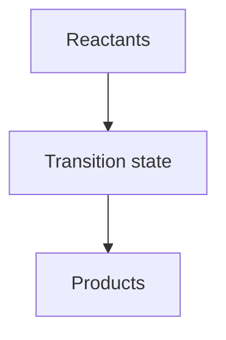

# Chapter NN — Chapter Title

> **Level:** Beginner | Intermediate | Advanced | University | Research
> **Estimated study time:** NN hours (reading) + NN hours (exercises)
> **Prerequisites:** [Chapter links or "None"]
> **Related chapters:** [Cross-links]
> **Difficulty:** ★☆☆☆☆ (1–5)

---

## 1. Learning Objectives

After working through this chapter you will be able to:

- [Action verb] ...
- [Action verb] ...
- [Action verb] ...

---

## 2. Introduction

Explain *why* the topic matters, where it sits in the wider curriculum, and what
the reader already needs to know. Motivate with a real observation, an industrial
process, or a biological phenomenon.

---

## 3. Fundamental Concepts

Build the ideas progressively, from the concrete to the abstract. Define every
symbol the first time it appears.

### 3.1 First concept

### 3.2 Second concept

---

## 4. Detailed Scientific Explanation

Provide the accurate, in-depth treatment. State clearly where an educational
model is a simplification (for example the Bohr model, VSEPR, or the ideal-gas
law) and what the more complete description is.

---

## 5. Visual Diagrams

Every diagram is followed by an explanatory paragraph that says what the reader
should take away from it.

**Figure NN.1 — Caption.** Explanation of the diagram and why the relationship
matters.

---

## 6. Mathematical Formulas

For each equation: define every variable, give SI units, state the assumptions,
and give the range of validity.

$$
\Delta G = \Delta H - T\Delta S
$$

| Symbol | Meaning | SI unit |
|---|---|---|
| $\Delta G$ | Gibbs energy change | J mol⁻¹ |
| $\Delta H$ | Enthalpy change | J mol⁻¹ |
| $T$ | Thermodynamic temperature | K |
| $\Delta S$ | Entropy change | J K⁻¹ mol⁻¹ |

---

## 7. Chemical Equations

Give balanced equations with phases and conditions.

$$
\ce{2H2(g) + O2(g) -> 2H2O(l)} \qquad \Delta H^\circ = -571.6\ \text{kJ mol}^{-1}
$$

Explain the stoichiometry, the conditions, and any assumptions.

---

## 8. Worked Examples

### Worked Example 8.1 — Title

**Problem.** ...

**Strategy.** ...

**Solution.** Step-by-step, with units carried through.

**Check.** Sanity check the answer.

---

## 9. Real-World Applications

Connect to industry, medicine, biology, engineering, and everyday life.

---

## 10. Common Mistakes

| Mistake | Why it happens | Correct approach |
|---|---|---|
| ... | ... | ... |

---

## 11. Chapter Summary

- Key idea 1
- Key idea 2

---

## 12. Exercises

### 12.1 Conceptual questions

### 12.2 Basic problems

### 12.3 Intermediate problems

### 12.4 Advanced problems

### 12.5 Calculation problems

> Solutions: `solutions/NN-chapter-title-solutions.md`

---

## 13. Further Reading

- Author, *Title*, Edition, Publisher, Year, chapter N.
- IUPAC. *Compendium of Chemical Terminology* ("Gold Book"), 2nd ed. (the
  "corrected" version). <https://goldbook.iupac.org/>
- NIST. *CODATA Internationally Recommended Values of the Fundamental Physical
  Constants*. <https://physics.nist.gov/cuu/Constants/>

> Only cite sources you can verify. Never invent a DOI or a page number.
